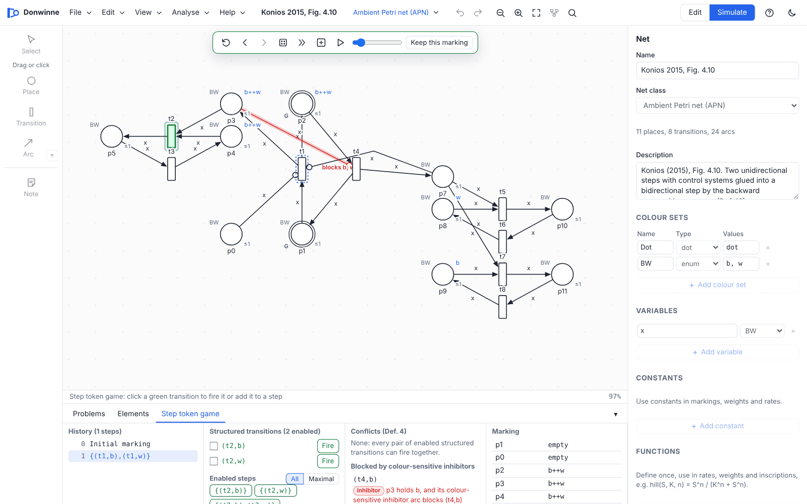
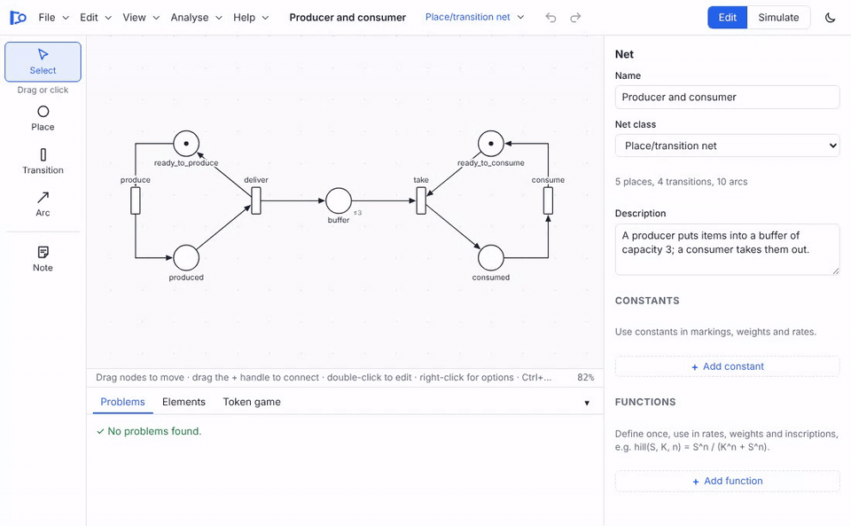
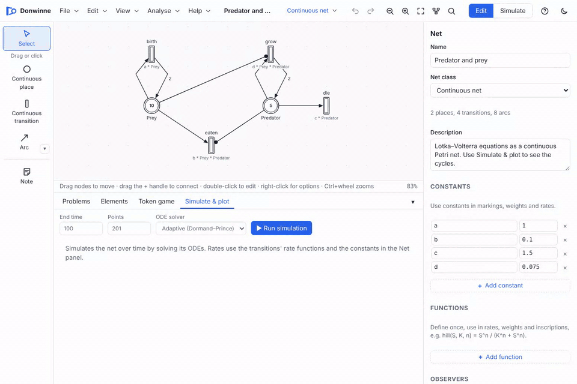
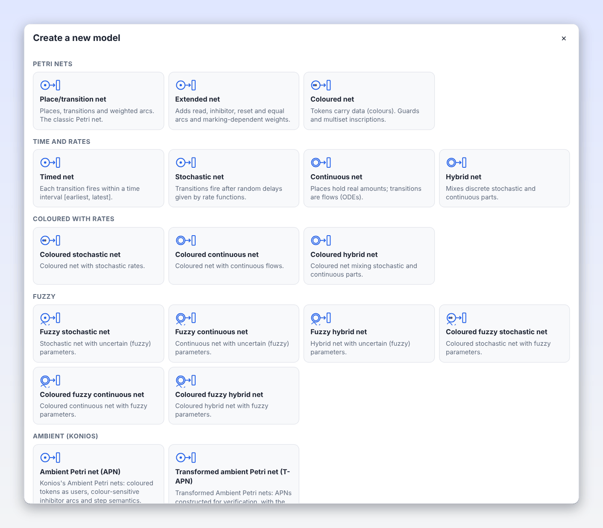
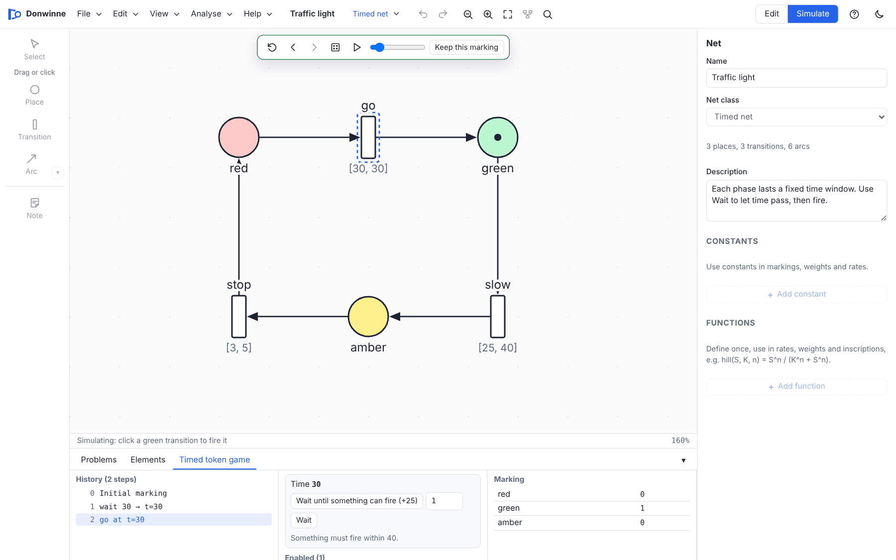
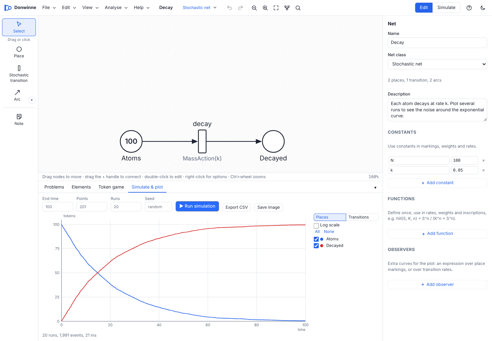
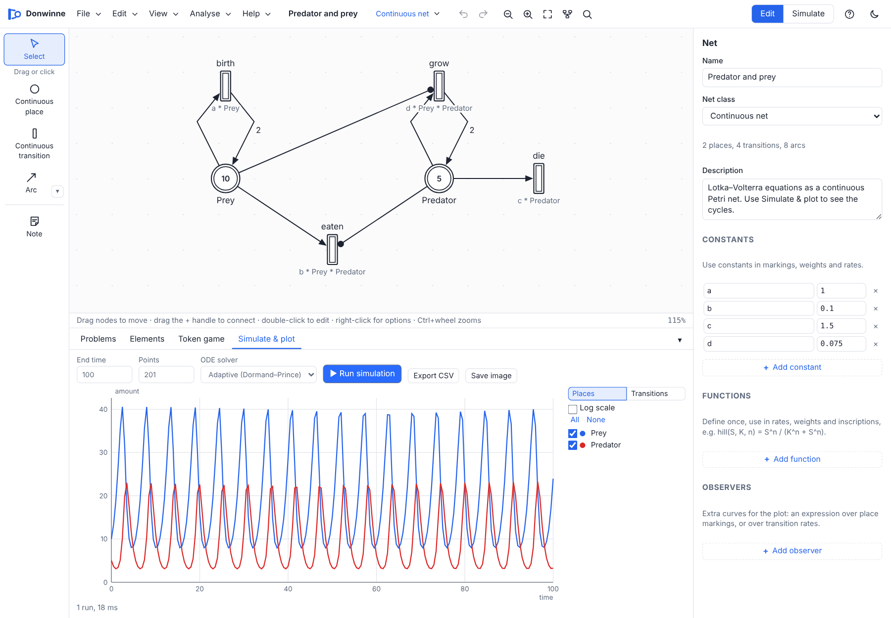
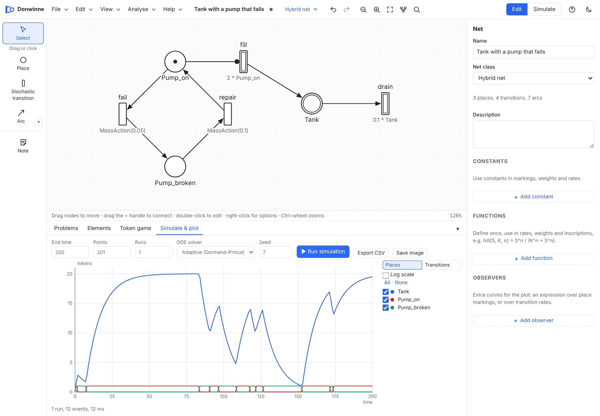
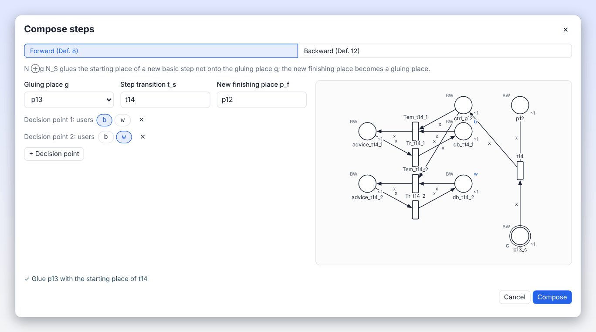
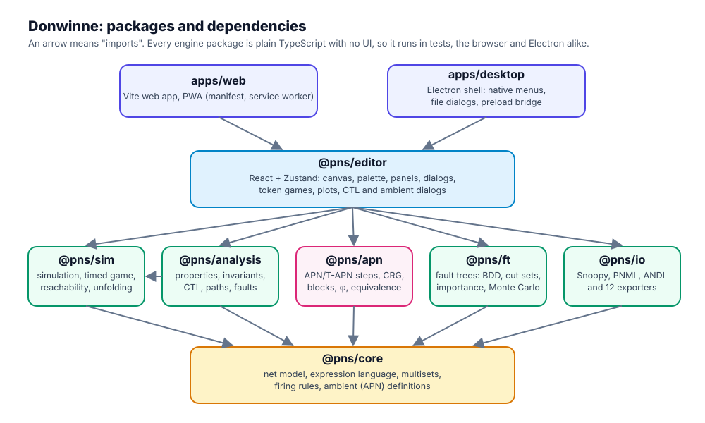

<p align="center">
  <picture>
    <source media="(prefers-color-scheme: dark)" srcset="docs/assets/logo/donwinne-logo-dark.svg">
    
  </picture>
</p>

<p align="center">
  <strong>Donwinne is a Petri nets studio.</strong><br>
  Draw, simulate, analyse and verify Petri nets and fault trees, in the browser or on the desktop.
</p>

<p align="center">
  
  
  
  
  
  
</p>

<p align="center">
  <a href="#quick-start">Quick start</a> ·
  <a href="#a-tour-in-motion">Tour</a> ·
  <a href="#features">Features</a> ·
  <a href="#how-it-works">How it works</a> ·
  <a href="#the-thesis">The thesis</a> ·
  <a href="docs/README.md">Documentation</a> ·
  <a href="#licence">Licence</a>
</p>

<picture>
  <source media="(prefers-color-scheme: dark)" srcset="docs/assets/images/hero-dark.png">
  
</picture>

Donwinne brings together two things. The first is everything you expect from **Snoopy**, the well-known Petri net tool:
two dozen net classes from place/transition nets to coloured, stochastic, continuous, hybrid and fuzzy nets, the token
game, simulation with plots, reachability and invariant analysis, fault trees and Snoopy's own file format. The second
is **every feature proposed in Alexandros Konios's PhD thesis,
[*Modelling and Verification of Ambient Systems using Petri Nets*](docs/thesis/Konios-2015-Modelling-and-Verification-of-Ambient-Systems-using-Petri-Nets.pdf)**
(Newcastle University, 2015): Ambient Petri Nets with colour-sensitive inhibitor arcs, step semantics, modelling with
building blocks, the construction of Transformed APNs, behavioural equivalence, and CTL model checking of ambient
systems. The thesis is included in this repository, and [a section below](#the-thesis) maps each of its chapters to the
part of the app that implements it.

It is written in TypeScript, runs entirely on your machine (nothing is uploaded anywhere), works on phones, tablets and
desktops, installs as an offline web app, and ships as a desktop app for Windows, macOS and Linux.

---

## Contents

- [Quick start](#quick-start)
- [A tour in motion](#a-tour-in-motion)
- [Features](#features)
  - [The editor](#the-editor)
  - [Net classes](#net-classes)
  - [Token game and simulation](#token-game-and-simulation)
  - [Analysis](#analysis)
  - [Fault trees](#fault-trees)
  - [Ambient Petri nets](#ambient-petri-nets)
  - [CTL model checking, paths and fault tolerance](#ctl-model-checking-paths-and-fault-tolerance)
  - [Files and formats](#files-and-formats)
  - [Every screen and device](#every-screen-and-device)
- [How it works](#how-it-works)
  - [Petri nets in one minute](#petri-nets-in-one-minute)
  - [Architecture](#architecture)
  - [The firing rule](#the-firing-rule)
  - [How simulation works](#how-simulation-works)
  - [How analysis works](#how-analysis-works)
  - [How the ambient tools fit together](#how-the-ambient-tools-fit-together)
  - [How CTL checking works](#how-ctl-checking-works)
  - [How the editor works](#how-the-editor-works)
- [The thesis](#the-thesis)
- [Installing, building and running](#installing-building-and-running)
- [Project layout](#project-layout)
- [Keyboard shortcuts](#keyboard-shortcuts)
- [Testing](#testing)
- [Documentation](#documentation)
- [Known limitations](#known-limitations)
- [Credits](#credits)
- [Licence](#licence)

---

## Quick start

You need [Node.js](https://nodejs.org) 20 or newer and [pnpm](https://pnpm.io) 10.

```sh
git clone https://github.com/navin-hariharan/Donwinne.git
cd Donwinne
pnpm install
pnpm dev          # open http://localhost:5173
```

Then, in the app:

1. Open **File > Examples** and pick **Producer and consumer (place/transition)**.
2. Press **S** (or the **Simulate** switch in the toolbar) to start the token game, and click a green transition to fire it.
3. Open **Analyse > Net properties and invariants…** to see whether the net is bounded, live and reversible, and its invariants.
4. For the thesis features, open **File > Examples > Konios: ambient garage (APN)**, start the step token game (**S**) and press **X** to fire a maximal step.

No Node.js? Use Docker instead: `docker compose up --build`, then open <http://localhost:8080>. See
[Installing, building and running](#installing-building-and-running) for the desktop app and installers.

---

## A tour in motion

| | |
| :---: | :---: |
| **Draw a net.** Double-click to add a place, then drag the **+** handle to draw an arc, or drop it on empty canvas to create and connect the next node. | **Pick an arc type.** The arc button opens a menu of the six arc kinds, each with its key and a short description. |
|  |  |
| **Play the token game.** Enabled transitions light up; click to fire, step back and forward through the history, or let it run. | **Simulate over time.** Stochastic, continuous and hybrid nets run with Gillespie's method or ODE solvers, with live plots. |
|  |  |
| **Fire steps in an Ambient Petri net.** Collect structured transitions into a step, or fire a maximal step, as in chapter 3 of the thesis. | **Check CTL and replay the witness.** A satisfied `EF` formula comes with a path you can replay on the canvas. |
|  |  |
| **Tidy up with auto layout.** Flow, top-to-bottom and organic layouts, powered by the Eclipse Layout Kernel. | **Take it with you.** The same app on a phone, with touch gestures and a layout built for small screens. |
|  |  |

---

## Features

### The editor


1. **Menu bar:** File, Edit, View, Analyse and Help.
2. **Toolbar:** the net's name and class, undo and redo, zoom, auto layout, find, and the **Edit** / **Simulate** switch.
3. **Palette:** select, place, transition, arc (with its type menu) and note tools; events and gates in fault trees.
4. **Canvas:** an SVG drawing surface with pan, zoom, snap to grid and rubber-band selection.
5. **Properties panel:** every attribute of the selection, from names and markings to rates, guards and capacities.
6. **Bottom panel:** problems, the element table, the token game, simulation plots and fault tree analysis.
7. **Status bar:** hints for the current tool, the pointer's coordinates and the zoom level.
8. **Overview map:** where you are in a large net; drag it to move around.

What you can do:

- **Draw quickly.** Double-click empty canvas for a place; drag the **+** handle on any node to draw an arc, or drop it on empty canvas to create the next node and connect it in one move. Drag arc midpoints to bend arcs and arc ends to reconnect them.
- **Edit in place.** Double-click a node to rename it, a place's tokens to change the marking, an arc to change its weight. Right-click for a menu of everything else.
- **Arrange.** Align and distribute, snap to grid, colour nodes, add notes, and run auto layout (flow, top to bottom, organic, or the selection only).
- **Structure big models.** Group a selection into a **subnet** (Ctrl+G), open it, go back with the breadcrumbs, and see the whole hierarchy in **View > Element table and hierarchy**, where every place, transition and arc can be filtered and edited in one table.
- **Declare things, Snoopy style.** Constants, colour sets (int, bool, string, enumerations, products, aliases, subsets and unions), variables, functions such as `hill(S, K, n) = S^n / (K^n + S^n)`, and observers that plot an expression over a run.
- **Undo up to 300 steps**, find by name, light and dark themes, auto-save in the browser, and printing.

More in [docs/editor.md](docs/editor.md).

### Net classes

Donwinne has the 24 net classes below. You choose one in **File > New…** and can switch a Petri net's class later
from the class badge in the toolbar.



| Group | Classes | What they add |
| --- | --- | --- |
| Petri nets | Place/transition, Extended, Coloured | The classic net; read, inhibitor, reset and equal arcs; coloured tokens, guards and multisets |
| Time and rates | Timed, Stochastic, Continuous, Hybrid | Firing intervals; exponential and general rates; ODEs; stochastic and continuous parts in one net |
| Coloured with rates | Coloured stochastic, continuous and hybrid | The above with colours, simulated by unfolding |
| Fuzzy | Fuzzy stochastic, continuous and hybrid, and their coloured variants | Uncertain parameters as fuzzy numbers, giving bands in the plots |
| Ambient (Konios) | Ambient Petri net (APN), Transformed APN (T-APN) | Colour-sensitive inhibitor arcs, capacities, step semantics; the thesis's chapters 3 to 7 |
| Special | Modulo, Music, Freestyle | Arithmetic modulo $m$; transitions that play notes; free drawing |
| Reliability | Fault tree, Extended fault tree | Events and gates; repair and dynamic gates (PAND, SPARE, FDEP) |

The six arc types are **normal**, **read**, **inhibitor**, **reset**, **equal** and **modifier**; each class allows the
ones that make sense for it. Every class, every arc and the declarations language are explained in
[docs/net-classes.md](docs/net-classes.md).

### Token game and simulation

<table>
<tr>
<td width="50%"></td>
<td width="50%"></td>
</tr>
<tr>
<td></td>
<td></td>
</tr>
</table>

- **Token game** for every discrete class: fire by clicking, step back and forward, fire at random, or run and pause. In coloured nets, every enabled binding is offered.
- **Timed token game** with a global clock and per-transition firing intervals.
- **Music nets** play a note each time a transition fires.
- **Stochastic simulation** with Gillespie's direct method, many runs averaged, with a seed for repeatable results.
- **Continuous simulation** with Dormand–Prince 5(4) (adaptive, the default), Rosenbrock (stiff), classic RK4 and Euler.
- **Hybrid simulation** that combines both, with stochastic transitions changing the ODE system as they fire.
- **Fuzzy simulation** that samples the fuzzy parameters at several membership levels and draws the result as bands.
- **Plots** of any places, transitions or observers, with totals or per-colour curves, and CSV export.

See [docs/simulation.md](docs/simulation.md).

### Analysis

<table>
<tr>
<td width="50%"></td>
<td width="50%"></td>
</tr>
</table>

- **Reachability graph** with its dead states and the bound of each place.
- **Net properties** in the style of Charlie: bounded, safe, k-bounded, deadlock free (with the shortest path to a deadlock), dead states, live, dead transitions, dynamic conflict free, reversible and home states.
- **Invariants:** P- and T-invariants, covering by them (CPI, CTI), minimal siphons and traps, and the siphon-trap property.
- **Structural properties:** state machine, marked graph, free choice, extended free choice, extended simple, ordinary, homogeneous, pure, conservative, connected, strongly connected and static conflict free, with the incidence matrix.
- **Show buttons** that highlight the places or transitions of any result on the canvas, and a text report you can save.
- **Unfolding** of coloured nets to uncoloured ones (Analyse > Unfold to an uncoloured net).

See [docs/analysis.md](docs/analysis.md).

### Fault trees

<table>
<tr>
<td width="50%"></td>
<td width="50%"></td>
</tr>
</table>

Basic and undeveloped events; AND, OR, XOR, NOT, k-of-n (voting), inhibit and conditional gates; and, in extended
fault trees, repairable events and the dynamic gates PAND, SPARE and FDEP. The analysis finds the **minimal cut
sets** (with a binary decision diagram), the **exact top event probability**, the **Birnbaum, Fussell–Vesely, risk
achievement and risk reduction** importance of each event, the unreliability over the mission time, and estimates
dynamic trees with **Monte Carlo simulation**. A fault tree can also be **converted to a stochastic Petri net**. See
[docs/analysis.md#fault-tree-analysis](docs/analysis.md#fault-tree-analysis).

### Ambient Petri nets

<table>
<tr>
<td width="50%"></td>
<td width="50%"></td>
</tr>
<tr>
<td></td>
<td></td>
</tr>
</table>

Everything from the thesis, in one place:

- **APN and T-APN net classes** (Defs 3, 20 and 21), with colour-sensitive inhibitor arcs, place capacities and gluing (interface) places, checked as you edit.
- **Step semantics** (Sec. 3.3): a step token game that fires single structured transitions, collected steps or maximal steps, shows conflicts, and explains why a mode is blocked.
- **The concurrent reachability graph** (CRG) of all steps, drawn as a graph you can explore.
- **Building blocks** (chapter 4): root nets, basic step nets with control systems and decision points, one step nets, and **forward and backward composition** (Defs 8, 9, 12 and 13).
- **Properties of composite APNs:** composite step net, pure, ordinary, live, k-bounded and reversible.
- **The construction φ** (chapter 6) that turns an APN into a T-APN by replacing inhibitors with complementary places, and a **behavioural equivalence check** (Theorem 1) that compares the two CRGs and gives a replayable counterexample if they differ.
- **The case studies** of the thesis, the **ambient garage** and the **ambient conference room**, and the nets of Figs 3.1, 4.9, 4.10 and 4.11, under File > Examples.

The full walkthrough, with a chapter-by-chapter table, is in [docs/ambient-petri-nets.md](docs/ambient-petri-nets.md).

### CTL model checking, paths and fault tolerance

<table>
<tr>
<td width="50%"></td>
<td width="50%"></td>
</tr>
</table>

**Analyse > Model checking (CTL)…** works for every discrete net class, not just ambient ones:

- **CTL formulas** with `EX`, `AX`, `EF`, `AF`, `EG`, `AG`, `E[φ U ψ]` and `A[φ U ψ]`, place counts and colours (`p10[w] > 0`), `sum(…)`, `fireable(t)` and `deadlock`, with helpful error messages.
- **Four semantics** for ambient nets: maximal steps, all steps (the full CRG), one transition at a time, or colour-blind as in the thesis's own checks. Other nets use one transition at a time.
- **Witnesses and counterexamples** for every verdict that has one, which you can **replay in the token game**.
- **22 property templates:** the 20 ambient and general properties of chapter 7 (FT0, TF0, FP0, PF0, k-B, DCF, DSt, DTr and the rest) and 2 fault tolerance templates, filled in for the open net.
- **Path queries** (Sec. 7.3.2): the shortest way to a goal when the users follow the system's advices, and when they ignore them.
- **Fault tolerance** (Sec. 7.3.3): what happens when the system gives wrong advice.

See [docs/ctl.md](docs/ctl.md).

### Files and formats

| | Formats |
| --- | --- |
| **Open and save** | Donwinne's own `.pns.json` |
| **Import** | Snoopy (every net class, with declarations), PNML, ANDL and CANDL |
| **Export** | Snoopy, PNML, ANDL / CANDL, LoLA, TINA, APNN, PRISM, SBML, CSV, DNF (cut sets), LaTeX / TikZ, SVG, PNG, and printing |

Work is auto-saved in the browser, and the desktop app adds native file dialogs, the system's recent documents and
opening `.pns.json` files from the operating system. See [docs/file-formats.md](docs/file-formats.md).

### Every screen and device

<table>
<tr>
<td width="26%"></td>
<td width="74%"></td>
</tr>
</table>

The layout adapts from phones in portrait to large monitors: panels become sheets on small screens, menus collapse,
and touch works throughout (pinch to zoom, long-press for menus, tap to place). The web app **installs** on phones,
tablets and computers and **works offline**. The **desktop app** (Electron) adds native menus, file dialogs, an
unsaved-changes prompt and file associations.

<table>
<tr>
<td width="50%"></td>
<td width="50%"></td>
</tr>
</table>

---

## How it works

This section explains the ideas behind Donwinne and how the code puts them to work. Each part links to a page in
[docs/](docs/README.md) with the full detail.

### Petri nets in one minute

A Petri net is a graph with two kinds of node. **Places** (circles) hold **tokens**; **transitions** (rectangles) move
them. **Arcs** connect places to transitions and transitions to places, and carry a **weight**. The tokens in every
place together form the **marking**, which is the state of the system.

A transition $t$ is **enabled** in a marking $M$ when every input place $p$ holds at least as many tokens as the arc
weight $W(p, t)$. When $t$ **fires**, it takes those tokens away and puts $W(t, p)$ tokens in each output place:

$$M'(p) = M(p) - W(p, t) + W(t, p)$$

That one rule describes concurrency, conflict, synchronisation and resource sharing, which is why Petri nets are used
for protocols, workflows, manufacturing, biology and, in Konios's thesis, ambient systems. The net classes extend the
rule with special arcs, colours, time and rates.

### Architecture



Donwinne is a pnpm monorepo. The engine is plain TypeScript with no UI, so every algorithm can be tested on its own
and reused; the editor is a React app on top; and the web and desktop apps are thin shells around the editor.

| Package | Role |
| --- | --- |
| [`@pns/core`](packages/core/src) | The net model, the expression language (numbers, colours, multisets, functions), and the firing rules |
| [`@pns/sim`](packages/sim/src) | Gillespie, ODE and hybrid simulation, fuzzy sweeps, the timed token game, the reachability graph |
| [`@pns/ft`](packages/ft/src) | Fault tree analysis: BDDs, cut sets, probabilities, importance, Monte Carlo, conversion to Petri nets |
| [`@pns/analysis`](packages/analysis/src) | Invariants, siphons and traps, structural and behavioural properties, state spaces, CTL, templates, paths, fault tolerance |
| [`@pns/apn`](packages/apn/src) | Ambient Petri nets: semantics, steps, the CRG, building blocks, composition, the construction φ, equivalence, the case studies |
| [`@pns/io`](packages/io/src) | The native format, Snoopy, PNML, ANDL and every exporter |
| [`@pns/editor`](packages/editor/src) | The React editor: canvas, palette, panels, dialogs, token games and the Zustand store |
| [`apps/web`](apps/web) | The Vite web shell, with the service worker that makes it installable and offline |
| [`apps/desktop`](apps/desktop) | The Electron shell: main process, sandboxed preload, native menus and dialogs |

More in [docs/architecture.md](docs/architecture.md).

### The firing rule

Every discrete class shares one firing rule in
[`packages/core/src/semantics.ts`](packages/core/src/semantics.ts). For a transition to be enabled:

1. in a coloured net, its **guard** must hold for the chosen **binding** of its variables;
2. every **normal** input arc needs its tokens, which firing removes;
3. every **read** arc needs its tokens but leaves them;
4. every **inhibitor** arc blocks it when the place holds at least the arc's weight; in coloured and ambient nets this is checked **colour by colour** (Konios's colour-sensitive inhibitor arcs);
5. every **equal** arc needs exactly its weight;
6. **reset** arcs never block, and firing empties their place;
7. **modifier** arcs only influence rates;
8. output places must stay within their **capacity**.

Ambient nets add **step semantics** on top ([`packages/apn/src/steps.ts`](packages/apn/src/steps.ts)): a **step** is
a set of structured transitions, each with a binding, that can fire together because the tokens they consume are
available all at once and no inhibitor or capacity is violated by the combined effect. A **maximal step** is one no
other enabled transition can join.

### How simulation works

- **Stochastic nets** are continuous-time Markov chains. Gillespie's direct method draws the time to the next event from the total rate and picks the transition in proportion to its rate, giving exact sample paths. Many runs are averaged.
- **Continuous nets** become a system of ODEs: each transition's rate is a flow, and each place's derivative is inflow minus outflow. An adaptive solver integrates it with error control.
- **Hybrid nets** integrate the continuous part between stochastic events, and each event changes the marking the ODEs see.
- **Coloured nets with rates** are unfolded into uncoloured nets first. **Fuzzy nets** are run for samples of their fuzzy parameters at each membership level, and the envelopes are drawn as bands.

Every run takes a seed, so results can be repeated exactly. See [docs/simulation.md](docs/simulation.md).

### How analysis works

- The **reachability graph** is built by breadth-first search over markings, with a state limit so huge nets stop with "Unknown" instead of freezing.
- **Invariants** come from the incidence matrix with the Farkas algorithm (minimal semi-positive P- and T-invariants); **siphons and traps** from a search over place sets.
- **Behavioural properties** (bounded, live, reversible, deadlock free, home states) are read off the reachability graph and its strongly connected components.
- **Fault trees** are compiled into a binary decision diagram, from which minimal cut sets and exact probabilities follow.

See [docs/analysis.md](docs/analysis.md).

### How the ambient tools fit together


The diagram follows the thesis. You **model** an ambient system by composing building blocks into an **APN N**
(chapter 4). You **play** it with the step token game, and **explore** all of its behaviour in the concurrent
reachability graph **CRG(N)** (chapter 3). The **construction φ** turns N into the **T-APN φ(N)** (chapter 6), whose
CRG is checked **equivalent** to CRG(N) (Theorem 1). Finally, a **transition system** of N or φ(N), under the
semantics you choose, is **model checked** against CTL properties, and searched for **paths** and **fault tolerance**
(chapter 7). Every witness, counterexample and path can be **replayed** in the token game.

### How CTL checking works

The checker ([`packages/analysis/src/ctl.ts`](packages/analysis/src/ctl.ts)) parses the formula, builds the
transition system for the chosen semantics up to the state limit, and labels each state with the subformulas that
hold there, working from the inside out. `EX` looks at successors; `EU` and `EF` are least fixpoints computed
backwards from the target states; `EG` is a greatest fixpoint over states that can stay inside the formula forever.
The `A` operators are their duals. For an existential verdict it records a **witness** path (a lasso for `EG`), and
for a failed universal one a **counterexample**, both of which the editor can replay. If the state space was cut off,
any verdict that could change is reported as **Unknown** rather than guessed. See [docs/ctl.md](docs/ctl.md).

### How the editor works

The editor's state lives in one Zustand store
([`packages/editor/src/store.ts`](packages/editor/src/store.ts)): the net, the current page, the selection, the tool,
the view and the undo history. Every edit goes through the store, which records it for undo (up to 300 steps) and
auto-saves. The canvas is plain SVG drawn by React, so it is crisp at every zoom and prints well. Dialogs and panels
call the engine packages directly. The web app and desktop app differ only in a
small platform layer ([`packages/editor/src/platform.ts`](packages/editor/src/platform.ts)) that opens and saves
files.

---

## The thesis

<table>
<tr>
<td width="62%">

The ambient features of Donwinne implement

> **Alexandros Konios.** *Modelling and Verification of Ambient Systems using Petri Nets.* PhD thesis, School of
> Computing Science, Newcastle University, June 2015. Supervised by Marta Pietkiewicz-Koutny.

The thesis is in this repository:
**[docs/thesis/Konios-2015-Modelling-and-Verification-of-Ambient-Systems-using-Petri-Nets.pdf](docs/thesis/Konios-2015-Modelling-and-Verification-of-Ambient-Systems-using-Petri-Nets.pdf)**

Ambient systems are embedded in their environment and interact with their users silently, such as a smart garage
that guides drivers to free spaces. The thesis introduces Petri net classes that model them faithfully, a modular way
to build the models, and a way to verify them with existing model checking techniques.

</td>
<td width="38%"></td>
</tr>
</table>

#### Where each chapter lives in Donwinne

| Chapter | Contribution | In Donwinne |
| --- | --- | --- |
| 2. Ambient Systems | What ambient systems are, and their categories | The two case studies under File > Examples |
| 3. Ambient Petri Nets | APNs (Def. 3), colour-sensitive inhibitor arcs, step semantics | APN net class; Analyse > Ambient (Konios) > Play the step token game, Concurrent reachability graph… |
| 4. Modelling with APNs | The step-modelling approach: building blocks, forward and backward composition, properties of the composite nets | Analyse > Ambient (Konios) > Building blocks…, Compose steps…, APN properties… |
| 5. Transformed APNs | T-APNs (Defs 20 and 21), complementary places instead of inhibitors | T-APN net class |
| 6. Relating APNs with T-APNs | The construction φ and behavioural equivalence (Theorem 1) | Analyse > Ambient (Konios) > Construct T-APN, Check equivalence… (with a replayable counterexample) |
| 7. Verification of Ambient Systems Using T-APNs | Model checking, qualitative properties, paths, fault tolerance | Analyse > Model checking (CTL)…: formulas, 22 property templates, paths, fault tolerance |
| 8. Conclusion and Future Work | | |

#### Reproducing the thesis's results

The thesis verifies its two case studies in chapter 7. Donwinne's test suite
([`packages/analysis/test/thesis.test.ts`](packages/analysis/test/thesis.test.ts)) re-runs those checks:

- **Paths (Sec. 7.3.2):** all 8 path lengths reproduce. In the garage, 4 and 6 steps following the advices and 8 and 10 ignoring them; in the conference room, 14, 16 and 12 following and 16 ignoring.
- **CTL properties (Sec. 7.3.1):** checked the way the thesis checks them (the colour-blind T-APN, one transition at a time), 30 of the 32 verdicts that can be decided agree (11 more stay unknown, because the conference room's state space has more than 5 million states). The garage agrees on all 22, over its complete state space of 573,441 states and 6,225,921 edges. The two differences are properties 7.11 and 7.17a of the conference room.
- **Maximal steps:** 40 of the 43 verdicts agree when the case studies are checked under maximal step semantics.
- **The construction φ** follows Defs 20 and 21 and is tested on the worked example of Sec. 6.4 (Fig. 6.4). On the garage it replaces 15 inhibitor arcs, adds 22 arcs and finds 8 step transitions, with no problems reported.

One thing does not reproduce: the thesis's "maximum concurrency" drawings of the case studies (52 states and 87
edges for the garage, 82 and 130 for the conference room) are smaller than the complete colour-blind maximal-step graphs
Donwinne builds (229 and 1,990; 314 and 1,620). The thesis draws them for illustration only. Every difference is explained,
and the steps to re-run each check yourself in the app are given, in
[docs/ambient-petri-nets.md#reproducing-the-thesiss-results](docs/ambient-petri-nets.md#reproducing-the-thesiss-results).

#### Citing the thesis

```bibtex
@phdthesis{konios2015ambient,
  author = {Konios, Alexandros},
  title  = {Modelling and Verification of Ambient Systems using Petri Nets},
  school = {School of Computing Science, Newcastle University},
  year   = {2015},
  month  = jun
}
```

The thesis remains the work and copyright of its author. It is included here for reference, so that every feature
can be checked against its source.

---

## Installing, building and running

### Requirements

- Node.js 20 or newer
- pnpm 10 (`npm install -g pnpm`)
- For the desktop app: a desktop session (Windows, macOS or Linux)

### Commands

```sh
pnpm install        # install dependencies
pnpm dev            # web app with hot reload at http://localhost:5173
pnpm test           # run the test suite
pnpm typecheck      # type-check every package
pnpm build          # static web build in apps/web/dist (host it on any static server)
pnpm desktop        # build the web app and launch the desktop app
pnpm desktop:dist   # build installers for this OS into apps/desktop/release
```

### Docker

The image builds the web app, runs the tests and serves the result with nginx, so you don't need Node.js.

```sh
docker build -t donwinne .
docker run --rm -p 8080:80 donwinne   # open http://localhost:8080
# or
docker compose up --build
```

The desktop app is not part of the image, because Electron needs a desktop session.

### Desktop installers

| OS | Command | Output |
| --- | --- | --- |
| Linux | `pnpm --filter @pns/desktop dist:linux` | AppImage and deb |
| Windows | `pnpm --filter @pns/desktop dist:win` | NSIS installer |
| macOS | `pnpm --filter @pns/desktop dist:mac` | dmg (Intel and Apple silicon) |

Build each on its own OS. Signing, notarisation and other details are in
[apps/desktop/README.md](apps/desktop/README.md).

### Installing the web app

Open the web app in Chrome, Edge or Safari and use **Install** (or **Add to Home Screen** on iOS). It then opens in its
own window and works offline.

---

## Project layout

```text
Donwinne/
├── apps/
│   ├── web/                 Vite web app, PWA manifest, service worker, icons
│   └── desktop/             Electron main process, preload, menus, installer config
├── packages/
│   ├── core/                net model, expressions, multisets, firing rules
│   ├── sim/                 simulation, timed token game, reachability graph
│   ├── ft/                  fault tree analysis
│   ├── analysis/            properties, invariants, CTL, templates, paths, fault tolerance
│   ├── apn/                 Ambient Petri nets (Konios, 2015)
│   ├── io/                  file formats
│   └── editor/              React editor
├── docs/
│   ├── *.md                 user and developer guides
│   ├── assets/              logo, screenshots, GIFs and diagrams
│   └── thesis/              Konios's thesis (PDF)
├── docker/, Dockerfile, docker-compose.yml
├── CREDITS.md
└── LICENSE.md
```

---

## Keyboard shortcuts

Press **?** in the app for the quick guide. Ctrl means ⌘ on a Mac.

| Keys | Action |
| --- | --- |
| **V**, **P**, **T**, **A**, **N** | Select, place, transition, arc and note tools |
| **1** to **6** | Arc type: normal, read, inhibitor, reset, equal, modifier |
| Double-click | Add a place on empty canvas; rename a node; edit a place's tokens; edit an arc's weight |
| **F2** or **Enter** | Rename the selection (Enter opens a subnet) |
| **+** / **−** | Add or remove a token on the selected places |
| **Delete** or **Backspace** | Delete the selection |
| **Backspace** with nothing selected | Go up to the parent page |
| Arrow keys (with Shift) | Nudge the selection by 1 (10) |
| **Esc** | Back to the select tool, clear the selection, close a dialog |
| Ctrl+Z, Ctrl+Shift+Z or Ctrl+Y | Undo, redo |
| Ctrl+C, X, V, D, A | Copy, cut, paste, duplicate, select all |
| Ctrl+G, Ctrl+L, Ctrl+F | Group into subnet, auto layout, find |
| Ctrl+N, O, S, Shift+S, P | New, open, save, save as, print |
| Ctrl+= / Ctrl+−, Ctrl+0 or **F** | Zoom in, zoom out, zoom to fit |
| Ctrl+wheel, pinch | Zoom |
| Space+drag, right-drag, middle-drag | Pan |
| **M**, **G**, **B** | Overview map, snap to grid, bottom panel |
| **S** | Start the token game |
| In the token game: **←** / **→**, **R**, **X**, **Space**, **Esc** | Back, forward, random firing, maximal step (ambient nets), run or pause, stop |

The full list, with touch gestures, is in [docs/editor.md#keyboard-shortcuts](docs/editor.md#keyboard-shortcuts).

---

## Testing

```sh
pnpm test        # 556 tests in 29 files
pnpm typecheck
```

The tests cover the firing rules and the expression language; the simulators against known solutions (exponential
decay, Lotka–Volterra, the stiff Robertson problem) and seeded reproducibility; invariants and properties, cross-checked
between independent algorithms; fault tree cut sets, probabilities and importance measures; every file format,
including real Snoopy files; the APN definitions, step semantics, building blocks, composition (against the thesis's
figures), the construction φ and equivalence; CTL; and the thesis's chapter 7 results. See
[docs/architecture.md#testing](docs/architecture.md#testing).

---

## Documentation

| Page | What it covers |
| --- | --- |
| [The editor](docs/editor.md) | Menus, palette, drawing, editing, subnets, panels, shortcuts, touch, devices |
| [Net classes](docs/net-classes.md) | Every class, the six arc types, markings and expressions, declarations, fault trees |
| [Simulation](docs/simulation.md) | Token games, stochastic, continuous, hybrid and fuzzy simulation, plots, unfolding |
| [Analysis](docs/analysis.md) | Reachability graph, net properties, invariants, siphons and traps, fault tree analysis |
| [Ambient Petri nets](docs/ambient-petri-nets.md) | The thesis chapter by chapter, with a full walkthrough of the ambient garage |
| [CTL model checking](docs/ctl.md) | Syntax, semantics, witnesses, templates, paths and fault tolerance |
| [File formats](docs/file-formats.md) | The native format, Snoopy, PNML, ANDL and every export |
| [Architecture](docs/architecture.md) | Packages, data model, store, desktop app, building, testing and extending |

An index of the pages and every image, GIF and diagram is in [docs/README.md](docs/README.md).

---

## Known limitations

- Not yet supported from Snoopy: lookup tables, the Snoopy steering server (S4), and decision diagram (MTBDD) based analysis.
- Snoopy import was checked against real place/transition, continuous and hybrid files. The other classes, and Snoopy's newer function, observer and colour set formats, follow Snoopy's source code but have not been checked against files Snoopy wrote.
- State spaces are explored explicitly, so very large nets (such as the conference room under full step semantics, with millions of states) stop at the state limit and report Unknown where a verdict could change.

---

## Credits

Donwinne is inspired by **[Snoopy](https://www-dssz.informatik.tu-cottbus.de/DSSZ/Software/Snoopy)** and its
companion **Charlie**, from the Data Structures and Software Dependability group at Brandenburg University of
Technology Cottbus-Senftenberg. Its ambient features come from **Alexandros Konios's thesis**, described
[above](#the-thesis). Donwinne is independent and not affiliated with or endorsed by any of them. The full credits and
references are in [CREDITS.md](CREDITS.md).

Built with React, Zustand, Vite, elkjs, Electron and Vitest.

---

## Licence

**Donwinne** is created by **Navin Hariharan** ([navin-hariharan.com](https://navin-hariharan.com),
[github.com/navin-hariharan](https://github.com/navin-hariharan)).

- **Free for educational use**: teaching, learning, coursework and academic research.
- **Attribution is required**: anyone who uses Donwinne must credit Navin Hariharan, link
  [github.com/navin-hariharan](https://github.com/navin-hariharan) and
  [navin-hariharan.com](https://navin-hariharan.com).
- **Commercial use** needs written permission from Navin Hariharan or a paid licence.

The full terms are in [LICENSE.md](LICENSE.md). If you use Donwinne in your work, please cite it:

```bibtex
@software{hariharan2026donwinne,
  author = {Hariharan, Navin},
  title  = {Donwinne: a Petri nets studio},
  year   = {2026},
  url    = {https://github.com/navin-hariharan/Donwinne}
}
```

<p align="center">
  <br>
  <sub>© 2026 Navin Hariharan</sub>
</p>
