# Ambient Petri nets

Donwinne implements every feature of Alexandros Konios's PhD thesis, *Modelling and Verification of Ambient Systems
using Petri Nets* (Newcastle University, 2015). This page explains the ideas chapter by chapter, shows where each one
lives in the code, and walks you through the whole method in the app: from an ambient system model to a verified
property.

The thesis is included with the documentation:
[Konios 2015 (PDF)](thesis/Konios-2015-Modelling-and-Verification-of-Ambient-Systems-using-Petri-Nets.pdf).

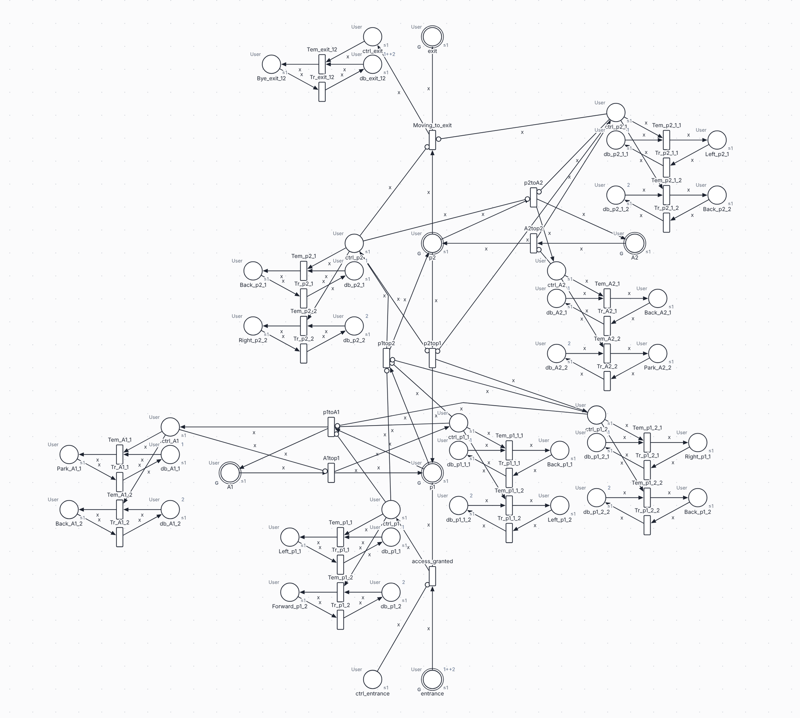

## Contents

- [The method at a glance](#the-method-at-a-glance)
- [Thesis to app: the mapping table](#thesis-to-app-the-mapping-table)
- [Chapter 2: ambient systems](#chapter-2-ambient-systems)
- [Chapter 3: Ambient Petri nets (APNs)](#chapter-3-ambient-petri-nets-apns)
- [Step semantics and the step token game](#step-semantics-and-the-step-token-game)
- [The concurrent reachability graph](#the-concurrent-reachability-graph)
- [Chapter 4: building blocks and composition](#chapter-4-building-blocks-and-composition)
- [Properties of composite APNs](#properties-of-composite-apns)
- [The case studies](#the-case-studies)
- [Chapter 5: Transformed APNs (T-APNs)](#chapter-5-transformed-apns-t-apns)
- [Chapter 6: the construction φ](#chapter-6-the-construction-φ)
- [Behavioural equivalence](#behavioural-equivalence)
- [Chapter 7: verification](#chapter-7-verification)
- [Reproducing the thesis's results](#reproducing-the-thesiss-results)
- [Walkthrough: the ambient garage from start to finish](#walkthrough-the-ambient-garage-from-start-to-finish)
- [What is not supported](#what-is-not-supported)

## The method at a glance

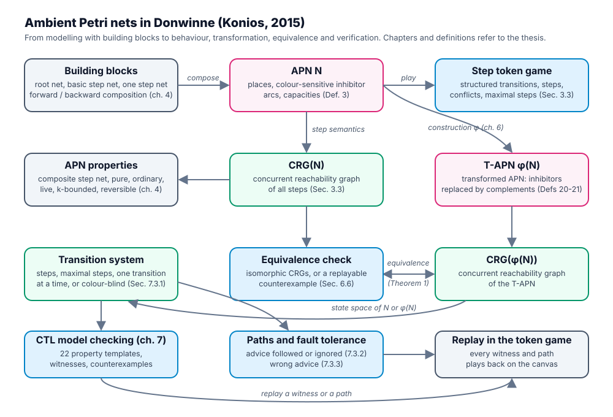

1. **Model** the ambient system as an **APN**: users are token colours, and colour-sensitive inhibitor arcs stop a
   particular user from moving on before the system has reacted (chapter 3).
2. **Build** it step by step from **building blocks** with forward and backward composition (chapter 4), so that the
   result is a *composite step net* with known good properties.
3. **Simulate** it with **step semantics**: several users act at the same time, so whole steps of transitions fire
   at once. All reachable markings form the **concurrent reachability graph** (CRG).
4. **Transform** it with the construction **φ** into a **T-APN** (chapters 5 and 6). The T-APN has no inhibitor arcs,
   only ordinary coloured arcs and guards, so standard Petri net tools can read it.
5. **Check** that the APN and the T-APN behave the same (their CRGs are isomorphic, Theorem 1).
6. **Verify** the T-APN (or the APN directly) with CTL model checking, qualitative analysis, path queries and fault
   tolerance checks (chapter 7).

Every step has a menu item under **Analyse > Ambient (Konios)** (in the desktop app: **Analyse > Ambient (Konios)**
in the native menu bar as well).

## Thesis to app: the mapping table

Source paths are relative to this folder. "Ambient" in the "How to use it" column means the **Analyse > Ambient
(Konios)** menu.

| Thesis | Donwinne feature | Source | How to use it in the app |
| --- | --- | --- | --- |
| Ch. 2, Sec. 2.2.5: Ambient Guidance and Ambient Information Systems | The template groups of the CTL dialog follow this taxonomy | [templates.ts](../packages/analysis/src/templates.ts) | Model checking (CTL), **Property template** list |
| Sec. 2.3.1, 2.3.2, 4.5: the ambient garage and conference room (Figs 4.13 to 4.17) | Case study models, with fragments and T-APN versions | [cases.ts](../packages/apn/src/cases.ts) | **File > Examples**: "Konios: ambient garage (APN)", "Konios: ambient conference room (APN)" |
| Defs 1 and 2: multisets | Immutable multisets of colours in every place | [multiset.ts](../packages/core/src/multiset.ts) | Markings are shown as pairs (p, c) in the token game |
| Def. 3: the APN class | Net class `apn` with colour-sensitive inhibitor arcs | [model.ts](../packages/core/src/model.ts), [ambient.ts](../packages/core/src/ambient.ts), [semantics.ts](../packages/apn/src/semantics.ts), [validate.ts](../packages/apn/src/validate.ts) | **File > New…**, group **Ambient (Konios)**, or **File > New APN from building blocks…** |
| Fig. 3.1 | Example net | [sem-examples.ts](../packages/apn/src/sem-examples.ts) | **File > Examples**: "Konios Fig. 3.1: colour-sensitive inhibitor arc (APN)" |
| Sec. 3.3: step semantics; Def. 4: conflict | Steps, enabledness, firing, conflicts | [steps.ts](../packages/apn/src/steps.ts) | Step token game: **Play the step token game** (key S) |
| Sec. 3.4, Def. 5, eq. 3.1: the CRG | Concurrent reachability graph | [crg.ts](../packages/apn/src/crg.ts) | Ambient > **Concurrent reachability graph…** |
| Sec. 4.1, Fig. 4.1: unidirectional step, control system | Building block functions | [blocks.ts](../packages/apn/src/blocks.ts) | Ambient > **Building blocks…**, tab "Unidirectional step" |
| Def. 6: basic step net (Figs 4.2, 4.5) | `basicStepNet` and its class check | [blocks.ts](../packages/apn/src/blocks.ts), [compose.ts](../packages/apn/src/compose.ts) | **Building blocks…**, tab "Basic step net" |
| Def. 7: root net (Fig. 4.6) | `rootNet`, `isRootNet` | same | **Building blocks…**, tab "Root net" |
| Def. 8: forward composition | `forwardCompose` | [compose.ts](../packages/apn/src/compose.ts) | Ambient > **Compose steps…**, tab "Forward (Def. 8)" |
| Def. 9: forward composite step nets | `isForwardCompositeStepNet` | same | Ambient > **APN properties…** |
| Def. 10: cyclic (reversible) | `isReversible` | [model-properties.ts](../packages/apn/src/model-properties.ts) | **APN properties…**, Behaviour |
| Def. 11: one step net | `oneStepNet`, `isOneStepNet` | [blocks.ts](../packages/apn/src/blocks.ts), [compose.ts](../packages/apn/src/compose.ts) | **Building blocks…**, tab "One step net" |
| Def. 12: backward composition | `backwardCompose` | [compose.ts](../packages/apn/src/compose.ts) | **Compose steps…**, tab "Backward (Def. 12)" |
| Def. 13: composite step nets | `isCompositeStepNet`, with a derivation | same | **APN properties…** |
| Figs 4.7 to 4.12 | Composition examples | [model-figures.ts](../packages/apn/src/model-figures.ts) | **File > Examples**: Figs 4.9, 4.10 and 4.11 |
| Defs 14 and 15, Lemma 1: liveness | `isLive` | [model-properties.ts](../packages/apn/src/model-properties.ts) | **APN properties…**, Behaviour |
| Defs 16 and 17: k-boundedness, structural boundedness | `isKBounded`, `placeBounds`, `isStructurallyBounded` | same | **APN properties…** |
| Def. 18, Lemma 2: pure; Def. 19, Lemma 3: ordinary | `isPure`, `isOrdinary` | same | **APN properties…** |
| Def. 20: the T-APN class; Sec. 5.2, 5.3 | Net class `tapn`, guards, complementary colours | [tapn.ts](../packages/apn/src/tapn.ts), [steps.ts](../packages/apn/src/steps.ts) | Created by **Construct T-APN**, or **File > New…** |
| Def. 21, Sec. 6.2 to 6.4: the construction φ | `constructTapn`, `classifyStepNet` | [construction.ts](../packages/apn/src/construction.ts) | Ambient > **Construct T-APN** |
| Sec. 6.5: the case studies' T-APNs (Figs 6.7 to 6.10) | `ambientGarageTapn`, `ambientConferenceRoomTapn` | [cases.ts](../packages/apn/src/cases.ts) | Open a case study, then **Construct T-APN** |
| Def. 22, Sec. 6.6, Theorem 1: equivalence | `checkEquivalence` with counterexamples | [equivalence.ts](../packages/apn/src/equivalence.ts) | Ambient > **Check equivalence…** |
| Sec. 7.1: CTL model checking (Charlie syntax) | Parser, checker, 22 property templates | [ctl.ts](../packages/analysis/src/ctl.ts), [check.ts](../packages/analysis/src/check.ts), [templates.ts](../packages/analysis/src/templates.ts) | Ambient > **Model checking (CTL)…**, see [CTL model checking](ctl.md) |
| Sec. 7.2: qualitative analysis (FT0, TF0, FP0, PF0, k-B, DCF, DSt, DTr) | Net properties report | [analyse.ts](../packages/analysis/src/analyse.ts) | **Analyse > Net properties and invariants…** |
| Sec. 7.3.1: reachability graph | Interleaving and step graphs | [ts.ts](../packages/analysis/src/ts.ts), [stepgraph.ts](../packages/analysis/src/stepgraph.ts) | **Analyse > Reachability graph…**, or the CRG dialog |
| Sec. 7.3.2: paths (following and ignoring advices) | `findPaths`, `compareAdvicePaths` | [paths.ts](../packages/analysis/src/paths.ts) | Model checking (CTL), tab **Paths** |
| Sec. 7.3.3: fault tolerance | `injectFaults`, `faultTolerance` | [fault.ts](../packages/analysis/src/fault.ts) | Model checking (CTL), tab **Fault tolerance** |
| Ch. 7: the models analysed in Snoopy and Charlie, colours ignored | Colour-blind projection | [projection.ts](../packages/analysis/src/projection.ts) | CTL semantics "Colour-blind (as in the thesis)" |

## Chapter 2: ambient systems

An **ambient system** is a computing environment that senses the people in it and reacts to them without being asked:
sensors detect where a user is, a control system decides what to tell them, and displays or other devices show the
advice. The user is free to follow or ignore it.

The thesis proposes a taxonomy with two families (Sec. 2.2.5):

| Family | What it does | Example in the thesis |
| --- | --- | --- |
| **Ambient Guidance Systems** | Guide users towards a goal, step by step, with advices | The ambient garage (Sec. 2.3.1): a car is guided to its parking bay |
| **Ambient Information Systems** | Show information on displays, taking care of who may see it | The ambient conference room (Sec. 2.3.2): reviewers, PC members, public displays |

Why Petri nets, and why a new class? Several users act **at the same time**, and the system must react to **each
user individually**. Coloured tokens give each user an identity, and step semantics lets several users move in the
same instant. What ordinary coloured nets lack is a way to say "user *c* may not move on until the system has
answered *c*". Konios adds exactly that: the **colour-sensitive inhibitor arc**.

## Chapter 3: Ambient Petri nets (APNs)

### The class (Def. 3)

An APN is a tuple $N = (P, T, Pre, Post, I, Cl, C, K, M_0, G)$:

| Part | Meaning | In Donwinne |
| --- | --- | --- |
| $P$, $T$ | Places and transitions | Ordinary places and transitions |
| $Pre$, $Post$ | Directed arcs, each of weight 1 | Normal arcs whose inscription is the transition's **mode variable** (for example `x`) |
| $I$ | Colour-sensitive inhibitor arcs $(p, t)$ | Inhibitor arcs: transition *t* in mode *c* is blocked while *p* holds a token of colour *c* |
| $Cl$, $C$ | Colour sets, and the colours each place and transition can take | Declarations (colour sets) and each place's colour set |
| $K$ | Capacity per colour | The place's **Capacity** field ("Maximum tokens of each colour; empty means no limit"). In an APN the default is 1 per colour (APNs are *colour safe*) |
| $M_0$ | Initial marking, a multiset of (place, colour) pairs | The places' markings, written as multisets such as `b ++ w` |
| $G$ | Gluing (interface) places, where nets are composed | The checkbox "Gluing (interface) place…" in the Properties panel; drawn with a double ring and "G" |

A transition fires in a **mode** *c* (one colour, one user). Together, *(t, c)* is a **structured transition**.
Every arc of *t* carries the same variable, so firing *(t, c)* moves exactly the token *c*.

The checks that make a net an APN are in [ambient.ts](../packages/core/src/ambient.ts) and
[validate.ts](../packages/apn/src/validate.ts). **Analyse > Check the model** reports them:

- only normal and inhibitor arcs are allowed;
- an arc's inscription must be the transition's mode variable, and a transition has one mode variable;
- an inhibitor arc next to a directed arc between the same place and transition is an error (Def. 3 keeps them apart);
- a guard on an APN transition is a warning (guards belong to T-APNs);
- output colours must fit the target place's colour set;
- a coarse place cannot be a gluing place.

To turn an existing coloured net into an APN, use **Analyse > Treat as an APN (ambient net)** (available for coloured Petri
nets), or switch the class with the **Net class** switcher in the toolbar.

### The example of Fig. 3.1

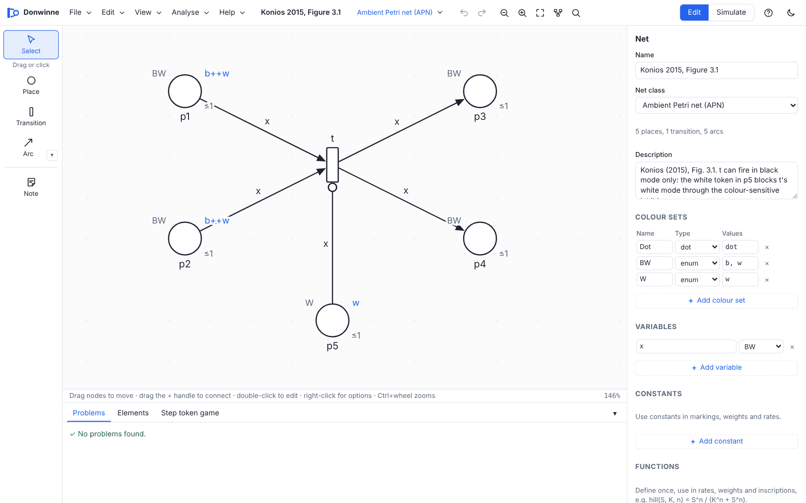

Open it with **File > Examples > Konios Fig. 3.1: colour-sensitive inhibitor arc (APN)**. Transition *t* takes a
token from *p1* and *p2* and puts one in *p3* and *p4*. Places *p1* and *p2* hold a black and a white token
(users *b* and *w*). Place *p5* holds a white token and has an inhibitor arc to *t*.

- $M_0 = \{(p1,b), (p1,w), (p2,b), (p2,w), (p5,w)\}$.
- *(t, w)* is blocked: *p5* holds a token of colour *w*.
- *(t, b)* is enabled: *p5* holds no black token.
- So the only enabled step is $\{(t,b)\}$, and the CRG is one edge $M_0 \to M_1$.

In the step token game, the inhibitor arc is drawn **red** with the label "blocks w" while it blocks the white mode.

## Step semantics and the step token game

### Steps (Sec. 3.3)

A **step** *U* is a non-empty set of structured transitions, for example `{(t3,b),(t4,b)}`. It is **enabled** at a
marking *M* when:

1. $Pre(U) \le M$: there are enough tokens for all of it together;
2. $M + Post(U) \le K$: the capacities hold (see the note below);
3. no *(t, c)* in *U* has an inhibitor place that holds a token of colour *c*.

Firing it gives $M' = M - Pre(U) + Post(U)$.

The capacity condition has two forms. The thesis states the strict one, $M + Post(U) \le K$, and gives in a footnote a
weaker one for nets with self-loops, $M - Pre(U) + Post(U) \le K$. Donwinne's default rule ("auto") uses the weaker
form exactly when the net has a self-loop on a structured place, and the strict one otherwise
([steps.ts](../packages/apn/src/steps.ts)).

Two structured transitions are **in conflict** (Def. 4) when each can fire alone but not both together, for example
because they need the same token.

A **maximal step** is an enabled step that is not contained in a larger enabled step: everyone who can act, acts.

### Playing the step token game

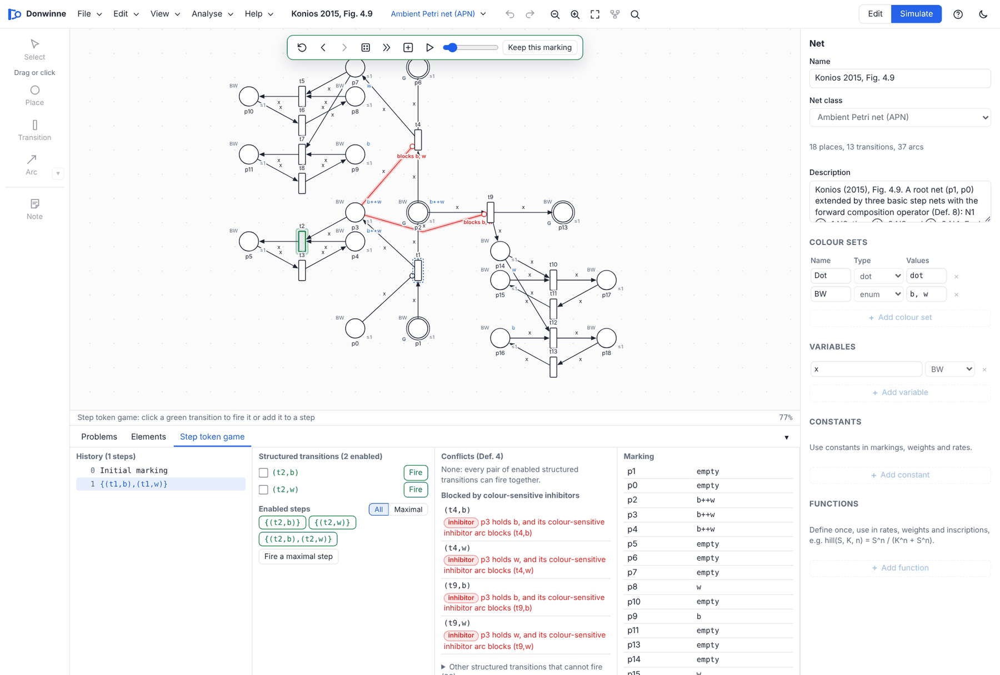

Start it with **Analyse > Ambient (Konios) > Play the step token game**, or press **S** in the editor. The canvas
says "Step token game: click a green transition to fire it or add it to a step". Green transitions have at least one
enabled mode.

- **Click a green transition.** If it has one enabled mode, it fires at once. Otherwise a picker lists "*t*: colour
  modes" with a button **Fire (t,c)** for each mode and **+ step** to add the mode to the step being collected.
- **Collect a step.** Turn on **Collect a step: taps add transitions to one step** in the simulation bar. Clicks then
  add *(t, c)* to a tray; press **Fire step** to fire them all together, or **Clear**. On touch screens the hint
  reads "Tap green transitions to collect a step".
- **Fire a random enabled step (R)**, **Fire a maximal step (X)**, **Run random firings (Space)** (random firing picks a
  single structured transition 70% of the time and a larger enabled step otherwise; with **Maximal** chosen in the
  panel, it fires maximal steps).
- **Left and Right arrow keys** move back and forward through the history; **Escape** leaves the token game.
- **Keep this marking** makes the current marking the new initial marking.

The bottom panel has these sections:

| Column | What it shows |
| --- | --- |
| **History (n steps)** | Every step fired so far; click one to go back to it |
| **Structured transitions (n enabled)** | Each enabled *(t, c)* with a checkbox and a **Fire** button. The checked ones form the step in the box "U = …", with **Fire this step** and **Clear**. If the step is not enabled, the box says why |
| **Enabled steps** | The enabled steps, **All** or **Maximal** only (up to 120 are listed); click one to fire it. The button **Fire a maximal step** fires a random maximal step |
| **Conflicts (Def. 4)**, **Blocked by colour-sensitive inhibitors**, **Other structured transitions that cannot fire** | The reason each structured transition cannot fire now: a conflict, an inhibitor place holding its colour, missing tokens or a full place |
| **Marking**, **As structured places** | The current marking, as token counts and as pairs (p, c); click a place to show it on the canvas |

To keep the panel quick, steps are listed up to 400 per marking (and 40,000 search nodes).

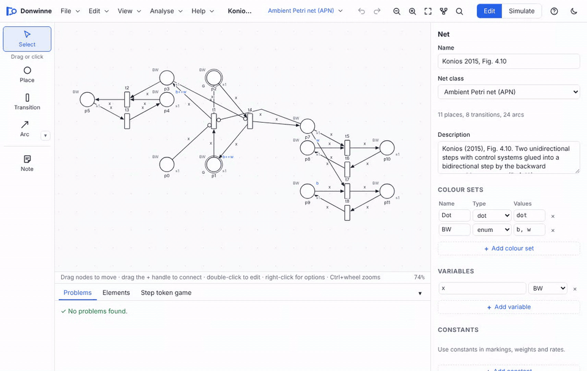

## The concurrent reachability graph

The **step transition system** of an APN (Def. 5, eq. 3.1) has the reachable markings as states and an edge
$M \xrightarrow{U} M'$ for every enabled step *U*. Its reachable part is the **concurrent reachability graph**, CRG(N).

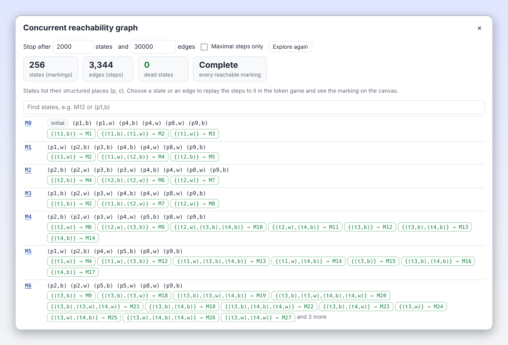

Open **Analyse > Ambient (Konios) > Concurrent reachability graph…**. The graph is explored as soon as the dialog
opens:

| Control | Meaning |
| --- | --- |
| "Stop after **2000** states and **30000** edges" | Exploration limits (states: 10 to 200,000) |
| **Maximal steps only** | Keep only maximal steps on the edges: a much smaller graph than CRG(N) |
| **Stop** / **Explore again** | Stop a long exploration, or start again after changing the limits or the model |
| States, edges, dead states, **Complete** or **Partial** | The size of the graph, and whether a limit cut it off |
| "Find states, e.g. M12 or (p1,b)" | Filter the states by name or by a structured place |
| **Export:** SVG, PNG, DOT, CSV | Save the graph as a picture (up to 1,000 states), a GraphViz file or a table; see [Reachability graphs](file-formats.md#reachability-graphs) |

Each state lists its structured places. **Click a state or an edge** to replay the steps that reach it in the step
token game.

Even small APNs have large CRGs, because every subset of independent structured transitions is a step. The ambient
garage has more than 66,000 states with all steps, but only 82 with maximal steps.

## Chapter 4: building blocks and composition

### The step-modelling approach (Sec. 4.1)

Konios models an ambient system as **steps** a user takes between locations. One step is a **building block**:

| Element | Name in Donwinne's blocks | Role |
| --- | --- | --- |
| Starting place *p_s* | `ps` | The user's location before the step (a sensor area) |
| Step transition *t_s* | `pstopf` (start + "to" + finish) | The user moves |
| Finishing place *p_f* | `pf` | The user's new location |
| Control place *p_c* | `ctrl_pf` | The step tells the control system that the user arrived |
| Database places *p_d* | `db_pf_k` | Data the system holds for each user (one per decision point) |
| Response places *p_r* | `advice_pf_k` | The advice shown to the user (on a display) |
| Emptying transitions *t_em* | `Tem_pf_k` | The system reacts: takes the control token and the data, shows the advice |
| Retrieve transitions *t_r* | `Tr_pf_k` | The advice is taken back and the data restored |

The control place, database places, response places and their transitions form the **control system**
(Sec. 4.1.2). A step with several database places has several **decision points**: the system may give different
advices to different users.

When steps are composed, a **colour-sensitive inhibitor arc** from a location's control place to the next step
transitions keeps user *c* from moving on until the system has answered *c*.

### The blocks (Defs 6, 7, 11)

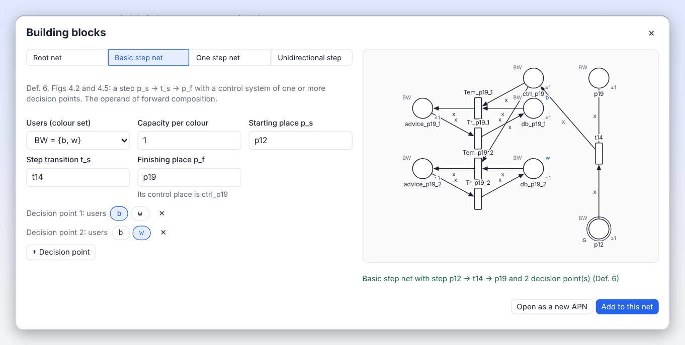

Open **Analyse > Ambient (Konios) > Building blocks…** (or **File > New APN from building blocks…**). The tabs are:

| Tab | Thesis | What you get |
| --- | --- | --- |
| **Root net** | Def. 7, Fig. 4.6 | Two places: *p* with the initial users, and its control place. The users you list under "Users stopped from proceeding…" start in the control place and are held back |
| **Basic step net** | Def. 6, Figs 4.2 and 4.5 | A step with its control system and at least one decision point. Gluing places: {*p_s*} |
| **One step net** | Def. 11 | The same net, with both *p_s* and *p_f* as gluing places: the second operand of a backward composition |
| **Unidirectional step** | Fig. 4.1 | Just *p_s*, *t_s*, *p_f*, without a control system |

Fields: "Users (colour set)", "Capacity per colour", "Place p", "Starting place p_s", "Step transition t_s",
"Finishing place p_f", the users as chips, and decision points (**+ Decision point**). Each decision point says which
users' data its database place holds (Def. 6 needs at least one). A preview shows the block. Press **Open as a new
APN** or **Add to this net**.

### Forward composition (Defs 8 and 9)

Forward composition $N \oplus^g N_S$ glues the starting place of a basic step net onto a gluing place *g* of *N*. For
every transition that puts users into *g*, it adds a colour-sensitive inhibitor arc from that transition's control
place to the new step transition. The new finishing place becomes a gluing place. Starting from a root net and
applying forward compositions gives the **forward composite step nets** (Def. 9).

In the app: **Analyse > Ambient (Konios) > Compose steps…**, tab **Forward (Def. 8)**. Choose the "Gluing place g",
name the "Step transition t_s" and the "New finishing place p_f", add decision points, and press **Compose**.

### Backward composition (Defs 12 and 13)

Backward composition $N \oplus^{g_1}_{g_2} N_S$ glues a one step net between two existing gluing places, from *g1*
back to *g2* (*g1 = g2* gives a self-loop step). It adds the inhibitor arcs for both ends. Forward and backward
compositions from a root net give the **composite step nets** (Def. 13).

In the app: tab **Backward (Def. 12)**, with "From g1 (glued to p_s)" and "To g2 (glued to p_f)".

Readings of the thesis made in the code (documented at the top of [compose.ts](../packages/apn/src/compose.ts)):

- either a basic step net or a one step net is accepted as the second operand of either operator (they differ only
  in their gluing places, and the thesis itself composes a basic step net "treated as a one step net");
- once a backward step from *g1* to *g2* exists, another backward composition on the same pair is refused
  (Sec. 4.3.2.1);
- the parallel composition used for the N-graph of Fig. 4.11 is the disjoint union (the thesis does not define it).
  The class checks accept several root nets side by side only when asked;
- a backward step's own control place never inhibits it when *g1 = g2*.

The composition examples of Figs 4.9, 4.10 and 4.11 are under **File > Examples**. Fig. 4.12 and the component nets of
Figs 4.7 and 4.8 are built in the tests ([model-figures.ts](../packages/apn/src/model-figures.ts)).

## Properties of composite APNs

**Analyse > Ambient (Konios) > APN properties…** checks the classes and the properties of Sec. 4.4.

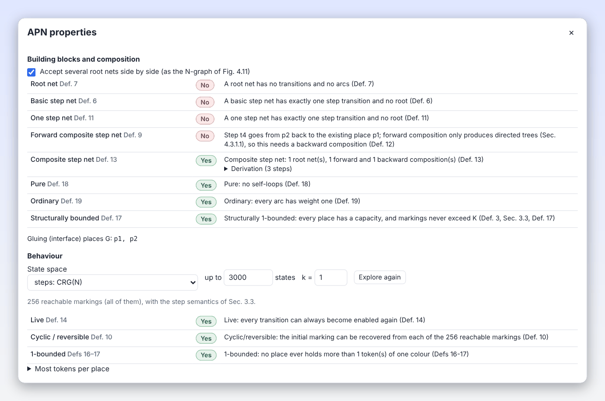

The **Building blocks and composition** table, each row with a verdict and a reason:

| Row | Thesis |
| --- | --- |
| Root net | Def. 7 |
| Basic step net | Def. 6 |
| One step net | Def. 11 |
| Forward composite step net | Def. 9 |
| Composite step net (with a "Derivation" list of compositions that builds the net) | Def. 13 |
| Pure | Def. 18, Lemma 2 |
| Ordinary | Def. 19, Lemma 3 |
| Structurally bounded | Def. 17 |

The checkbox **Accept several root nets side by side (as the N-graph of Fig. 4.11)** is on by default. Below the
table, "Gluing (interface) places G" lists the gluing places. If the net records none, they are read from the
structure, and **Mark them as gluing places** stores them.

The **Behaviour** section explores a state space ("State space": **steps: CRG(N)** or **one transition at a time
(smaller)**, up to 3000 states by default) and checks:

| Row | Thesis |
| --- | --- |
| Live | Defs 14 and 15, Lemma 1 |
| Cyclic / reversible | Def. 10 |
| *k*-bounded (set *k*, default 1) | Defs 16 and 17 |

"Most tokens per place" lists, for each place, the most tokens of one colour and in total. When the limit cuts the
graph off, the behavioural verdicts say so.

## The case studies

| Case study | Thesis | Model | Size |
| --- | --- | --- | --- |
| Ambient garage | Sec. 2.3.1, 4.5.1, Figs 4.13 to 4.15 | Root net (entrance, ctrl_entrance) plus 5 forward and 3 backward compositions. Users 1 and 2 (colour set `User` = int 1..2). Bay A1 is for car 1, A2 for car 2 | 45 places, 38 transitions, 114 arcs (15 inhibitor arcs) |
| Ambient conference room | Sec. 2.3.2, 4.5.2, Figs 4.16 and 4.17 | Root net (participants, ctrl_participants) plus 13 steps: 10 forward and 3 backward | 61 places, 49 transitions, 145 arcs (16 inhibitor arcs) |

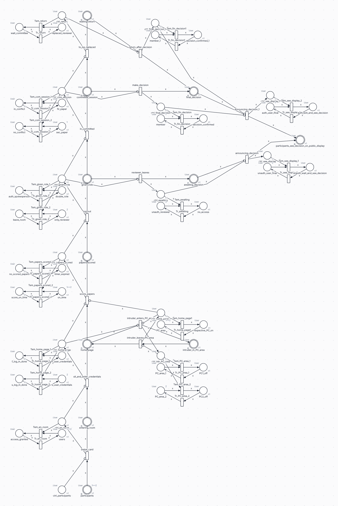

The garage's steps, in order of composition:

| Kind | Step transition | From | To |
| --- | --- | --- | --- |
| forward | access_granted | entrance | p1 |
| forward | p1toA1 | p1 | A1 |
| backward | A1top1 | A1 | p1 |
| forward | p1top2 | p1 | p2 |
| forward | p2toA2 | p2 | A2 |
| backward | A2top2 | A2 | p2 |
| backward | p2top1 | p2 | p1 |
| forward | Moving_to_exit | p2 | exit |

The gluing places are entrance, p1, A1, p2, A2 and exit. The advices are response places named after the display,
the location and the user, for example `Left_p1_1` (at p1, user 1 is told to turn left) or `Park_A2_2`.

The fragments of Figs 4.14 and 4.16 (`ambientGarageFragment`, `ambientConferenceRoomFragment`) and the T-APN versions
of Sec. 6.5 are in [cases.ts](../packages/apn/src/cases.ts); the case models also take options for the users and the
users held back at the start.

## Chapter 5: Transformed APNs (T-APNs)

Inhibitor arcs are hard for most analysis tools. A **T-APN** (Def. 20) expresses the same blocking with ordinary
means:

$N = (P, T, Pre, Post, Cl, \overline{Cl}, C_P, C_T, Ins, K, Gd, M_0, G)$

- $\overline{Cl}$ are **complementary colours**: for every user colour *c* there is a special colour *f(c)* (a
  bijection *f*). In Fig. 5.1, black and white have the complements grey and light.
- A control place holds *f(c)* while user *c* **may** proceed. Instead of "no token *c* here", the step transition
  asks "token *f(c)* here", through a directed arc carrying *f(c)*.
- **Guards** $Gd$ tie the modes together: a step transition with such arcs has the guard
  $B_t = \{(x, f(x))\}$, so it fires in mode *c* only with the complement *f(c)*.
- Capacities stay as they were for user colours and are 1 for complementary colours.

The step semantics is the same as for APNs (Sec. 5.2), except that condition 3 becomes "every guard holds". The
step token game, the CRG and the CTL dialog all work on T-APNs too.

In Donwinne, a T-APN is the net class `tapn` ("Transformed ambient Petri net (T-APN)"). Its colour sets can carry a
`complementOf` link that records *f*. There is no editor field for `complementOf`: it is set by the construction or
read from a file.

## Chapter 6: the construction φ

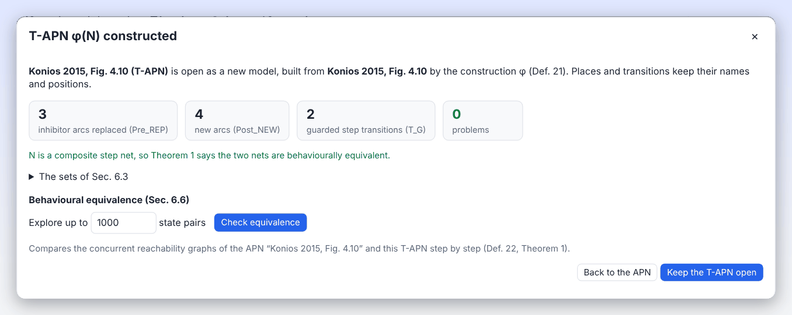

The construction **φ** (Def. 21) turns a composite step net *N* into a T-APN φ(N). It keeps the places,
transitions, directed arcs, colour sets and gluing places, and removes every inhibitor arc. In the numbering of
Def. 21 ([construction.ts](../packages/apn/src/construction.ts)):

| Part | What φ does |
| --- | --- |
| (iii) Pre_REP | Each inhibitor arc (p, t) becomes a directed arc from *p* to *t* carrying the complementary colour |
| (iii) Post_NEW | New arcs carrying *f(c)*: from each emptying transition back to the control place it empties, and from each step transition *t* to the control places of the other steps into its finishing place (including the root's control place) |
| (v) | The complementary colours $\overline{Cl}$ and the bijection *f* |
| (vi) | Control places hold $C(p) \cup f(C(p))$; other places keep $C(p)$ |
| (viii) | New and replacing arcs carry complementary colours; all others carry user colours |
| (ix) | Capacities kept for user colours, 1 for complementary colours |
| (x) | Step transitions with inhibitor places (the set $T_G$) get the guard $\{(x, f(x))\}$ |
| (xi) | The control places of marked step places get *f(c)* for every user *c* that may proceed |

Places and transitions keep their ids, names and positions, so φ(N) draws like N (as in Figs 6.2 and 6.4).

Naming in Donwinne:

- complementary colours are `<colour>_bar` for name-like colours, else `bar_<index>`; the garage's users 1 and 2 get
  `bar_0` and `bar_1`;
- two colour sets are added: `<set>_bar` (with `complementOf`) and `<set>_ctrl` (the union, for control places),
  and the variable `x_bar`;
- the T-APN is named "<name> (T-APN)".

### In the app

1. Open an APN that is a composite step net.
2. Choose **Analyse > Ambient (Konios) > Construct T-APN** (APN only).
3. The T-APN opens as a new model, with the dialog **"T-APN φ(N) constructed"**. It shows the sizes of Pre_REP,
   Post_NEW and T_G, and any problems. The details block **"The sets of Sec. 6.3"** lists every set, the binding
   pairs and the new initial marking M′0.
4. The dialog contains the equivalence check (Sec. 6.6, see below), and the buttons **Back to the APN** and **Keep the
   T-APN open**.

For the garage, the construction gives Pre_REP 15, Post_NEW 22, T_G 8 and 0 problems. Its colour sets are Dot, User,
User_bar (complementOf User) and User_ctrl, and M′0 adds (ctrl_entrance, bar_0) and (ctrl_entrance, bar_1).

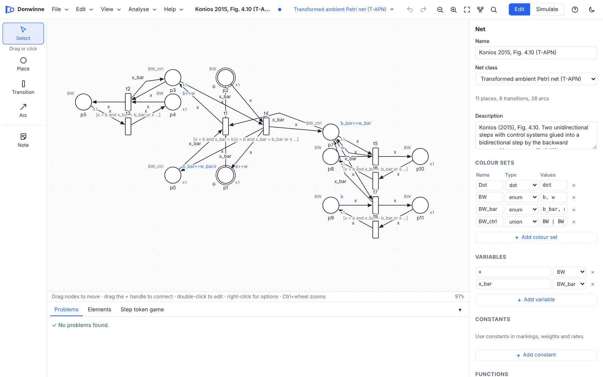

The worked examples of Sec. 6.3 and 6.4 (Figs 6.1 to 6.6) are reproduced in the tests: φ(N1) has 10 states and 15
edges, as in Fig. 6.6.

## Behavioural equivalence

Theorem 1 says that for a composite step net, CRG(N) and CRG(φ(N)) are **isomorphic** (Def. 22): there is a bijection
ψ between their states with ψ(M0) = M′0, and the same steps lead between matching states.

Both graphs are deterministic, so ψ is forced. Donwinne explores the two nets in lock step
([equivalence.ts](../packages/apn/src/equivalence.ts)) and stops at the first difference, which becomes a
**counterexample**:

| Counterexample | Meaning |
| --- | --- |
| Step only in the APN | After a step sequence, a step is enabled in the APN but not in the T-APN |
| Step only in the T-APN | The other way round |
| State mismatch | Two step sequences reach the same state in one net but different states in the other |

The verdict is **Equivalent**, **Not equivalent**, or **Unknown** (a limit was reached before the whole graphs were
compared and no difference was found).

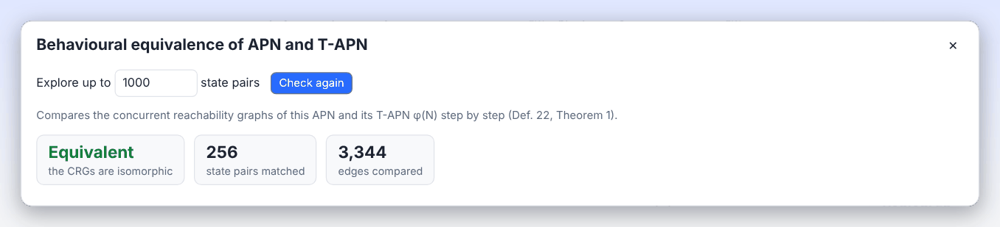

### In the app

Open **Analyse > Ambient (Konios) > Check equivalence…** (dialog "Behavioural equivalence of APN and T-APN"; it runs
at once), or use the panel in the "T-APN φ(N) constructed" dialog.

- On an **APN**, the T-APN is constructed for the check.
- On a **T-APN** built in this session, it is compared with the APN it came from. A T-APN that was not built in this
  session cannot be checked (the menu item is disabled).
- "Explore up to **1000** state pairs" sets the limit; press **Check equivalence** (or **Check again**).
- For a counterexample, **Replay in this APN/T-APN** plays the step sequence in the token game; **Open the APN and
  replay** goes back to the APN first.

Results to expect:

| Net | Verdict at 1000 state pairs |
| --- | --- |
| Fig. 4.9 example | Equivalent (256 states, 1593 edges) |
| Fig. 4.10 example | Equivalent (256 states, 3344 edges) |
| Fig. 4.11 example | Equivalent (76 states, 309 edges) |
| Garage fragment (Fig. 4.14) | Equivalent (1156 pairs, needs a higher limit) |
| Full ambient garage | Unknown: its CRG is too large (it stays unknown even at 200,000, where the edge limit is hit) |
| Fig. 3.1 | Not equivalent: Fig. 3.1 is not a composite step net, so Theorem 1 does not apply |

## Chapter 7: verification

The thesis verifies its case studies with Snoopy and Charlie. Donwinne does all of it in the
**Model checking (CTL)** dialog and the net properties report. The [CTL page](ctl.md) is the full reference; this
section maps chapter 7 to the app.

### Model checking (Sec. 7.1)

Open **Analyse > Ambient (Konios) > Model checking (CTL)…**. Formulas use Charlie's syntax, so the thesis's formulas
can be typed as printed. The 22 property templates follow the thesis's classification:

| Group in the dialog | Thesis section | Templates |
| --- | --- | --- |
| Ambient guidance (7.1.1.1) | Examining sensors; user's initiative | 4 |
| Ambient information (7.1.1.2) | Displays; leak of information | 2 |
| Common ambient (7.1.1.3) | Notifying the user; alternation; restricting; system's actions | 4 |
| General guidance (7.1.2.1) | Redundancy of advices; returning to previous states | 2 |
| Common general (7.1.2.2) | Database resources, bounds, goals, terminal state, users, improper actions | 8 |
| Fault tolerance (7.3.3) | Wrong advice | 2 |

The **Semantics** setting decides which state space a formula is checked on:

| Semantics | State space | When to use it |
| --- | --- | --- |
| **Maximal steps** (default for ambient nets) | CRG with maximal steps only | Small and complete for the case studies: the garage gives 82 states |
| **All steps: CRG(N)** | The full CRG | Exact step semantics, but large |
| **One transition at a time** | Interleaving graph of the coloured net | Sequential reading, users kept apart |
| **Colour-blind (as in the thesis)** | Interleaving graph with colours ignored, as Charlie reads a Snoopy net | To reproduce the thesis's verdicts |

### Qualitative analysis (Sec. 7.2)

**Analyse > Net properties and invariants…** gives the Charlie-style report. The properties of Sec. 7.2 appear as:

| Thesis | Row in the report | Thesis result for both case studies |
| --- | --- | --- |
| FT0 (no input transition) | Has input transitions (FT0) | no input transitions |
| TF0 (no output transition) | Has output transitions (TF0) | no output transitions |
| FP0 (no input place) | Has input places (FP0) | has input places |
| PF0 (no output place) | Has output places (PF0) | has output places |
| k-B | k-bounded (k-B) | k = 2 |
| DCF | Dynamic conflict free (DCF) | not dynamically conflict free |
| DSt | Has dead states (DSt) | 1 dead state |
| DTr | Has dead transitions (DTr) | no dead transitions |

Note the wording: the thesis states FT0, TF0, FP0 and PF0 as "no input transition" and so on, while the report asks
whether the net has them. A thesis "FT0 holds" is a report "No". Coloured nets are unfolded for this report.

### Paths (Sec. 7.3.2)

The **Paths** tab finds firing sequences from the initial marking to a target, with transitions that must or must
not fire. "Following or ignoring advice" compares the shortest way to a goal when every advice is followed with the
shortest way when some advice is ignored. See [Path queries](ctl.md#path-queries).

### Fault tolerance (Sec. 7.3.3)

The **Fault tolerance** tab injects a fault (extra tokens in database places, as a faulty sensor would), then checks
whether the wrong advice can now appear, whether the user can still reach the goal, and whether the correct advice
can follow. See [Fault tolerance](ctl.md#fault-tolerance).

## Reproducing the thesis's results

The test file [thesis.test.ts](../packages/analysis/test/thesis.test.ts) checks every formula, qualitative property
and path length of chapter 7 on the case models, with the formulas transcribed in
[thesis-formulas.ts](../packages/analysis/test/thesis-formulas.ts). Each mismatch is listed there with a diagnosis;
nothing in the models or the formulas was changed to make a result fit.

### Two readings

1. **Colour-blind** (the thesis's own reading). Chapter 7 analyses the T-APNs with Charlie, which prints uncoloured
   markings, and states that the verification is based on sequential analysis. The reference is therefore the
   interleaving graph of the colour-blind projection of the T-APN: token counts summed over colours, one transition
   per coloured transition, no capacities, as in Snoopy.
2. **Coloured**. The APNs with users 1 and 2, one database token per user and capacity 1 per colour.

### Results of the colour-blind reading

| Check | Result |
| --- | --- |
| Formula rows of chapter 7 | 44, of which 43 can be transcribed (Fig. 7.13 for the conference room is cut off in the thesis): 22 for the garage, 21 for the conference room |
| Verdicts, interleaving | **30 agree, 2 differ, 11 unknown** |
| Garage | **22 of 22 agree**, on the complete graph of **573,441 states and 6,225,921 edges**, with 1 dead state and no dead transitions, and AG(EF(deadlock)) true |
| Conference room | Explored up to 300,000 states (the whole graph has more than 5 million) and checked three-valued. The 2 differences are 7.11 and 7.17a; the 11 unknown verdicts are figures 7.1, 7.3, 7.5, 7.9, 7.19, 7.23, 7.25, 7.27, 7.29, 7.31 and 7.35 |
| Path lengths of Sec. 7.3 | **All 8 reproduce**: garage following advices 4 and 6; conference room following advices 14, 16 and 12 (on up to 1,000,000 states); garage ignoring advices 8 and 10; conference room ignoring advices 16 |
| Verdicts, maximal steps | **40 of 43 agree** (differences: 7.11 conference, 7.13 garage, 7.39b conference) |
| Graph sizes, maximal steps | Garage 229 states, 1990 edges, 1 dead state; conference room 314 states, 1620 edges, 1 dead state. The thesis's "maximum concurrency" drawings have 52/87 and 82/130, so **these sizes are not reproduced** (the thesis draws them only for visualisation) |

The two differences under interleaving, in short:

- **7.11, conference room**: the clause `auth_spokesperson == 1 -> EX(committee_session)` fails once the user ignores
  the advice and leaves (`reviewer_leaves`).
- **7.17a, conference room**: the two participants swipe their cards one after the other, so `entering_room == 2` can
  happen before any access advice is shown; the thesis's "true" would need the advice first.

### Results of the coloured reading

| Check | Result |
| --- | --- |
| Maximal-step graphs | Complete: garage 82 states, 156 edges, 1 dead state; conference room 142 states, 194 edges, 4 dead states; no dead transitions |
| Verdicts | 9 of 43 differ, each explained in the test file (for example, in the APN each database token belongs to one user, so car 1 at A1 can only be told `Park_A1_1`) |
| Qualitative | FT0, TF0, FP0, PF0 and DCF match the thesis; k = 2 by base name |
| Paths, following advices | Garage 4 and 6; conference room (a) 14 and (b) 16 as in the thesis; (c) is 16 instead of 12, because both users must act in the coloured model |
| Paths, ignoring advices | The thesis's targets name `ctrl_entrance` / `ctrl_participants`, which the coloured models never mark; without that conjunct the garage paths have the thesis's lengths, 8 and 10 |
| Fault tolerance formulas 7.55 and 7.57 | Hold vacuously on the fault-free models |

### Reproducing it yourself in the app

1. **File > Examples > Konios: ambient garage (APN)**.
2. **Analyse > Ambient (Konios) > Construct T-APN**, then **Keep the T-APN open**.
3. **Analyse > Ambient (Konios) > Model checking (CTL)…**, set **Semantics** to **Colour-blind (as in the thesis)**
   and "up to" to at least **573,441** states (for example 600,000).
4. Pick templates with **Thesis example**, or type the thesis's formulas, and press **Check**. Expect a few seconds
   for the first check while the state space is built; it is reused for the next formulas.

## Walkthrough: the ambient garage from start to finish

This walkthrough uses only the menus and buttons of the app. Each step says what you should see.

### 1. Open the model

**File > Examples > Konios: ambient garage (APN)**. The model has 45 places, 38 transitions and 114 arcs, 15 of them
inhibitor arcs, with colour sets Dot and User (int 1..2) and the variable x. Two cars (users 1 and 2) wait at the
entrance.

### 2. Play steps

1. Press **S** (or **Analyse > Ambient (Konios) > Play the step token game**).
2. In the bottom panel, **Enabled steps** lists three steps: `{(access_granted,1)}`, `{(access_granted,2)}` and
   `{(access_granted,1),(access_granted,2)}`. With **Maximal**, only the pair is left. There are no conflicts.
3. Press **X** (fire a maximal step): both cars pass the entrance together.
4. Keep pressing **X** and watch the control system: the control place gets a token, an emptying transition shows
   an advice (`Left_p1_1`, `Forward_p1_2`), and while user *c*'s control token is still there, the next step is
   blocked for *c* (the inhibitor arc turns red, "blocks 1").
5. Use the Left arrow key to step back through the history, or click a step in **History**.

### 3. Build the CRG

1. **Analyse > Ambient (Konios) > Concurrent reachability graph…**. With the default limits (2000 states, 30000
   edges) the graph is **Partial**: the full CRG has more than 66,000 states.
2. Tick **Maximal steps only** and press **Explore again**: the graph is **Complete**, with 82 states, 156 edges and
   1 dead state.
3. Click a state to replay the steps to it in the token game.

### 4. Check the structure

**Analyse > Ambient (Konios) > APN properties…**: Composite step net is **yes**, with a derivation of 1 root net, 5
forward and 3 backward compositions; the net is pure and ordinary. The Behaviour section explores up to 3000 states
of CRG(N) by default, which is only part of the garage's graph, so its verdicts rest on a partial graph. The
maximal-step CRG of step 3 is the complete picture.

### 5. Construct the T-APN

**Analyse > Ambient (Konios) > Construct T-APN**. The T-APN "Ambient garage (Konios 2015, Fig. 4.15) (T-APN)" opens.
The dialog shows Pre_REP 15, Post_NEW 22, T_G 8 and no problems. Open "The sets of Sec. 6.3" to see M′0 with
(ctrl_entrance, bar_0) and (ctrl_entrance, bar_1): both cars may proceed.

### 6. Check equivalence

In the same dialog, press **Check equivalence**. For the full garage, the verdict at 1000 state pairs is
**Unknown**: no difference was found, but the CRGs are too large to compare completely. To see a complete
**Equivalent** verdict, try **File > Examples > Konios Fig. 4.10: bidirectional step (APN)** and **Analyse > Ambient
(Konios) > Check equivalence…**: equivalent, 256 states and 3344 edges.

Press **Back to the APN** to return to the garage.

### 7. Check a CTL property

1. **Analyse > Ambient (Konios) > Model checking (CTL)…**. Semantics is **Maximal steps**.
2. Choose the template **Reaching user's goal** (group "Common general (7.1.2.2)") and press **Thesis example**,
   then **Use this property**. The formula is

   ```
   EF(A1 & Park_A1_1) & EF(A2 & Park_A2_2)
   ```

3. Press **Check**. The result is **True** on a complete state space of 82 states. The witness has 4 steps, starting
   with `{access_granted<x=1>, access_granted<x=2>}`.
4. Press **Replay in the token game** to watch it.

A few more to try on the same model:

| Formula | Result | Meaning |
| --- | --- | --- |
| `AG(EF(deadlock))` | True | The system can always come to rest |
| `EF(exit == 2)` | True | Both cars can reach the exit |
| `AG(entrance[1] -> EF(A1[1]))` | True | While car 1 is at the entrance, it can still reach bay A1 |
| `EF(Park_A1_1[2])` | False | Car 2 is never told to park in A1 |

### 8. Find a path

In the **Paths** tab, type the target `Left_p1_1 * A1 * Park_A1_1` and press **Find paths** with **One transition at
a time** semantics. The shortest path has 4 firings and is conclusive:
`access_granted<x=1>`, `Tem_p1_1<x=1>`, `p1toA1<x=1>`, `Tem_A1_1<x=1>`.

## What is not supported

- **Editing complementary colours by hand.** A colour set's `complementOf` link has no editor field; it is set by
  **Construct T-APN** or read from a file.
- **The construction outside composite step nets.** φ is defined for composite step nets. On other APNs it may
  report problems, and the equivalence check may say **Not equivalent** (as for Fig. 3.1).
- **The thesis's maximum-concurrency graph sizes** (52/87 and 82/130) are not reproduced, as described above.
- **APN and T-APN classes in Snoopy.** Snoopy has no such classes (Konios drew both as coloured nets). Donwinne
  exports them as coloured Snoopy nets (colpn) and keeps the class, the gluing places and the complementary colour
  sets in a last line of the net description, `[Donwinne ambient net: {...}]`, which the importer reads back and
  removes.
- **Background workers.** Exploration runs in the page and yields regularly so the interface stays responsive; very
  large state spaces (millions of states) take time and memory. Use **Stop** and the limits.
