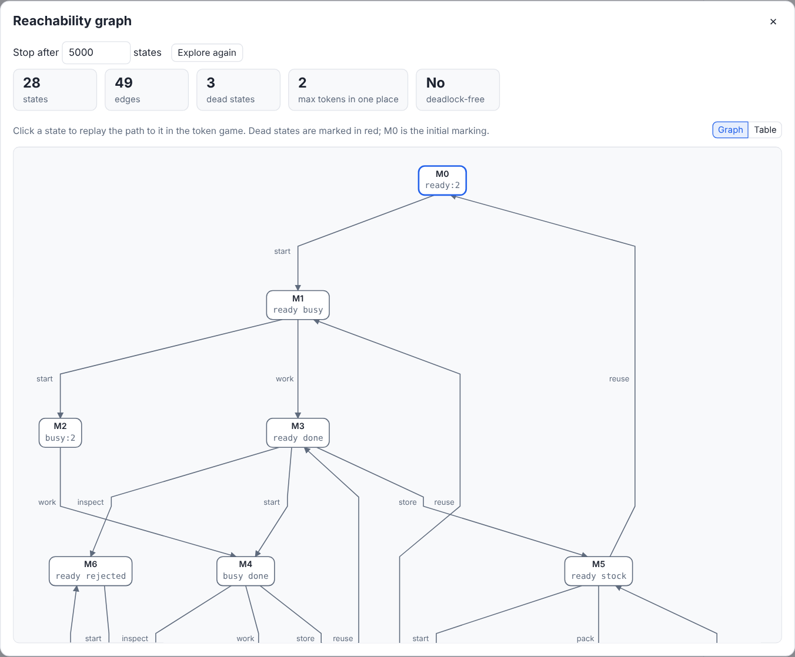
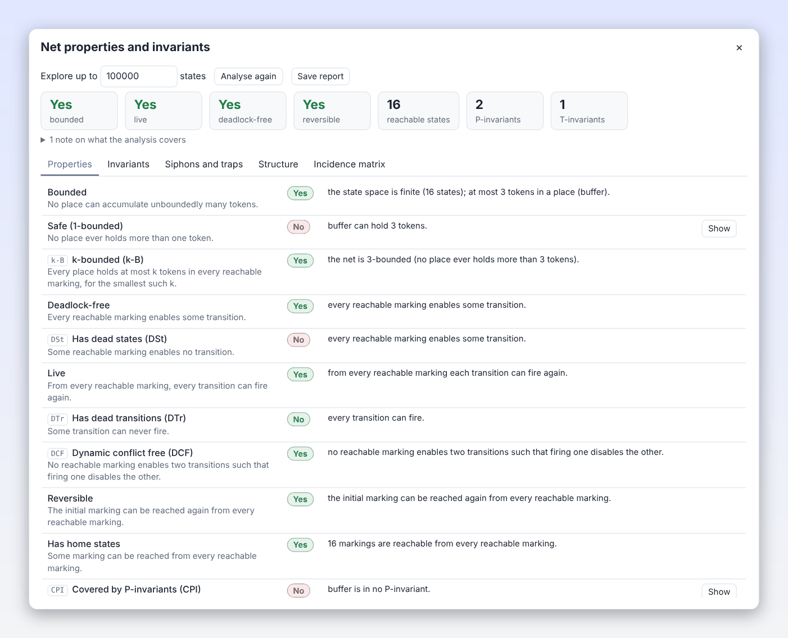
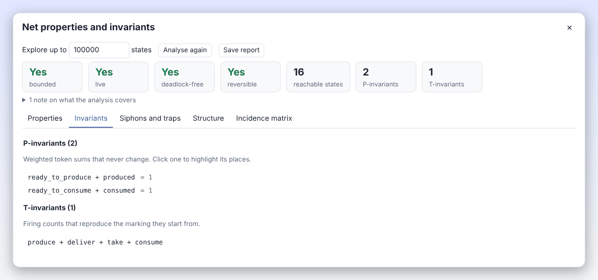
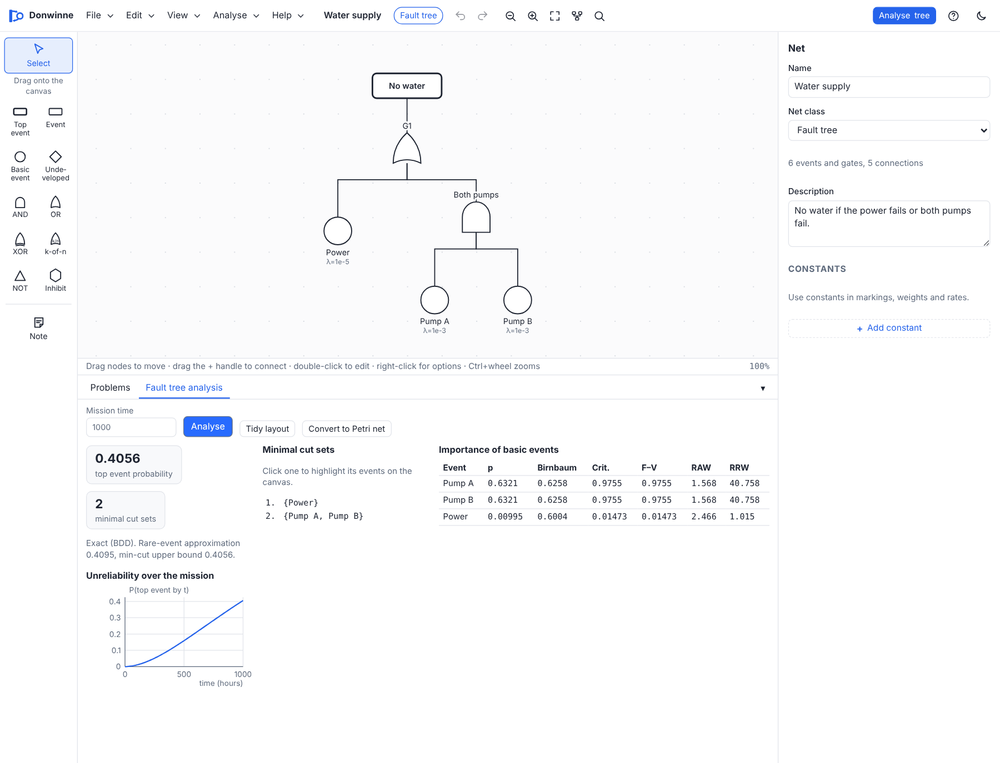

# Analysis

Donwinne can answer questions about a net without you playing it by hand: which markings can be reached, whether the net can deadlock, whether token counts are bounded, which weighted sums of tokens never change, and more. For fault trees it computes cut sets, probabilities and importance measures. This page explains each analysis, how it is computed, and how to read the results.

For model checking temporal logic formulas, see [CTL model checking](ctl.md). For the analyses specific to ambient nets (concurrent reachability graph, APN properties, equivalence), see [Ambient Petri nets](ambient-petri-nets.md).

## Contents

- [Reachability graph](#reachability-graph)
- [Net properties and invariants](#net-properties-and-invariants)
  - [How the analysis sees a net](#how-the-analysis-sees-a-net)
  - [Behavioural properties](#behavioural-properties)
  - [Invariants](#invariants)
  - [Siphons and traps](#siphons-and-traps)
  - [Structural properties](#structural-properties)
  - [Incidence matrix](#incidence-matrix)
  - [Show: highlighting results](#show-highlighting-results)
  - [The text report](#the-text-report)
- [Fault tree analysis](#fault-tree-analysis)
  - [Running the analysis](#running-the-analysis)
  - [Minimal cut sets](#minimal-cut-sets)
  - [Top event probability](#top-event-probability)
  - [Importance measures](#importance-measures)
  - [Unreliability over the mission](#unreliability-over-the-mission)
  - [Dynamic gates and Monte Carlo simulation](#dynamic-gates-and-monte-carlo-simulation)
  - [Converting a fault tree to a Petri net](#converting-a-fault-tree-to-a-petri-net)
- [Model checking](#model-checking)

## Reachability graph

The **reachability graph** has one node for each marking that can be reached from the initial marking, and an edge for each firing that leads from one marking to another. It contains every possible behaviour of the net (as long as it is finite).

Open it with **Analyse > Reachability graph…**. The model must have no errors ("Fix the problems in the model first"). Donwinne explores the markings breadth first, firing every enabled transition (and every binding, in coloured nets) with the token game's firing rule. In timed, stochastic and hybrid nets, time and rates are ignored.

| Control or result | Meaning |
| --- | --- |
| Stop after [5000] states | The exploration limit, from 10 to 200,000. Change it and press **Explore again**. |
| states | The number of markings found; "(stopped early)" when the limit was reached. |
| edges | The number of firings between them. |
| dead states | Markings in which nothing is enabled. |
| max tokens in one place | The largest number of tokens seen in a single place (shown with ≥ when the exploration stopped early). |
| deadlock-free | Yes, No, or ? when the exploration stopped early before finding a dead state. |

Below the figures, **Graph** and **Table** switch between two views. Graphs of up to 150 states open as a drawing, the way Snoopy shows them: one box per state with its name (M0 is the initial marking, at the top) and the places that hold tokens (`busy:2` means two tokens in *busy*), and one arrow per firing labelled with the transition. Dead states have a red border. Larger graphs open as the table, which lists the first 300 states: the state number, the marking of each place, and a **Next** column with up to six successors written as `transition → state`. Dead states are marked there too.

**Click a state** (a box in the graph or a row in the table) to see how it is reached: the dialog closes and the token game starts with the shortest firing sequence from M0 to that state already in its history, so you can step through it with ← and →.

## Net properties and invariants

**Analyse > Net properties and invariants…** runs a qualitative analysis in the style of the Charlie tool, with the same abbreviations as Charlie and Konios (2015, §7.2). It combines the state space (behaviour) with structural methods (invariants, siphons and traps, structural classes) that work on the net's graph and incidence matrix.

At the top:

- **Explore up to [100000] states** sets the state space limit (100 to 2,000,000); **Analyse again** reruns the analysis and **Save report** saves it as text.
- A row of figures: **bounded**, **live**, **deadlock-free** and **reversible** (Yes, No, ? or –), the number of **reachable states** (with + when the exploration stopped at the limit), and the numbers of **P-invariants** and **T-invariants**.
- Errors that stop parts of the analysis, and a collapsible list "N notes on what the analysis covers" (see the next section).
- Tabs: **Properties**, **Invariants**, **Siphons and traps**, **Structure** and **Incidence matrix**.

If you change the model, a line says "The model changed since this analysis. Press Analyse again."

### How the analysis sees a net

The analysis works on an ordinary place/transition view of the net. The notes list exactly what was simplified:

| Net | What is analysed |
| --- | --- |
| Coloured classes, APN, T-APN | The [unfolding](simulation.md#unfolding). Results name unfolded places and transitions, and highlighting maps them back to the coloured elements. |
| Timed, stochastic | The untimed net. Rates, delays and priorities are ignored; its behaviour includes every timed run. |
| Continuous | The underlying discrete net (markings and weights must be whole numbers). |
| Hybrid | Only the discrete part; continuous places and transitions are left out with their arcs. Rates are ignored as for stochastic nets. |
| Modulo | The state space counts tokens modulo the modulus; structural results refer to the ordinary integer net. |
| Fault trees, freestyle nets | Not available (use [fault tree analysis](#fault-tree-analysis) for fault trees). |

Arcs other than normal ones are handled as follows:

- **Read arcs** are treated as self-loops (an input and an output arc of the same weight) by the structural analysis.
- **Inhibitor and equal arcs** are ignored by the structural analysis. P-invariants still hold, because these arcs only restrict firing, but conclusions about liveness and deadlocks drawn from invariants, siphons and traps are not reliable; the state space is.
- **Reset arcs** are ignored by the structural analysis, so conclusions based on invariants (including token sums and boundedness) are not reliable; the state space is.
- **Modifier arcs** are ignored: they only influence rates.
- **Capacities** are ignored by the structural analysis and respected by the state space.
- **Marking-dependent weights** are ignored by the structural analysis.

The state space (the behaviour) always uses the real firing rule, with all arc types and capacities.

### Behavioural properties

The **Properties** tab lists each property with a status (Yes, No, Unknown or n/a), an explanation, and a **Show** button where elements can be highlighted.

| Property | Meaning |
| --- | --- |
| Bounded | No place can accumulate unboundedly many tokens. |
| Safe (1-bounded) | No place ever holds more than one token. |
| k-bounded (k-B) | Every place holds at most k tokens in every reachable marking, for the smallest such k. |
| Deadlock-free | Every reachable marking enables some transition. |
| Has dead states (DSt) | Some reachable marking enables no transition. |
| Live | From every reachable marking, every transition can fire again. |
| Has dead transitions (DTr) | Some transition can never fire. |
| Dynamic conflict free (DCF) | No reachable marking enables two transitions such that firing one disables the other. |
| Reversible | The initial marking can be reached again from every reachable marking. |
| Has home states | Some marking can be reached from every reachable marking. |
| Covered by P-invariants (CPI) | Every place has a weighted token sum that never changes. |
| Covered by T-invariants (CTI, consistent) | Some firing sequence using every transition reproduces its starting marking. |
| Siphon-trap property (DTP) | Every minimal siphon contains an initially marked trap. |

**When the whole state space is explored** (fewer states than the limit), the results are exact:

- boundedness and the exact k come from the largest marking of each place;
- deadlocks are the dead states, and the **Shortest path to a deadlock** is shown below the tabs;
- liveness, reversibility and home states are decided with the strongly connected components of the reachability graph: a transition is live if it can fire in every terminal component, the net is reversible if the initial marking can be reached from every state, and it has home states if there is exactly one terminal component;
- dynamic conflict freedom is checked on every reachable marking (up to 20,000,000 tests).

**When the exploration stops at the limit**, Donwinne falls back on theorems:

- **Boundedness:** if every place is covered by P-invariants (and the net has no reset arcs or marking-dependent weights), the net is bounded. Otherwise, for nets with only normal and read arcs, constant weights and no capacities (and not modulo nets), Donwinne builds the **Karp–Miller coverability graph**, which shows which places are unbounded.
- **Deadlock-freedom:** an ordinary net (all weights 1) with only normal and read arcs in which every minimal siphon contains an initially marked trap has no deadlocks.
- **Liveness:** an ordinary, extended simple net with the siphon-trap property is live; an extended free-choice net in which some siphon has no marked trap is not live (Commoner's theorem).
- **Dynamic conflict freedom:** a statically conflict-free net is dynamically conflict-free.

Anything that cannot be decided is shown as Unknown.

### Invariants

A **P-invariant** is a weighting of the places such that the weighted sum of tokens never changes, whatever fires. For example `2·P1 + P2 = 4` means that twice the tokens in P1 plus the tokens in P2 is always 4. P-invariants prove boundedness and mutual exclusion. A **T-invariant** is a multiset of transitions whose firing, in some order, brings the net back to the marking it started from; T-invariants describe cycles of behaviour.

The **Invariants** tab lists the minimal P-invariants (with their token sum in the initial marking) and the minimal T-invariants. Click one to highlight its places or transitions. They are computed with the Farkas algorithm, pruned to minimal supports (the Martínez–Silva method). If the computation exceeds its limit (20,000 intermediate rows), the count is marked with + and coverage becomes Unknown.

### Siphons and traps

A **siphon** is a set of places such that every transition that puts tokens into the set also takes tokens from it: once a siphon is empty, it stays empty, and the transitions it feeds die. A **trap** is a set of places such that every transition that takes tokens from the set also puts tokens back: once a trap holds a token, it always will.

The **Siphons and traps** tab lists the minimal siphons and minimal traps (click one to highlight it). They are enumerated by a branching search over the places, with limits on the search size and at most 5,000 sets of each kind. The siphon-trap property (every minimal siphon contains an initially marked trap) is the key to the deadlock and liveness theorems above.

### Structural properties

The **Structure** tab lists properties that depend only on the graph of the net, with the elements that witness each answer:

| Property | Meaning |
| --- | --- |
| Pure (PUR) | No transition has a place as both input and output. |
| Ordinary (ORD) | Every arc has weight 1. |
| Homogeneous (HOM) | All arcs leaving a place have the same weight. |
| Conservative (CSV) | Every transition adds as many tokens as it removes. |
| Static conflict free (SCF) | No two transitions share an input place. |
| State machine (SM) | Every transition has exactly one input and one output place. |
| Synchronisation graph / marked graph (SG) | Every place has exactly one input and one output transition. |
| Free choice (FC) | Transitions that share an input place have no other input places. |
| Extended free choice (EFC) | Transitions that share an input place have the same input places. |
| Extended simple (ES) | Places' sets of output transitions are disjoint or nested. |
| Connected (CON) | The net is one piece. |
| Strongly connected (SC) | Every node can reach every other along the arcs. |
| Has input transitions (FT0) | Some transition has no input places. |
| Has output transitions (TF0) | Some transition has no output places. |
| Has input places (FP0) | Some place has no input transitions. |
| Has output places (PF0) | Some place has no output transitions. |
| Has isolated nodes | Some place or transition has no arcs. |

### Incidence matrix

The **Incidence matrix** tab shows the matrix $C$ with one row per place and one column per transition, where $C[p][t]$ is the number of tokens transition $t$ adds to place $p$ minus the number it removes. P-invariants are the solutions of $y^T C = 0$ and T-invariants of $C x = 0$. The matrix is shown for nets of up to 80 places and 80 transitions; larger matrices are included in the saved report.

### Show: highlighting results

The **Show** button next to a property closes the dialog and highlights the elements concerned on the canvas, for example the unbounded places, the dead transitions or a siphon without a marked trap. Clicking an invariant, siphon or trap does the same. Press Esc on the canvas to clear the highlighting.

### The text report

**Save report** saves `<net name>-analysis.txt`, a plain text report with the sections Behaviour, Invariants, Siphons, Structure, P-invariants, T-invariants, Minimal siphons, Minimal traps, Incidence matrix (tab-separated, so it pastes into a spreadsheet) and Notes.

## Fault tree analysis

Fault trees are described in [Net classes](net-classes.md#fault-trees). This section explains how they are analysed. The algorithms are in [`../packages/ft/src/`](../packages/ft/src/).

### Running the analysis

Press **Analyse tree** in the toolbar, or choose **Analyse > Fault tree analysis…** and press **Analyse** in the **Fault tree analysis** tab. The tab has:

- **Mission time**: the time, in hours, at which probabilities are computed. It is needed when basic events have failure rates, and is set to 1000 when you open a tree that uses rates. Leave it empty if every event has a fixed probability, or to get the long-run (steady state) values of repairable events.
- **Analyse**, **Tidy layout** (redraws the tree top-down) and **Convert to Petri net**.

The tree must be valid: one top event, no cycles, and the right number of inputs on each gate. Problems are listed in the **Problems** tab.

### Minimal cut sets

A **cut set** is a set of basic events whose joint failure causes the top event; a **minimal cut set** has no smaller cut set inside it. Minimal cut sets show the weak points of a system: a cut set with one event is a single point of failure.

Donwinne first turns the tree into a **binary decision diagram** (BDD) of its top event, then derives the minimal cut sets from the BDD with Rauzy's method, as a zero-suppressed decision diagram (ZDD). The **Minimal cut sets** list shows up to 300 sets; click one to highlight its events on the canvas.

In the BDD, gates are read as follows:

| Gate | Logic |
| --- | --- |
| AND, Inhibit, Condition | all inputs |
| OR, intermediate events, the top event | any input |
| XOR | exactly one input |
| k-of-n | at least k inputs |
| NOT | the input does not fail |
| FDEP | each dependent event is replaced by "the event or its trigger" |
| Priority AND, Spare | read as AND (the order and switching are handled by [Monte Carlo simulation](#dynamic-gates-and-monte-carlo-simulation)) |

Trees with NOT or XOR gates are not coherent (a failure can stop the top event). Their minimal cut sets are the coherent approximation, while the probability below is still exact.

Minimal **path sets** (sets of events whose working guarantees that the top event does not occur) are computed by the analysis library ([`../packages/ft/src/analysis.ts`](../packages/ft/src/analysis.ts)) but are not shown in the app.

### Top event probability

The probability of each basic event at the mission time $t$ is:

| Data | Probability |
| --- | --- |
| Failure rate λ only | $1 - e^{-\lambda t}$ |
| Failure rate λ and repair rate μ | $\frac{\lambda}{\lambda+\mu}\left(1 - e^{-(\lambda+\mu)t}\right)$, or $\frac{\lambda}{\lambda+\mu}$ without a mission time |
| Fixed probability | that probability |
| Undeveloped event without data | 0 |

The top event probability is then computed **exactly** on the BDD (by Shannon decomposition), shown as "Exact (BDD)". For repairable trees it is the unavailability at time $t$. Two classic approximations are shown for comparison:

- the **rare-event approximation**: the sum over the minimal cut sets of the product of their event probabilities;
- the **min-cut upper bound**: $1 - \prod_{C} \left(1 - \prod_{e \in C} p_e\right)$ over the minimal cut sets $C$.

### Importance measures

The **Importance of basic events** table ranks the basic events by how much they matter, computed exactly on the BDD. With $Q$ the top event probability, $Q_{i=1}$ and $Q_{i=0}$ the probability when event $i$ is certain to fail or certain to work, and $p_i$ its probability:

| Column | Measure | Definition |
| --- | --- | --- |
| p | Probability | $p_i$ |
| Birnbaum | Birnbaum | $Q_{i=1} - Q_{i=0}$: how much the top probability changes with this event. |
| Crit. | Criticality | $\text{Birnbaum} \cdot p_i / Q$ |
| F–V | Fussell–Vesely | $(Q - Q_{i=0}) / Q$: the share of risk through this event. |
| RAW | Risk achievement worth | $Q_{i=1} / Q$ |
| RRW | Risk reduction worth | $Q / Q_{i=0}$ |

The table is sorted by Birnbaum importance, largest first. Dynamic gates are read statically (as AND) for these measures.

### Unreliability over the mission

When a mission time is given and some events have failure rates, the tab also plots **Unreliability over the mission**: the top event probability at 101 evenly spaced times from 0 to the mission time. Reliability is one minus this curve (availability, for repairable trees).

### Dynamic gates and Monte Carlo simulation

Priority AND and Spare gates depend on the order of failures, which a BDD cannot express. When a tree has such gates, the top event probability (and the unreliability curve) is estimated by **Monte Carlo simulation** instead, shown as "Monte Carlo simulation (dynamic gates)" with a standard error (±). A mission time is then required ("Monte Carlo simulation of a fault tree (needed for PAND and SPARE gates) needs a mission time").

The simulation runs 20,000 histories with a fixed seed, so results are repeatable. In each history, every basic event alternates between working and failed with exponential failure (λ) and repair (μ) times; events with only a probability are failed from time 0 with that probability. After every event the gates are re-evaluated:

- **Priority AND** is failed when all its inputs are failed and they failed in order from left to right (ties count as in order). After a repair the order is checked again.
- **Spare** uses cold spares: only the unit in use can fail. When it becomes unavailable, the first available unit (the primary first) is switched in, and the gate fails when no unit is available. Units are not switched back when the primary is repaired.
- **FDEP**: a dependent event counts as failed while any of its triggers is failed.

Minimal cut sets and importance measures are still computed on the BDD.

### Converting a fault tree to a Petri net

**Convert to Petri net** replaces the fault tree with an equivalent **stochastic Petri net**, laid out top-down, so you can simulate it with [stochastic simulation](simulation.md#stochastic-simulation). The conversion and the layout are one undoable step: "Converted to a stochastic Petri net. Undo brings the fault tree back."

The construction:

- Every event and gate X gets two places, `X_ok` and `X_failed`, sharing one token, so the net is 1-safe.
- A basic event with a failure rate gets a stochastic transition `X_fail` (rate λ) from `X_ok` to `X_failed`, and `X_repair` (rate μ) back if it has a repair rate. An event with only a probability starts in `X_init` and immediately chooses `X_failed` (weight p) or `X_ok` (weight 1 − p).
- Gates are immediate transitions that read their inputs' `_ok` and `_failed` places with read arcs and move the gate's token as soon as a failure or repair condition holds. AND, Inhibit, Condition, OR, XOR, NOT and k-of-n are exact.
- Priority AND uses progress places that record how many inputs failed in order, and a `X_blocked` place when they fail out of order.
- Spare uses a place `X_use_U` for each unit, marking the unit in use; only the unit in use can fail.
- FDEP reads each dependent event D through an OR node `D_eff` (D or its trigger).

The top event has occurred when `<top event>_failed` is marked; the net's description says so. Only nodes that influence the top event are translated, and constants are copied.

## Model checking

To check temporal properties such as "the system can always return to its initial state" or "every request is eventually served", use **Analyse > Model checking (CTL)…**. See [CTL model checking](ctl.md).
