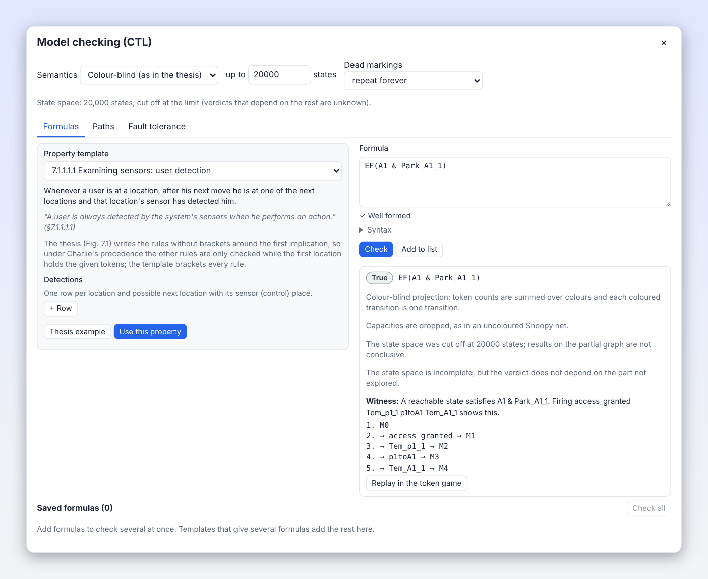
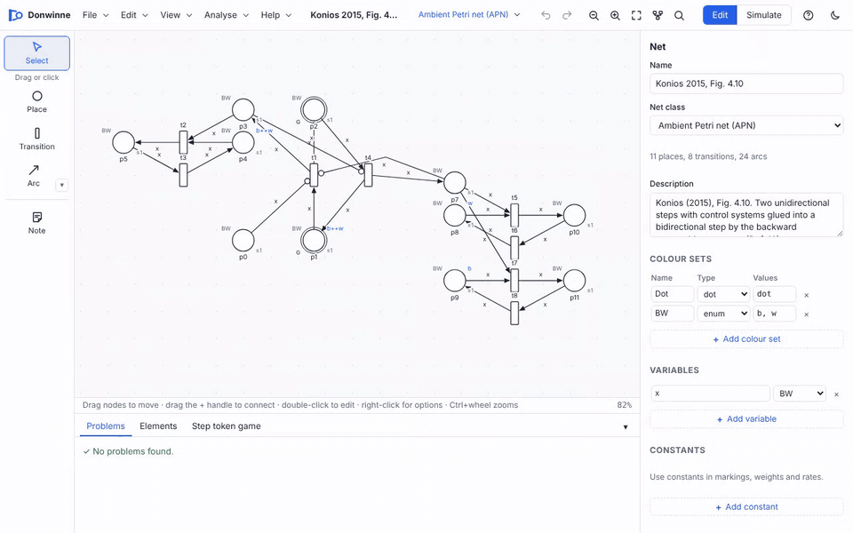
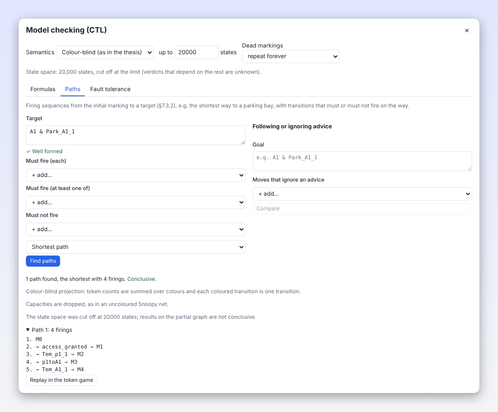
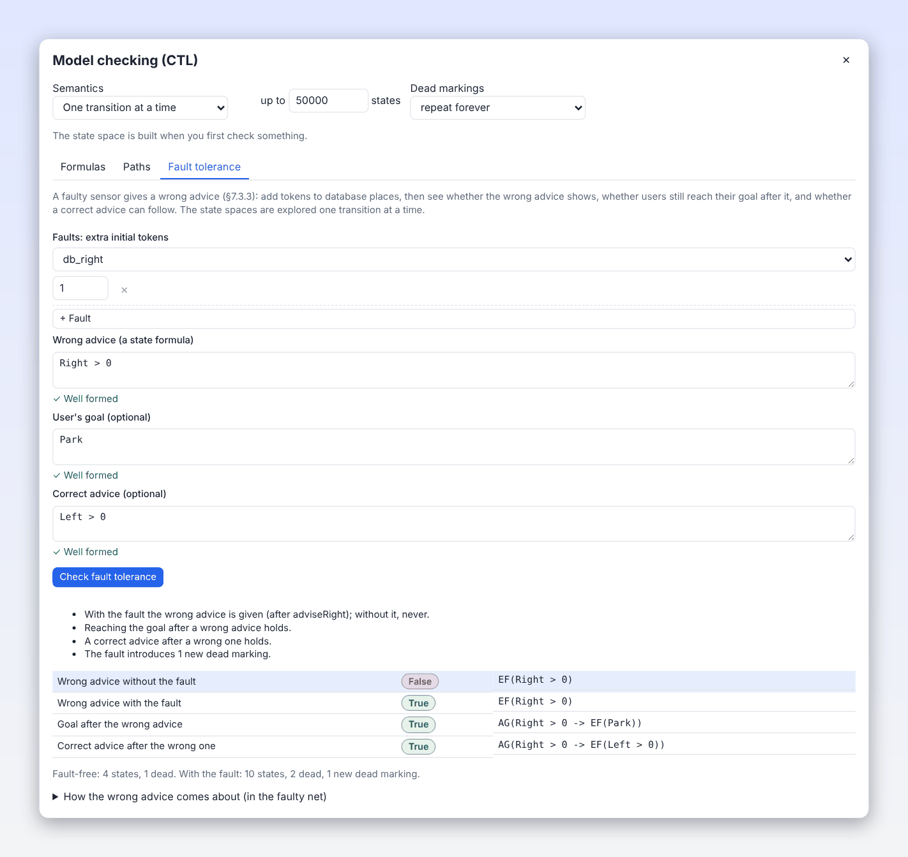

# CTL model checking

Donwinne checks properties written in **Computation Tree Logic** (CTL) on the state space of a net. The syntax is
that of the Charlie analysis tool, as used in chapter 7 of Konios's thesis, so formulas from the thesis can be typed
as printed. Results come with a witness or counterexample that you can replay in the token game. The same dialog
also finds paths and checks fault tolerance.

This page is the reference. For the ambient method as a whole, see [Ambient Petri nets](ambient-petri-nets.md).



## Contents

- [Opening the dialog](#opening-the-dialog)
- [CTL in five minutes](#ctl-in-five-minutes)
- [Syntax](#syntax)
- [Settings: semantics, limits and dead markings](#settings-semantics-limits-and-dead-markings)
- [Checking formulas](#checking-formulas)
- [Witnesses and counterexamples](#witnesses-and-counterexamples)
- [Property templates](#property-templates)
- [Path queries](#path-queries)
- [Fault tolerance](#fault-tolerance)
- [Tips](#tips)
- [Source files](#source-files)

## Opening the dialog

| Net | Menu item |
| --- | --- |
| APN or T-APN | **Analyse > Ambient (Konios) > Model checking (CTL)…** |
| Any other Petri net class | **Analyse > Model checking (CTL)…** |
| Desktop app | **Analyse > Model Checking (CTL)…** in the native menu (also in its "Ambient (Konios)" submenu) |

The dialog **Model checking (CTL)** has three tabs: **Formulas**, **Paths** and **Fault tolerance**. Its settings
row (semantics, state limit, dead markings) applies to all three.

## CTL in five minutes

A Petri net's behaviour is a tree: from the initial marking, every enabled transition (or step) leads to a new
marking, and so on. CTL talks about this tree. Each temporal operator is a pair: a **path quantifier** (A: on all
paths, E: on some path) followed by a **state operator** (X: next state, F: some future state, G: every state from
now on, U: until).

| Formula | Reads as | Example |
| --- | --- | --- |
| `EX φ` | Some next state satisfies φ | `EX(p2 > 0)`: one firing can mark p2 |
| `AX φ` | Every next state satisfies φ | `AX(p2 > 0)`: whatever fires, p2 is marked after |
| `EF φ` | φ can be reached | `EF(done == 1)`: the goal is reachable |
| `AF φ` | φ is reached on every path | `AF(done == 1)`: the goal is inevitable |
| `EG φ` | Some path keeps φ forever | `EG(p1 > 0)`: p1 can stay marked forever |
| `AG φ` | φ holds in every reachable state | `AG(sum(p1, p2) == 1)`: an invariant |
| `E[φ U ψ]` | Some path keeps φ until ψ holds | `E[waiting > 0 U served > 0]` |
| `A[φ U ψ]` | Every path keeps φ until ψ holds | `A[advice != 0 U db == 0]` |

Common patterns:

| Pattern | Meaning |
| --- | --- |
| `AG(!(bad))` | Safety: a bad state never happens |
| `AG(request -> AF(response))` | Every request is eventually answered |
| `AG(EF(home))` | The home state can always be reached again |
| `AG(EF(deadlock))` | The system can always come to rest |
| `!EF(deadlock)` | The system never deadlocks |

## Syntax

### Atoms

| Atom | Meaning |
| --- | --- |
| `p` | Place *p* is marked: the same as `p != 0` |
| `p == 2`, `p = 2` | Comparison of token counts. Operators: `==` `=` `!=` `<>` `<` `<=` `>` `>=` |
| `p >= q` | Two places can be compared |
| `p[c]` | The tokens of colour *c* on place *p* (no space before `[`). Write the colour as in the place's colour set, tuples as `p[1,a]` |
| `sum(p, q, r) >= 2` | The total of several places |
| `"my place" > 0` | A name with spaces, or a name that is a keyword, in double quotes |
| `true`, `false` (also `TRUE`, `FALSE`) | Constants |
| `deadlock` | No transition (or step) can fire |
| `fireable(t)`, `enabled(t)` | Transition *t* can fire. For a coloured transition, any binding; a single binding is written `fireable(t<x=a>)` |

Token counts are whole numbers. A coloured place's name on its own counts **all** its tokens, summed over colours:
in the ambient garage, `A1 == 2` means two tokens of any colours on A1, and `A1[1]` counts only user 1.

Transitions of coloured nets are named by their bindings, as in the unfolded net: `access_granted<x=1>`. A coloured
transition's plain name stands for any of its bindings.

### Operators and precedence

From tightest to loosest:

| Level | Operators | Notes |
| --- | --- | --- |
| 1 | `!` (also `~`, `not`), and `EX` `AX` `EF` `AF` `EG` `AG` | Unary; the temporal operators bind like `!` |
| 2 | `&` (also `&&`, `*`, `and`) | And |
| 3 | `\|` (also `\|\|`, `+`, `or`) | Or. Note that `+` is **or**, as in Charlie, not addition |
| 4 | `->` (also `=>`) | Implication, **left-associative** as in Charlie: `a -> b -> c` is `(a -> b) -> c` |
| 5 | `<->` (also `<=>`) | Equivalence |

Until is written `E[φ U ψ]` or `A[φ U ψ]`; round brackets also work: `A(φ U ψ)`.

Other rules:

- A trailing `;` is ignored, and so are comments: `// to the end of the line` and `/* … */`.
- Keywords (`EX`, `AX`, `EF`, `AF`, `EG`, `AG`, `E`, `A`, `U`, `true`, `false`, `TRUE`, `FALSE`, `deadlock`,
  `fireable`, `enabled`, `sum`, `not`, `and`, `or`) must be quoted to be used as place names: `"A" > 0`.
- Only place names, colours, sums and numbers can be compared. `(p) > 0` is an error ("remove the brackets around the
  place name"), and so is a number on its own.
- Names may contain letters, digits, `_`, `'` and `.`, and start with a letter or `_`.

### Examples

```
EF(deadlock)
AG(p1 -> EF(p2))
AG(!(p1 > 0 & p2 > 0))                     // mutual exclusion
AG(sum(free, busy) == 3)                   // an invariant
AG(request -> A[request U grant])
EF(A1 & Park_A1_1) & EF(A2 & Park_A2_2)    // both cars can reach their goal
AG(entrance[1] -> EF(A1[1]))               // car 1 at the entrance can still reach bay A1
fireable(access_granted<x=2>)
```

### Errors and suggestions

The formula box checks as you type. A good formula shows **✓ Well formed**. Otherwise the box shows the error with
its line and column, what was expected there, and for an unknown name **Did you mean** with close matches (click one
to use it). The **Syntax** block under the box is a short reminder of this section.

## Settings: semantics, limits and dead markings

### Semantics

The state space a formula is checked on depends on the **Semantics** setting:

| Semantics | Offered for | State space |
| --- | --- | --- |
| **Maximal steps** (default for ambient nets) | APN, T-APN | The CRG with maximal steps only: every user who can act, acts |
| **All steps: CRG(N)** | APN, T-APN | The full concurrent reachability graph: every enabled step |
| **One transition at a time** | All nets (the only choice for non-ambient nets) | The interleaving reachability graph of the coloured net |
| **Colour-blind (as in the thesis)** | APN, T-APN | The interleaving graph with colours ignored: token counts summed over colours, one transition per coloured transition, no capacities. This is how Charlie reads a Snoopy net, and how the thesis checked its formulas |

`EX` and `AX` depend on the semantics most: "next" is one firing, one step or one maximal step.

### State limit

"up to **N** states" bounds the exploration (100 to 2,000,000). The default is 20,000 for ambient nets and 50,000
for other nets. Step semantics also stop at 40 edges per state on average and 2000 steps per state.

The state space is built when you first check something, then reused for every formula and path query until you
change the model, the semantics or the limit. The status line says "State space: N states, complete" or "cut off at
the limit (verdicts that depend on the rest are unknown)". **Stop** cancels a long build.

### Unknown verdicts

When the state space is cut off, Donwinne checks the formula **three-valued**: for each state it knows where the
formula certainly holds and where it might. If the answer in the initial state does not depend on the unexplored
part, you still get **True** or **False**, with the note "The state space is incomplete, but the verdict does not
depend on the part not explored." Otherwise the result is **Unknown**, and the dialog says whether the formula holds
on the explored part. Raise the limit, or use a smaller semantics (maximal steps), to decide it.

### Dead markings

"Dead markings" says how a path that reaches a dead marking (nothing can fire) is read:

| Choice | Meaning |
| --- | --- |
| **repeat forever** (default) | The dead marking repeats itself, as if it had a self-loop. `EX φ` and `AX φ` both mean φ there. This is the textbook way to make every path infinite |
| **end the path** | Paths may end in a dead marking. There, `EX φ` is false and `AX φ` is true |

The other operators give the same answers under both readings.

## Checking formulas

The **Formulas** tab:

1. Type a formula in the box (or fill it from a [template](#property-templates)).
2. Press **Check**. The result shows **True**, **False** or **Unknown**, the formula in canonical form (with the
   brackets that matter, every implication chain bracketed), notes, and a trace.
3. Press **Add to list** to keep it. The **Saved formulas** list has columns Property, Result and Expected, and
   **Check all** checks every saved formula on the same state space. A formula from a template carries its expected
   result, and the Expected column says "as expected" or, in red, "expected true" or "expected false". **Clear**
   empties the list; the cross removes one formula. Click a row to load it back into the box.

## Witnesses and counterexamples

Where CTL allows one, the result includes a path from the initial marking that **shows** why:

| Result | Trace |
| --- | --- |
| `EF φ` true | **Witness**: a path to a state where φ holds |
| `AG φ` false | **Counterexample**: a path to a state where φ fails |
| `EG φ` true, `AF φ` false | A path that loops forever (or ends in a dead marking) |
| `E[φ U ψ]` true | A path through φ-states to a ψ-state |
| `EX φ` true, `AX φ` false | One firing or step |

The trace is shown as `M0 → label → M1 → …`. Hover over a marking to see its marked places. `↺` marks the state a
looping path returns to ("then back to M*k* and around again"), and "dead marking: nothing can fire" ends a path in
a deadlock. A short sentence explains the trace in plain English. If the initial marking alone shows the result, the
dialog says "The initial marking alone shows it."



### Replaying a trace

Press **Replay in the token game**. The dialog closes and the token game plays the trace from the initial marking;
the history in the bottom panel holds every firing or step, so you can step back and forth with the arrow keys.

- In an **APN or T-APN**, each step is fired as a step of structured transitions.
- In other nets, each firing uses the binding named in the trace.
- A **colour-blind** trace cannot be replayed: it does not say which colour (user) moved. The app says so; check the
  formula again with a coloured semantics to get a replayable trace.

## Property templates


The **Property template** list holds the 22 properties of chapter 7 of the thesis, in six groups. Choose one to see
its summary, the thesis's own statement (with its section) and, where useful, a note. Fill the fields (places, token
counts, rules; **+ Row** adds a rule), or press **Thesis example** to use the arguments the thesis used for the
ambient garage. Then press **Use this property**: the formula goes into the box, with its expected result. Templates
that give two formulas put the second in the saved list.

The formulas below are the **Thesis example** of each template, shortened with `…` where a rule repeats for every
location or advice. Place names are those of the ambient garage.

| # | Template (section) | Formula (thesis example) | Meaning | Expected |
| --- | --- | --- | --- | --- |
| | **Ambient guidance (7.1.1.1)** | | | |
| 1 | Examining sensors: user detection (7.1.1.1.1) | `AG((entrance == 2 -> AX((p1 > 0 & ctrl_p1 > 0))) & (p1 == 2 -> AX((p2 > 0 & ctrl_p2 > 0) \| (A1 > 0 & ctrl_A1 > 0))) & …)` | After every move, the user is at a next location and its sensor has detected him | true |
| 2 | Examining sensors: no overlapping sensors (7.1.1.1.1) | `AG((p1 == 2 & ctrl_p1 == 2) -> !(p2 == 2 & ctrl_p2 == 2))` | A user is never detected at two locations at once | true |
| 3 | User's initiative: ignoring an advice (7.1.1.1.2) | `AG((p1 > 0 & Left_p1_1 > 0 -> EX(p2)) & (p1 > 0 & Forward_p1_2 > 0 -> EX(A1)) & …)` | While an advice is shown, the user can still go elsewhere | true |
| 4 | User's initiative: reaching the goal after ignoring advices (7.1.1.1.2) | `AG(((p1 > 0 & Left_p1_1 > 0 -> EX(p2)) & (p2 > 0 & Back_p2_1 -> EF(A1))) \| (…))` | A user who ignores an advice and is redirected can still reach the goal | true |
| | **Ambient information (7.1.1.2)** | | | |
| 5 | Examining displays (7.1.1.2.1) | `AG((EF(Left_p1_1 == 0) \| EF(Left_p1_1 != 0)) & …)` | Every display can be off or on | true |
| 6 | Examining leak of information (7.1.1.2.2) | `AG((db_p1_1 == 0 -> !(Left_p1_1 > 1)) & …)` | An advice is never shown to more users than the database allows | true |
| | **Common ambient (7.1.1.3)** | | | |
| 7 | Notifying the user (7.1.1.3.1) | `AG(((p1 & ctrl_p1 -> EX(p1 & Left_p1_1)) & (p1 & Left_p1_1 -> EX(p2 & ctrl_p2))) & …)` | Each detected action can be followed by its advice, and each advice by the next detected action | true |
| 8 | Alternation of actions (7.1.1.3.2) | `AG((entrance -> p1) -> AX((p1 == 2 & ctrl_p1_1 == 0 & ctrl_p1_2 == 0) -> (Left_p1_1 \| Forward_p1_2))) & AG(… -> AX(… -> (p2 \| A1)))` | User actions and system advices alternate | true |
| 9 | Restricting user's actions (7.1.1.3.3) | `AG((entrance -> p1) -> AX((p1 > 0 & ctrl_p1_1 == 0 & ctrl_p1_2 == 0) -> (Left_p1_1 \| Forward_p1_2)))` and `AG((entrance -> p1) -> AX(p1 -> p2))` | An advice always follows a move (true); the user cannot move twice in a row (the second formula is expected to fail) | true, false |
| 10 | Examining system's actions (7.1.1.3.4) | `AG((((entrance -> AX(p1)) -> EX(Left_p1_1 \| Forward_p1_2)) -> EX(db_p1_1 \| db_p1_2)) & …)` | Each interaction is a user action, a system response and a database refill | true |
| | **General guidance (7.1.2.1)** | | | |
| 11 | Examining redundancy of advices (7.1.2.1.1) | `EF(Back_p1_2) & EF(Left_p1_1) & EF(Right_p1_1) & EF(Forward_p1_2) & EF(Park_A1_1) & EF(Park_A2_2) & EF(Bye_exit_12)` | Every advice can be given at some point | true |
| 12 | Returning to previous states (7.1.2.1.2) | `AG((p1 -> EX(A1)) & (A1 -> EX(p1))) & AG((p1 -> EX(p2)) & (p2 -> EX(p1))) & …` | Between neighbouring locations the user can go both ways | true |
| | **Common general (7.1.2.2)** | | | |
| 13 | Relating advice with database resources (7.1.2.2.1) | `AG(Left_p1_2 -> A[Left_p1_2 != 0 U db_p1_1_2 == 0]) & …` | An advice stays shown until its database place is used up | true |
| 14 | Refilling the database resources (7.1.2.2.2) | `AG((Left_p1_1 -> EX(db_p1_1)) & (Forward_p1_2 -> EX(db_p1_2)) & …)` | After each advice, its database place can be refilled in the next step | true |
| 15 | Quantity of resources: upper bound (7.1.2.2.3) | `AG(!(entrance > 2) & !(exit > 2) & !(p1 > 2) & …)` | No chosen place ever holds more than the bound | true |
| 16 | Quantity of resources: lower bound (7.1.2.2.3) | `AG(!(entrance < 0) & !(exit < 0) & …)` | No chosen place ever holds fewer than the bound | true |
| 17 | Reaching user's goal (7.1.2.2.4) | `EF(A1 & Park_A1_1) & EF(A2 & Park_A2_2)` | Each user's goal can be reached | true |
| 18 | Reaching terminal state (7.1.2.2.5) | `AG(EF(exit == 2 & db_p1_1 & … & db_exit_12 == 2))` | From every state, the terminal state can still be reached | true |
| 19 | Interacting with users (7.1.2.2.6) | `AF(EF((A2 & Back_A2_1) & (p1 & Forward_p1_2)))` | The system always gets to a point where it can serve an authorised and an unauthorised user at once | true |
| 20 | Dealing with improper actions (7.1.2.2.7) | `AG(A1 & Back_A1_2 -> !(EX(p1 & ctrl_p1_1))) & AG(A2 & Back_A2_1 -> !(EX(p2 & ctrl_p2_1)))` | Claims an improper action is never followed by a warning; a working system makes it fail | false |
| | **Fault tolerance (7.3.3)** | | | |
| 21 | Fault tolerance: reaching the goal after a wrong advice | `AG(p2 == 2 & Back_p2_1 == 2 -> EF(exit & Bye_exit_12))` | After the faulty system's wrong advice, the goal can still be reached | true |
| 22 | Fault tolerance: correct advice after a wrong one | `AG(p2 == 2 & Back_p2_1 == 2 -> EF(p2 == 2 & Back_p2_1 == 1 & Right_p2_2))` | After a wrong advice, the correct one can still follow | true |

"Expected" is the thesis's verdict, which the dialog compares with yours. Notes the templates show:

- **User detection** (1): the thesis writes the rules without brackets around the first implication, so under
  Charlie's precedence the later rules would only be checked while the first location holds the tokens. The
  template brackets every rule.
- **Examining displays** (5): as written in the thesis the formula holds in every net, since each state itself has
  `d == 0` or `d != 0`. `AG(EF(d == 0)) & AG(EF(d != 0))` would check that every display can still switch both ways.
- **Alternation of actions** (8): the thesis's formula reads, under Charlie's precedence, `(AG(…) & AG(…)) -> AX(…)`,
  so its last part is only checked in the initial state. The template puts that part inside AG.
- **Examining system's actions** (10): implication associates to the left, so each rule reads
  `((user action) -> advice) -> refill`, as the thesis's formula was checked.
- **Lower bound** (16): with the thesis's bound 0 the formula holds in every net, since markings are never negative.
- **Reaching user's goal** (17): `EF` checks that the goal can be reached on some run, which is what the thesis's
  formula expresses.
- **Fault tolerance** (21, 22): check them on the net with the fault injected, which is what the
  [Fault tolerance](#fault-tolerance) tab does.

How the thesis's verdicts come out in Donwinne, reading by reading, is in
[Reproducing the thesis's results](ambient-petri-nets.md#reproducing-the-thesiss-results).

## Path queries

The **Paths** tab finds firing sequences from the initial marking to a **target** (Sec. 7.3.2 of the thesis), for
example the shortest way to a parking bay.



| Field | Meaning |
| --- | --- |
| **Target** | A formula whose states end the path. Charlie's filter `Left_p1_1 * A1 * Park_A1_1` works (`*` is "and"), and so does any CTL formula, temporal operators included |
| **Must fire (each)** | Transitions that must each fire at least once on the way |
| **Must fire (at least one of)** | At least one of these must fire |
| **Must not fire** | Transitions that must not fire |
| **Shortest path** / **All paths (shortest first)** | One shortest path, or up to 20 paths, shortest first, up to the shortest length plus 8 |

Press **Find paths**. The result says how many paths were found and the length of the shortest one, then
**Conclusive.** (the whole state space was searched) or "Not conclusive: the state space was cut off." Each path
shows its firings (or steps, under step semantics), the places it re-enters, and **Replay in the token game**.

The path search uses the state space of the chosen **Semantics**. A coloured transition's name in the "must fire"
lists stands for any of its bindings.

### Following or ignoring advice

The section **Following or ignoring advice** compares two ways to the same goal:

1. Write the **Goal** (a state formula).
2. List the **Moves that ignore an advice** (transitions).
3. Press **Compare**.

"Following" is the shortest path to the goal where none of those moves fire; "Ignoring" is the shortest path where at
least one of them fires. The summary gives both lengths and firing sequences (or says that the goal cannot be
reached that way), and the two paths are shown below it, ready to replay.

Example on the ambient garage, **One transition at a time**: the target `Left_p1_1 * A1 * Park_A1_1` gives a
conclusive shortest path of 4 firings: `access_granted<x=1>`, `Tem_p1_1<x=1>`, `p1toA1<x=1>`, `Tem_A1_1<x=1>`.

## Fault tolerance

The **Fault tolerance** tab models a faulty sensor that gives a wrong advice (Sec. 7.3.3): extra tokens on database
places make the system believe something false.



| Field | Meaning |
| --- | --- |
| **Faults: extra initial tokens** | One row per fault: a place (a coloured place with its colour, for example `db_p1_1[1]`) and how many tokens to add (negative removes). **+ Fault** adds a row |
| **Wrong advice (a state formula)** | What the wrong advice looks like, for example `p2 == 2 & Back_p2_1 == 2` |
| **User's goal (optional)** | For example `exit & Bye_exit_12` |
| **Correct advice (optional)** | For example `p2 == 2 & Back_p2_1 == 1 & Right_p2_2` |

Press **Check fault tolerance**. Donwinne builds two state spaces, without and with the fault (one transition at a
time, on the unfolded net, up to the dialog's state limit) and reports:

| Row | Formula | What you hope for |
| --- | --- | --- |
| Wrong advice without the fault | `EF(wrong)` on the fault-free net | False: the correct system never gives it |
| Wrong advice with the fault | `EF(wrong)` on the faulty net | True: the fault shows (with "How the wrong advice comes about (in the faulty net)") |
| Goal after the wrong advice | `AG(wrong -> EF(goal))` on the faulty net | True: users still reach their goal |
| Correct advice after the wrong one | `AG(wrong -> EF(correct))` on the faulty net | True: the system can recover |

Below the table: the sizes of both state spaces, their dead markings, and the **new dead markings** that only the
faulty net reaches, plus a summary line per finding (including changes in the largest number of tokens on one place).

Note that on the fault-free case models, the thesis's fault tolerance formulas (Figs 7.55 and 7.57) hold vacuously:
the wrong advice never shows, so the implication is always true. That is why the faults must be injected first.

## Tips

- **Bracket generously.** `AG p1 -> p2` is `(AG p1) -> p2`, because temporal operators bind like `!`. Write
  `AG(p1 -> p2)`.
- **Chains of implications** associate to the left: write `a -> (b -> c)` if that is what you mean.
- **`+` is "or"**, not addition. To add token counts, use `sum(p, q)`.
- **Coloured places**: `p` counts all colours; `p[c]` counts one. In ambient nets, colours are users, so
  `A1[1]` asks about car 1.
- **Start small.** Use **Maximal steps** on ambient nets first: the case studies' maximal-step graphs are complete in
  a fraction of a second (82 states for the garage). Use **All steps: CRG(N)** or **One transition at a time** when
  you need every interleaving, and raise "up to" as needed.
- **Unknown is honest.** It means the verdict depends on states that were not explored. Raise the limit before
  drawing conclusions.
- **Name a template's places for your net.** The **Thesis example** arguments use the garage's place names; on another
  net the formula box marks unknown names and suggests close ones.
- **Reproducing the thesis**: construct the T-APN, choose **Colour-blind (as in the thesis)** and set "up to" to at
  least 573,441 states for the garage. See
  [Reproducing the thesis's results](ambient-petri-nets.md#reproducing-the-thesiss-results).

## Source files

| File | What it does |
| --- | --- |
| [ctl.ts](../packages/analysis/src/ctl.ts) | Parser, printer (`formatCtl`), name resolution and error messages |
| [check.ts](../packages/analysis/src/check.ts) | Explicit-state labelling checker, three-valued checking, witnesses and counterexamples |
| [ts.ts](../packages/analysis/src/ts.ts) | Transition systems: interleaving, coloured or colour-blind, with limits |
| [stepgraph.ts](../packages/analysis/src/stepgraph.ts) | Turns a concurrent reachability graph into a transition system |
| [projection.ts](../packages/analysis/src/projection.ts) | The colour-blind projection |
| [templates.ts](../packages/analysis/src/templates.ts) | The 22 property templates |
| [paths.ts](../packages/analysis/src/paths.ts) | Path queries and the advice comparison |
| [fault.ts](../packages/analysis/src/fault.ts) | Fault injection and the fault tolerance report |
| [ctl.ts (editor)](../packages/editor/src/ctl.ts) | Semantics choices, building the state space, replaying traces |
| [CtlDialog.tsx](../packages/editor/src/CtlDialog.tsx) | The dialog |
