# The editor

This page describes everything you can do in Donwinne's editor: the menus, the toolbar and palette, drawing and editing, the panels, keyboard shortcuts and touch gestures, and how the layout changes on phones, tablets and desktops.

For what the different kinds of net mean, see [Net classes](net-classes.md). For running nets, see [Simulation](simulation.md); for properties and invariants, see [Analysis](analysis.md); for opening and saving other formats, see [File formats](file-formats.md).

## Contents

- [A tour of the window](#a-tour-of-the-window)
- [Menus](#menus)
- [The top bar](#the-top-bar)
- [The palette](#the-palette)
- [Drawing a net](#drawing-a-net)
- [Editing in place](#editing-in-place)
- [Selecting, moving and arranging](#selecting-moving-and-arranging)
- [Copy, cut, paste and duplicate](#copy-cut-paste-and-duplicate)
- [Auto layout](#auto-layout)
- [Subnets and breadcrumbs](#subnets-and-breadcrumbs)
- [Navigating the canvas](#navigating-the-canvas)
- [Find](#find)
- [Notes and colours](#notes-and-colours)
- [The properties panel](#the-properties-panel)
- [The bottom panel](#the-bottom-panel)
- [Undo, auto-save and themes](#undo-auto-save-and-themes)
- [Keyboard shortcuts](#keyboard-shortcuts)
- [Touch gestures](#touch-gestures)
- [Phones, tablets and desktops](#phones-tablets-and-desktops)
- [Installing and working offline](#installing-and-working-offline)
- [The desktop app](#the-desktop-app)

## A tour of the window

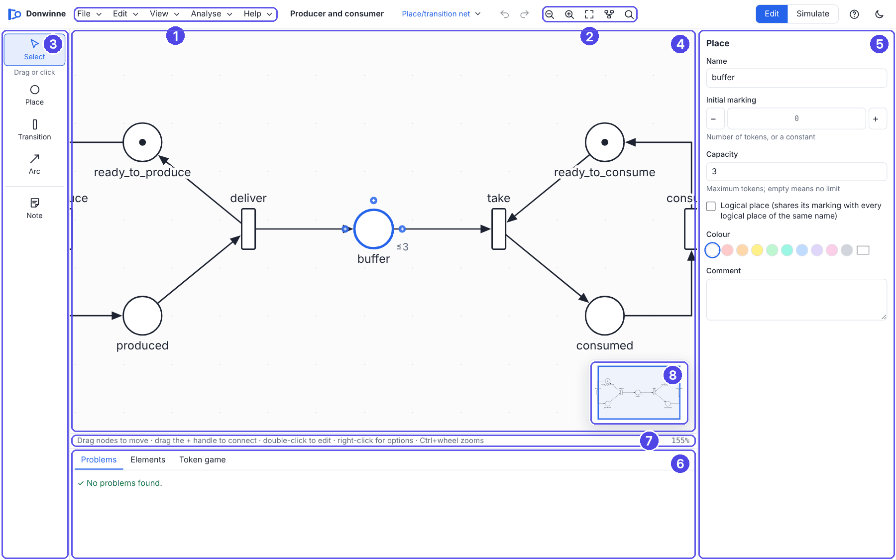

| No. | Area | What it is for |
| --- | --- | --- |
| 1 | Menu bar | File, Edit, View, Analyse and Help menus. |
| 2 | Toolbar | Net name, net class, undo and redo, zoom, auto layout, find, and the **Edit** / **Simulate** switch. |
| 3 | Palette | Tools for selecting and for adding places, transitions, arcs and notes (or events and gates in fault trees). |
| 4 | Canvas | Where the net is drawn. |
| 5 | Properties panel | Details of the selected element, or of the whole net when nothing is selected. |
| 6 | Bottom panel | Problems, the element table, the token game, simulation plots and fault tree analysis. |
| 7 | Status bar and zoom | Hints for the current tool, the pointer's coordinates and the zoom level. |
| 8 | Overview map | A small map of the whole page; click or drag in it to move the view. |

When you start the app with nothing open, the **Create a new model** dialog appears. It shows every kind of model grouped as *Petri nets*, *Time and rates*, *Coloured with rates*, *Fuzzy*, *Ambient (Konios)*, *Special* and *Reliability*, each with a one-line description. Under **Or start from** you can open the ambient building blocks, open a file (Donwinne, Snoopy, PNML or ANDL) or load one of the examples.

## Menus

On a desktop-sized window the menus sit in the menu bar. On narrower screens a **Menu** button opens a drawer with the same menus plus a **Net class** section. Keyboard shortcuts are shown as `Ctrl+` on Windows and Linux and as `⌘` on a Mac.

### File

| Item | Shortcut | What it does |
| --- | --- | --- |
| New… | Ctrl+N | Opens the **Create a new model** dialog. |
| New APN from building blocks… | | Opens the ambient building blocks dialog (see [Ambient Petri nets](ambient-petri-nets.md)). |
| Open… | Ctrl+O | Opens a Donwinne file (`.pns.json` or `.json`) or a PNML file (`.pnml`, `.xml`). |
| Save | Ctrl+S | Saves to the current file, or asks for a name the first time. |
| Save as… | Ctrl+Shift+S | Saves under a new name. The suggested name is `<net name>.pns.json`. |
| Import (Snoopy, PNML, ANDL)… | | Reads a model written by another tool: Snoopy files, PNML, ANDL, CANDL or a DNF fault tree. |
| Export as ▸ | | Lists the formats that can hold this kind of net. A format that cannot hold this particular net is greyed out with the reason underneath. |
| Print… | Ctrl+P | Prints the current page of the drawing. |
| Examples ▸ | | Opens one of the bundled example models. |

The examples are: Producer and consumer (place/transition net), Priority access with read, inhibitor and reset arcs (extended net), Konios's Fig. 3.1, 4.9, 4.10 and 4.11 (APNs), the ambient garage and the ambient conference room (APNs), Predator and prey (continuous), Radioactive decay (stochastic), Traffic light (timed), Scale (music) and Water supply (fault tree).

Exporting, importing and printing are described in detail in [File formats](file-formats.md).

### Edit

| Item | Shortcut | Notes |
| --- | --- | --- |
| Undo | Ctrl+Z | |
| Redo | Ctrl+Shift+Z (also Ctrl+Y) | |
| Cut | Ctrl+X | |
| Copy | Ctrl+C | |
| Paste | Ctrl+V | |
| Duplicate | Ctrl+D | |
| Delete | Del | Backspace works too. |
| Select all | Ctrl+A | Everything on the current page. |
| Select only ▸ | | All places on this page, All transitions on this page, All arcs on this page. Not shown for fault trees. |
| Find… | Ctrl+F | See [Find](#find). |
| Group into subnet | Ctrl+G | See [Subnets](#subnets-and-breadcrumbs). Not shown for fault trees. |
| Auto layout (flow) | Ctrl+L | See [Auto layout](#auto-layout). |
| Auto layout (top to bottom) | | |
| Auto layout (organic) | | |
| Lay out selection only | | Needs at least two selected nodes. |

Editing items are disabled while the token game is running.

### View

| Item | Shortcut | Notes |
| --- | --- | --- |
| Zoom in | Ctrl++ (or Ctrl+=) | |
| Zoom out | Ctrl+− | |
| Zoom to fit | F (or Ctrl+0) | Fits the whole page in the window. |
| Overview map | M | A tick shows when it is on. |
| Snap to grid | G | A tick shows when it is on. Nodes snap to a 10 unit grid. |
| Bottom panel | B | Shows or hides the bottom panel. |
| Element table and hierarchy | | Opens the **Elements** tab of the bottom panel. Not shown for fault trees. |
| Light theme, Dark theme, Match system | | The current choice has a tick. |

### Analyse

The Analyse menu depends on the net class.

| Item | Shown for | See |
| --- | --- | --- |
| Play the token game / Stop the token game (S) | Petri nets except ambient and freestyle nets | [Simulation](simulation.md#the-token-game) |
| Simulate over time and plot… | Stochastic, continuous, hybrid, and their coloured and fuzzy variants | [Simulation](simulation.md#simulating-over-time) |
| Net properties and invariants… | Petri nets except freestyle | [Analysis](analysis.md#net-properties-and-invariants) |
| Reachability graph… | Petri nets except freestyle | [Analysis](analysis.md#reachability-graph) |
| Model checking (CTL)… | Petri nets except freestyle | [CTL model checking](ctl.md) |
| Unfold to an uncoloured net | Coloured classes | [Simulation](simulation.md#unfolding) |
| Treat as an APN (ambient net) | Coloured nets | [Ambient Petri nets](ambient-petri-nets.md) |
| Fault tree analysis… | Fault trees | [Analysis](analysis.md#fault-tree-analysis) |
| Check the model | Always | Opens the **Problems** tab. |

For APNs and T-APNs the menu starts with an **Ambient (Konios)** group: Play the step token game (S), Concurrent reachability graph…, APN properties…, Model checking (CTL)…, Construct T-APN (APNs only), Check equivalence…, Building blocks… and Compose steps… (APNs only). In a T-APN that was not constructed in this session, **Check equivalence…** is greyed out with the hint "Open the APN and check equivalence there". These are described in [Ambient Petri nets](ambient-petri-nets.md).

### Help

- **Quick guide and shortcuts** (?) opens the **Quick guide** dialog: short instructions for drawing, touch screens, running nets and ambient nets, and a table of shortcuts.
- **About** shows the version and licence.

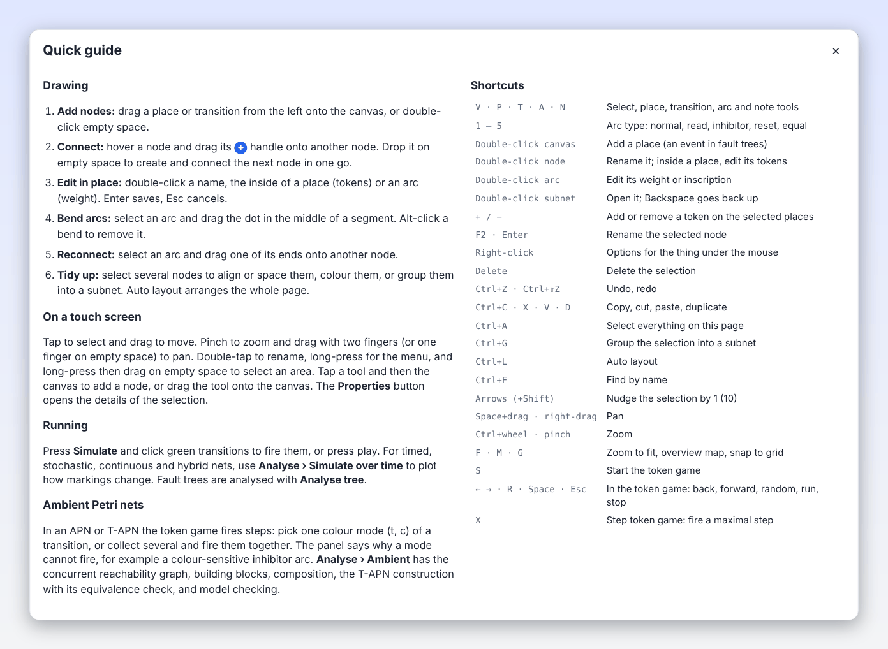

## The top bar

From left to right on a desktop:

- The **net name**. Click it to rename the net. A dot (●) after it means there are unsaved changes.
- The **net class badge**, for example *Place/transition net*. Click it to switch to another class (see [Switching class](net-classes.md#switching-class)). For fault trees the badge is only a label, because a fault tree cannot become a Petri net.
- **Undo** and **Redo** buttons.
- **Zoom out**, **Zoom in**, **Zoom to fit (F)**, **Auto layout (Ctrl+L)** and **Find (Ctrl+F)**.
- The **Edit** / **Simulate** switch. **Simulate** starts the token game (S). It is hidden for freestyle nets and fault trees; fault trees have an **Analyse tree** button instead, which opens the fault tree tab and runs the analysis.
- **Help** (?), a **Properties** button (only when the properties panel is not docked) and a theme button that switches between the light and dark theme.

While the token game runs, the palette is replaced by the simulation controls: **Back to the initial marking**, **Step back (←)**, **Step forward (→)**, **Fire a random enabled transition (R)**, **Run random firings (Space)** with a speed slider from 1 to 30 firings per second, a sound button for music nets, and **Keep this marking**. See [Simulation](simulation.md#the-token-game).

## The palette

| Tool | Key | What it does |
| --- | --- | --- |
| Select | V | Select and move. |
| Place | P | Adds a place. Called *Continuous place* in continuous nets. |
| Transition | T | Adds a transition. Called *Stochastic transition* in stochastic and hybrid nets and *Continuous transition* in continuous nets. |
| Arc | A | Draws arcs. The ▾ marker opens the arc type chooser. |
| Note | N | Adds a free text comment. |

Use a tool in either of two ways: click it and then click the canvas, or drag it from the palette onto the canvas. Place and transition tools stay active after you add a node, so you can add several in a row; press V or Esc to go back to selecting. The note tool returns to Select after one note.

### The arc type chooser

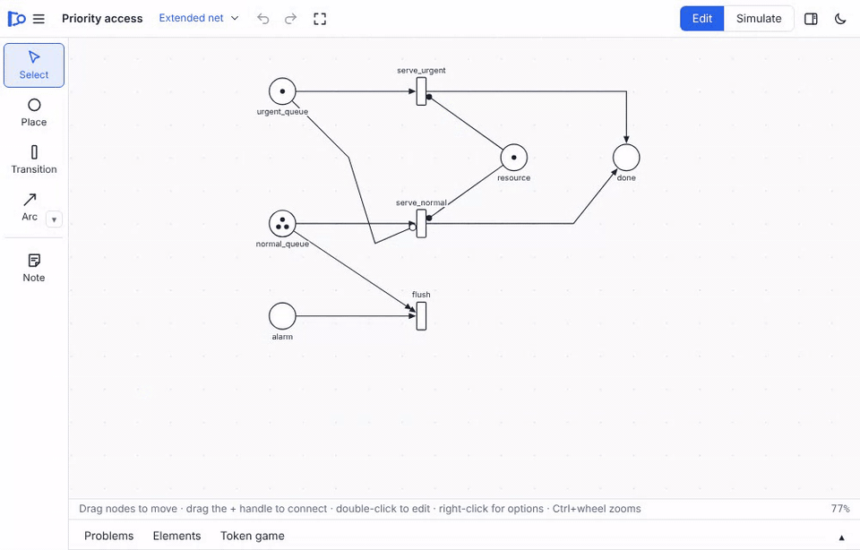

When the net class allows more than one kind of arc, the arc tool shows a small ▾. Open the **Arc type** popup by clicking the arc tool again while it is active, by right-clicking it, by clicking the ▾, or by pressing and holding it on a touch screen. The popup lists the kinds allowed in the current class with a short explanation and their keys:

| Key | Kind | Meaning |
| --- | --- | --- |
| 1 | Normal | Consumes tokens from the place, or produces them into it. |
| 2 | Read | Needs the tokens in the place but does not consume them. |
| 3 | Inhibitor | Blocks the transition while the place holds at least this many tokens (of the given colour). |
| 4 | Reset | Empties the place when the transition fires; never blocks it. |
| 5 | Equal | Enables the transition only when the place holds exactly this many tokens. |
| 6 | Modifier | Lets the place's marking appear in the transition's rate without testing or changing it. |

The keys work anywhere on the canvas: they choose the kind and switch to the arc tool. In a place/transition net only normal arcs are offered, but if you draw a read, inhibitor, reset or equal arc anyway (with keys 2 to 5, or by changing an arc's type), the net becomes an extended net and a message says "Switched to an extended net to allow this arc type". Which kinds each class allows is listed in [Net classes](net-classes.md#arc-types).

### The fault tree palette

In fault trees the palette holds events and gates instead: **Top event**, **Event** (intermediate), **Basic event**, **Undeveloped**, **AND**, **OR**, **XOR**, **k-of-n**, **NOT** and **Inhibit**. Extended fault trees add **Priority AND**, **Spare**, **Func. dep.** and **Condition**. Hover a button to see what it means. In fault trees the palette label reads "Drag onto the canvas". See [Fault trees](net-classes.md#fault-trees).

## Drawing a net

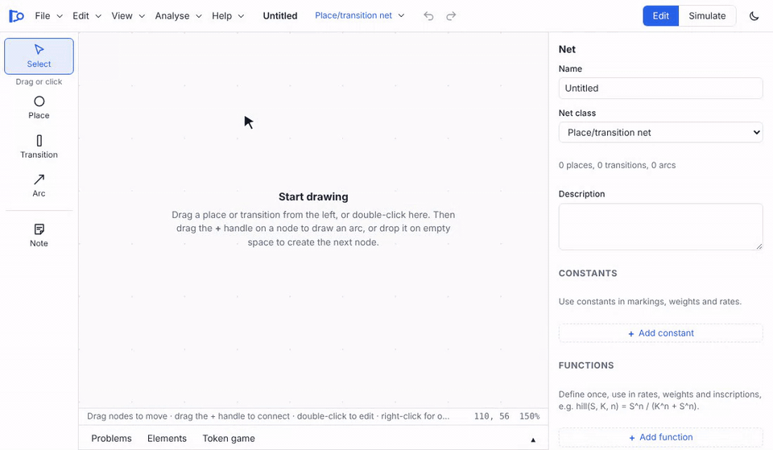

1. **Add nodes.** Drag a place or transition from the palette onto the canvas, or click the tool and then the canvas. Double-clicking empty canvas adds a place and lets you type its name straight away (in fault trees it adds a basic event). New places are named P0, P1, … and new transitions T0, T1, ….
2. **Connect with the + handle.** Hover a node: small **+** handles appear (three on a place, at the left, right and top; two on a transition, at the sides). Drag a handle onto another node to draw an arc. The handle's tooltip says "Drag to connect, or drop on empty space to add a connected node".
3. **Drop on empty space.** If you release the + handle over empty canvas, Donwinne creates a node of the opposite kind there and connects it: a transition after a place, a place after a transition. Coming from a place, the new arc has the current arc kind. This lets you draw a whole chain with one drag per step. A drag shorter than 12 pixels does nothing.
4. **Or use the arc tool.** With the arc tool, drag from one node to another, or click the first node and then the second. Clicks on empty space in between add bend points.

An arc must join a place and a transition. If it does not, or it would duplicate an existing arc of the same kind, a message explains why ("Arcs must join a place and a transition", "That arc already exists"). Read, inhibitor, reset and equal arcs must go from a place to a transition; modifier arcs need a stochastic, continuous or hybrid net. Freestyle nets have no such rules.

New arcs get a sensible inscription: `1` for normal arcs, empty for reset arcs, and in coloured nets the dot token or a variable of the place's colour set.

In fault trees, connections go from an event or gate up to the gate or event it feeds. Dropping a node's + handle on empty space below the node adds a basic event that feeds it; dropping it above adds an OR gate that the node feeds. Basic events cannot have inputs: "Basic events have no inputs; connect from the event up to a gate".

### Reshaping arcs

Select an arc to see its handles:

- **Bend:** drag the dot in the middle of a segment ("Drag to bend the arc"). Segments shorter than 30 pixels have no dot.
- **Remove a bend:** Alt-click it. **Straighten (remove bends)** in the arc's right-click menu removes them all, as does **Remove N bend points** in the properties panel.
- **Reconnect:** drag one of the arc's ends onto another node ("Drag onto another node to reconnect").
- **Move the label:** drag the weight or inscription label.
- **Reverse direction:** in the right-click menu or the properties panel (normal arcs only).

## Editing in place

Double-click to edit text directly on the canvas:

| Double-click on | Edits |
| --- | --- |
| A node's name | The name. |
| The inside of a place | Its tokens (marking). Hold Alt to rename instead. |
| An arc | Its weight or inscription. |
| A note | Its text. |
| A subnet (coarse node) | Opens the subnet instead. |

F2 or Enter starts renaming the selected node. On a selected arc Enter edits the inscription, on a note the text, and on a subnet it opens the subnet.

In the inline editor, **Enter** saves and **Esc** cancels. Notes save with **Ctrl+Enter** (Enter adds a new line). Names cannot be empty ("A name can't be empty"). When editing the marking of an uncoloured place, the **Up** and **Down** arrow keys add or remove a token. Coloured markings and inscriptions show examples as placeholders, such as ``2`a ++ b`` and ``x ++ y``.

To change the marking of the selected places without typing, press **+** or **−** (also = and _), or use **Add a token** and **Remove a token** in the right-click menu.

## Selecting, moving and arranging

- **Click** a node, arc or note to select it. **Shift-click**, **Ctrl-click** or **⌘-click** adds or removes a node from the selection.
- **Drag on empty canvas** with the Select tool to select everything inside a band. Hold Shift to add to the selection.
- **Drag** selected nodes to move them; with **Snap to grid** on they land on a 10 unit grid.
- **Arrow keys** nudge the selection by 1 unit, or by 10 with Shift.
- **Right-click** anything for a menu of what you can do with it.

### The right-click menu

On empty canvas: **Net properties…** (when the properties panel is not docked), **Add place here (P)**, **Add transition here (T)**, **Add note here**, **Paste**, **Select all**, **Auto layout**, and **Back to parent net (Backspace)** inside a subnet. In fault trees the add items are **Add basic event**, **Add intermediate event**, **Add AND gate** and **Add OR gate**.

On an element, depending on what it is:

| Element | Items |
| --- | --- |
| Any node | Rename (F2) |
| Place | Edit marking, Add a token, Remove a token, Make logical (fusion) place or Make ordinary |
| Transition | Make horizontal or Make vertical |
| Subnet | Open subnet, Ungroup subnet |
| Arc | Edit inscription, Reverse direction (normal arcs), Straighten (remove bends), and the list of arc kinds with a tick at the current one |
| Note | Edit text |

Then come the colour swatches, and for a multiple selection **Align left**, **Align tops**, **Distribute horizontally** and **Group into subnet**. The menu for an element ends with **Cut**, **Copy**, **Duplicate** and **Delete**.

### Aligning and spacing

When two or more nodes are selected, a selection bar appears over the canvas with the number of selected items and buttons to:

- align left edges, horizontal centres or right edges;
- align top edges, vertical centres or bottom edges;
- distribute horizontally or vertically (needs at least three nodes);
- colour the selection, **Group** it into a subnet, **Duplicate** it or **Delete** it.

The properties panel offers the same **Arrange** buttons and colours for a multiple selection.

## Copy, cut, paste and duplicate

**Copy** (Ctrl+C) remembers the selected places, transitions, notes and fault tree nodes, plus the arcs between them. **Paste** (Ctrl+V) puts a copy on the current page, shifted by 40 units; **Duplicate** (Ctrl+D) copies and pastes in one go, shifted by 30 units. Pasted nodes whose names are already taken get new names, except logical places, which keep their names because a logical place is meant to appear several times.

The clipboard lives inside the app: it works between pages and between models in the same window, but not with other programs. Connections between fault tree nodes are not copied.

## Auto layout

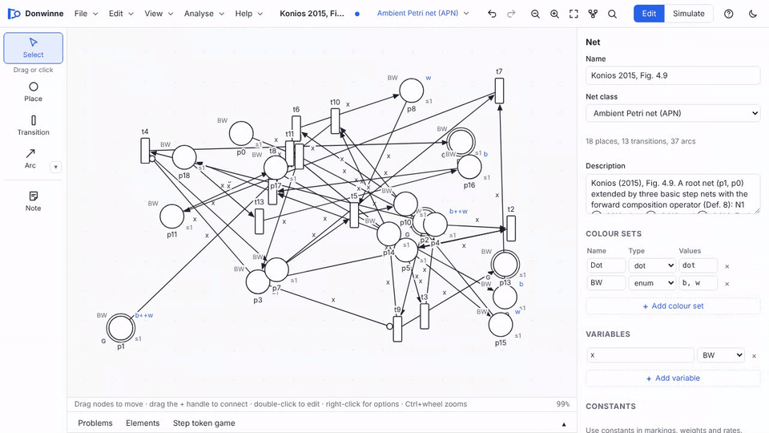

Auto layout uses the Eclipse Layout Kernel (ELK) to arrange the current page:

| Menu item | Arrangement |
| --- | --- |
| Auto layout (flow) (Ctrl+L) | Layered, flowing left to right. Fault trees flow upwards, towards the top event. |
| Auto layout (top to bottom) | Layered, flowing downwards. |
| Auto layout (organic) | A force-like (stress) layout, good for nets without a main direction. |
| Lay out selection only | Applies the flow layout to the selected nodes only. |

The layout keeps the top-left corner of the drawing where it was, snaps positions to the grid and, for layered layouts, keeps the arc bends that ELK computes. A message confirms "Layout applied. Ctrl+Z undoes it." In fault trees, **Tidy layout** in the fault tree tab draws the tree in classic top-down form.

## Subnets and breadcrumbs

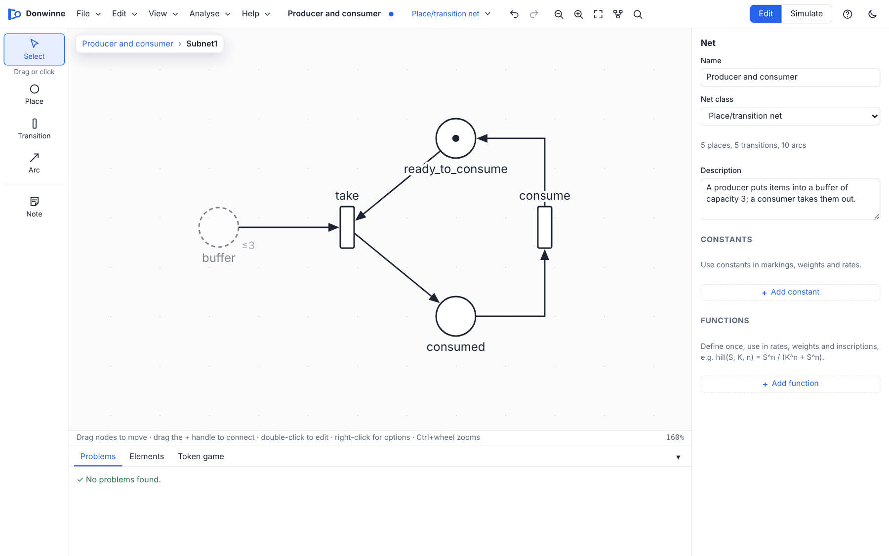

Large nets can be split into pages. Select some nodes and choose **Edit > Group into subnet** (Ctrl+G): they move into a new subnet, drawn on the parent page as a coarse transition (a box with a double border) named Subnet1, Subnet2, …. A message says "Created subnet … Double-click it to open."

- **Open** a subnet by double-clicking it, pressing Enter, or choosing **Open subnet**. Inside, nodes from the parent page that connect to the subnet's contents are shown as faded copies; double-click one to jump to the real node.
- **Go back up** with **Backspace** (when nothing is selected), **Back to parent net** in the right-click menu, or the breadcrumbs.
- The **breadcrumbs** at the top of the canvas show where you are: the net name (or *Top level*), then each subnet down to the current one. Click one to go there.
- **Ungroup subnet** moves the contents back to the parent page and removes the coarse node and its arcs.

On the parent page, arcs to and from nodes inside a subnet are drawn to the coarse node. Subnets are only a way of drawing: they do not change the behaviour.

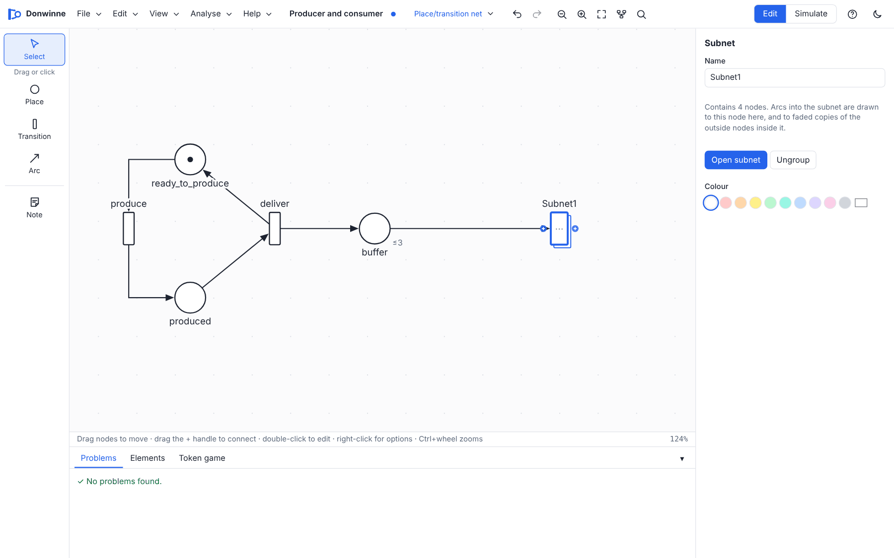

The **Hierarchy** tab of the element table shows the tree of subnets. Subnets are not available in fault trees.

## Navigating the canvas

- **Scroll** with the mouse wheel or two fingers on a trackpad; hold Shift to scroll sideways.
- **Zoom** with Ctrl+wheel (⌘+wheel on a Mac), a trackpad pinch, the zoom buttons or the View menu. The zoom range is 10% to 400%; the current zoom is shown in the status bar.
- **Pan** by dragging with the middle or right mouse button, or by holding Space and dragging. In the token game, dragging empty canvas also pans.
- **Zoom to fit** with F.
- The **overview map** in the corner shows the whole page with the visible area outlined. Click or drag in it to move the view; its × button hides it (M shows it again). It only appears when the canvas is large enough, there are at least three nodes, and part of the net is out of view.

Hovering a node for a moment shows a tooltip with its details. The status bar shows hints for the current tool and the pointer's coordinates. An empty page shows a "Start drawing" hint.

## Find

**Edit > Find…** (Ctrl+F) opens a search box ("Find places, transitions, events, notes…"). It searches:

- places by name, comment and marking;
- transitions by name, comment, guard and rate;
- fault tree events and gates;
- notes by their text;
- arcs by their inscription.

Up to 200 matches are listed and highlighted on the canvas, with the subnet each one is in and the number found. Use **↑** and **↓** to move through the list and **Enter** to go to a match: Donwinne opens the right subnet page and centres the view on it. **Esc** closes the box.

## Notes and colours

A **note** is a free text comment on the canvas. Add one with the Note tool (N) or **Add note here**, and double-click it to edit the text. Notes have no effect on behaviour. Each place, transition and arc can also carry a **Comment** in the properties panel, and the net has a **Description**.

Nodes and notes can be coloured with the swatches in the right-click menu, the selection bar or the properties panel: Default, Red, Orange, Yellow, Green, Teal, Blue, Purple, Pink and Grey. The properties panel also has a custom colour picker. Arcs have a **Line colour**. Colours are only for reading the drawing.

## The properties panel

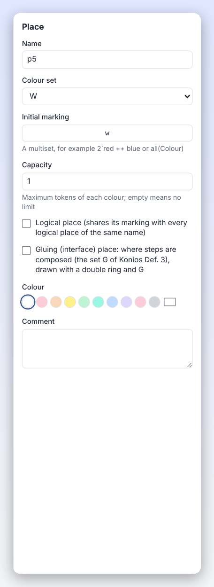

The properties panel shows the details of what is selected. On a desktop it is docked on the right and can be resized by dragging its edge (double-click the edge to reset it). On tablets it slides in as a drawer and on phones it is a bottom sheet; a **Properties** button appears when something is selected.

| Selection | Fields |
| --- | --- |
| Nothing (the net) | Name, Net class, Modulus (modulo nets), element counts, Description, and the [declarations](net-classes.md#declarations). |
| Place | Name; Colour set (coloured nets); Initial marking (or Initial amount in continuous nets) with − and + buttons; Continuous place (hybrid nets); Fixed (continuous places); Capacity; Logical place; Gluing (ambient nets); colour; Comment. |
| Transition | Name; Guard (coloured nets); Kind and Rate function / Weight / Delay / Schedule (stochastic, continuous and hybrid nets); Firing interval (timed nets); Note and Sound (music nets); Draw horizontally; colour; Comment. |
| Arc | Type; Weight (or Inscription in coloured nets); Remove N bend points; Reverse direction; Line colour. |
| Note | Text and colour. |
| Subnet | Name, Open subnet, Ungroup. |
| Several items | Arrange buttons, colours, Group into subnet, Delete selection. |
| Fault tree node | Name, Type, k (k-of-n gates), Failure rate λ, Or a fixed probability, Repair rate μ (extended fault trees), colour, Comment. |

Problems that concern the selected element are shown at the bottom of its properties. What each field means is explained in [Net classes](net-classes.md).

## The bottom panel

The bottom panel has tabs:

| Tab | Shown for | Contents |
| --- | --- | --- |
| Problems | Always | Errors and warnings in the model, with counts on the tab. Click a problem to select the element. "✓ No problems found." when all is well. |
| Elements | Petri nets | The element table and hierarchy (below). |
| Token game, Timed token game or Step token game | When simulating | History, enabled transitions and the current marking. See [Simulation](simulation.md#the-token-game). |
| Simulate & plot | Stochastic, continuous and hybrid classes | Plots over time. See [Simulation](simulation.md#simulating-over-time). |
| Fault tree analysis | Fault trees | See [Analysis](analysis.md#fault-tree-analysis). |

Resize the panel by dragging its top edge, and fold it away with ▾ or B. Tabs with more content, such as plots, open taller.

### Element table and hierarchy

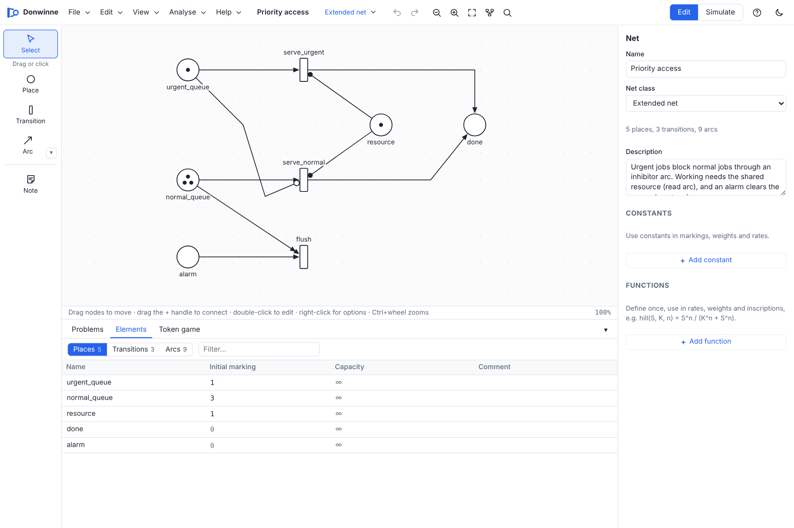

**View > Element table and hierarchy** opens the **Elements** tab, a spreadsheet view of the net with a **Filter…** box:

- **Places:** Name, Initial marking (or Initial amount), Colour set, Capacity, Subnet and Comment.
- **Transitions:** Name, Kind, Rate / weight / delay, Guard, Interval, Subnet and Comment (only the columns that apply to the class).
- **Arcs:** From, To, Type and Weight (or Inscription).
- **Hierarchy:** the tree of subnets (only when the net has subnets); click an entry to open it.

Cells can be edited in place, and clicking a row selects the element on the canvas, opening its subnet if needed.

## Undo, auto-save and themes

- **Undo and redo** keep the last 300 steps. Typing in one field counts as a single step if you pause for less than 1.5 seconds. Undo is not available while the token game runs.
- **Auto-save:** the model is saved in the browser's local storage a moment after every change, and comes back when you open the app again in the same browser. This is a safety net, not a replacement for **Save**: the undo history is not kept, and clearing site data removes it. In the browser, closing the tab with unsaved changes asks for confirmation; the desktop app asks before closing the window.
- **Preferences** such as the theme, snap to grid, the overview map, sound and panel sizes are remembered too.
- **Themes:** choose **Light theme**, **Dark theme** or **Match system** in the View menu, or use the sun/moon button in the top bar.

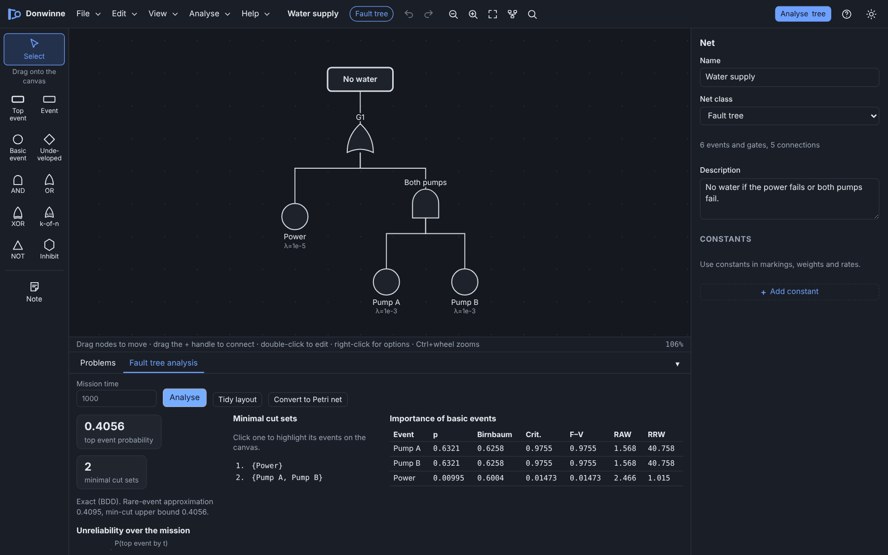

## Keyboard shortcuts

Shortcuts without Ctrl are ignored while you type in a text field. Ctrl means ⌘ on a Mac.

### Anywhere

| Keys | Action |
| --- | --- |
| Ctrl+N | New model |
| Ctrl+O | Open |
| Ctrl+S / Ctrl+Shift+S | Save / Save as |
| Ctrl+P | Print |
| Ctrl+Z | Undo |
| Ctrl+Shift+Z or Ctrl+Y | Redo |
| Ctrl+C / Ctrl+X / Ctrl+V | Copy / cut / paste |
| Ctrl+D | Duplicate |
| Ctrl+A | Select everything on this page |
| Ctrl+G | Group the selection into a subnet |
| Ctrl+L | Auto layout (flow) |
| Ctrl+F | Find |
| Ctrl++ or Ctrl+= / Ctrl+− | Zoom in / zoom out |
| Ctrl+0 | Zoom to fit |
| Ctrl+wheel, pinch | Zoom |
| Space+drag, right-drag, middle-drag | Pan |
| ? | Quick guide |
| M | Overview map on or off |
| B | Bottom panel on or off |
| F | Zoom to fit |
| Esc | Close the open dialog or menu |

### While editing

| Keys | Action |
| --- | --- |
| V | Select tool |
| P / T | Place / transition tool (not in fault trees) |
| A | Arc tool |
| N | Note tool |
| 1 to 6 | Arc type normal, read, inhibitor, reset, equal, modifier (and switch to the arc tool) |
| G | Snap to grid on or off |
| S | Start the token game |
| Delete or Backspace | Delete the selection |
| Backspace (nothing selected) | Go up to the parent page |
| F2 or Enter | Rename the selected node; on an arc edit its inscription, on a note its text; on a subnet open it |
| + or = / − or _ | Add / remove a token on the selected places |
| Arrow keys (Shift) | Nudge the selection by 1 (10) |
| Esc | Back to the Select tool; clear the selection and highlights |
| Double-click | See [Editing in place](#editing-in-place) |
| Alt-click a bend | Remove the bend |

### In the token game

| Keys | Action |
| --- | --- |
| ← / → | Step back / step forward through the history |
| R | Fire a random enabled transition (a random step in ambient nets) |
| X | Fire a maximal step (ambient nets) |
| Space | Run or pause random firing |
| Esc | Stop the token game |

The **Quick guide** dialog lists the most common of these. The desktop app also shows the shortcuts in its native menus.

## Touch gestures

Donwinne works with fingers and pens as well as with a mouse:

| Gesture | Action |
| --- | --- |
| Tap | Select. With a place, transition or note tool active, tap the canvas to add a node. |
| Drag a node | Move it. |
| Drag on empty canvas | Pan. |
| Two-finger drag, pinch | Pan, zoom. |
| Double-tap | Rename (or edit tokens inside a place, or open a subnet). |
| Long-press (half a second) | The right-click menu. |
| Long-press, then drag on empty canvas | Band selection. |
| Drag a tool out of the palette | Add a node where you lift your finger. The node is shown a little above your finger so you can see where it goes. |
| Press and hold the arc tool | Open the arc type chooser. |
| Drag the + handle | Connect, or drop on empty space to add a connected node. |
| Swipe the properties sheet down | Close it (phones). |

On touch screens buttons, handles and fields are larger, and text fields use a 16 pixel font so that the page does not zoom when you type.

## Phones, tablets and desktops

The layout adapts to the size of the window:

| Screen | Size | Layout |
| --- | --- | --- |
| Phone | up to 599 pixels wide | Menus in a drawer. The palette is a scrolling bar along the bottom, hidden while simulating. Properties open as a bottom sheet. Dialogs fill the screen. The bottom panel takes at most 45% of the height and starts folded away. |
| Short (phone in landscape) | up to 499 pixels high | A narrow icon-only palette rail, full-screen dialogs, properties as a drawer, bottom panel folded away at start. |
| Tablet | up to 1023 pixels wide | Menus in a drawer (the class badge stays visible). A slim palette rail down the side. Properties open as a drawer. |
| Desktop | wider | Menu bar, palette, docked properties panel and bottom panel. Very wide screens (1800 and 2400 pixels) get a wider properties panel and larger dialogs. |

Below 720 pixels the Edit / Simulate switch shows icons instead of words. The app keeps to the visible part of the screen, so the on-screen keyboard does not hide the field you are typing in.

| Phone, portrait | Phone, landscape | Tablet |
| --- | --- | --- |
| 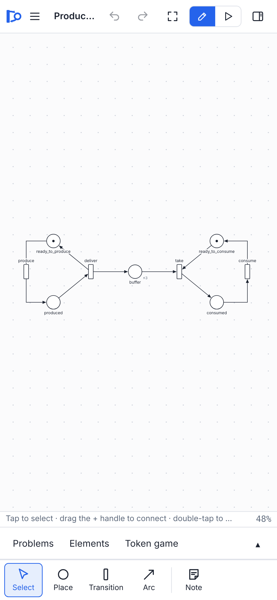 | 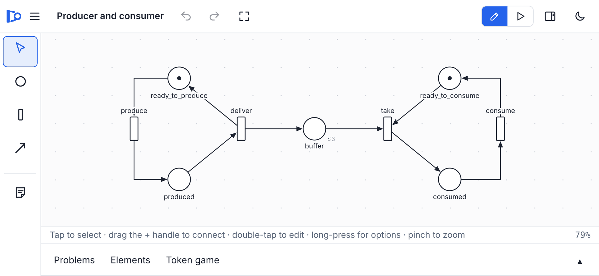 | 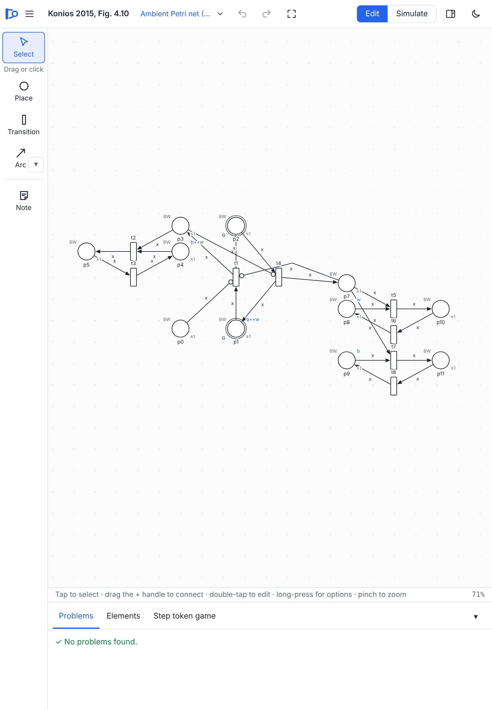 |

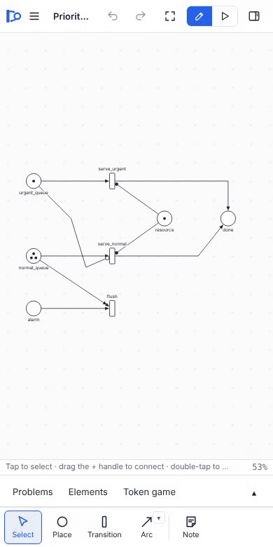

## Installing and working offline

The web app is a progressive web app (PWA). In a browser that supports it, use the browser's **Install** or **Add to Home Screen** command to install Donwinne as an app with its own window, in any orientation.

Once loaded, the app keeps a copy of itself so it also works offline: pages are fetched from the network when possible (with a 4 second limit) and from the stored copy otherwise, and the app's code and assets come from the stored copy. When a new version has been published, a message says "A new version of Donwinne is ready. Click here to reload."

Models are always stored on your own device: in files you save, and in the browser's auto-save. Nothing is uploaded.

## The desktop app

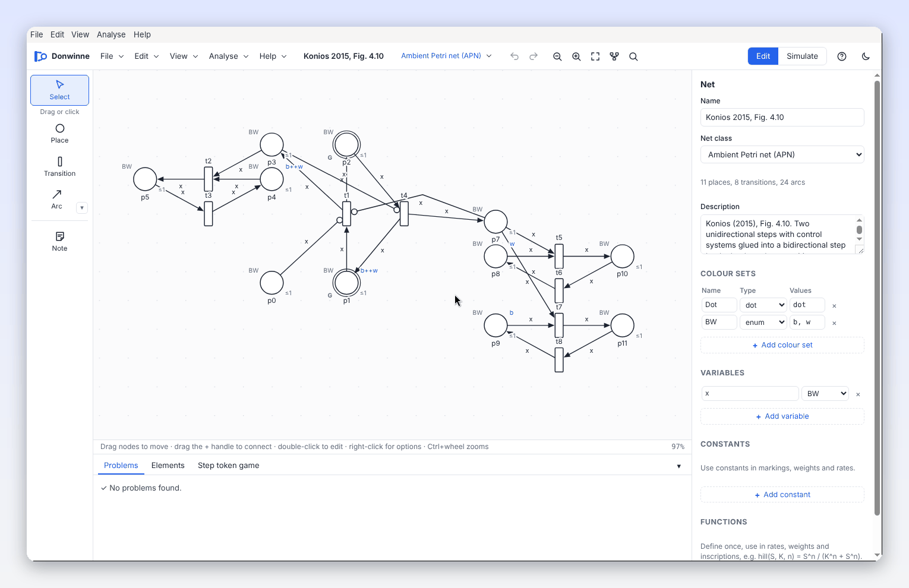

The desktop app is the same editor in its own window, with native menus and file dialogs:

- **File:** New…, New APN from Building Blocks…, Open…, Open Recent (macOS), Save, Save As…, Import (Snoopy, PNML, ANDL)…, Export As (Snoopy File…, PNML…, ANDL…, CANDL…, LoLA…, TINA…, APNN…, PRISM…, SBML…, Declarations as CSV…, Minimal Cut Sets (DNF)…, LaTeX (TikZ)…, SVG Image…, PNG Image…), Print… and Quit.
- **Edit:** Undo, Redo, Cut, Copy, Paste, Duplicate, Delete, Select All, Find…, Group into Subnet and Auto Layout.
- **View:** Zoom In, Zoom Out, Zoom to Fit, Overview Map, Element Table and Hierarchy, developer tools and full screen.
- **Analyse:** Token Game, Reachability Graph…, Net Properties and Invariants…, Model Checking (CTL)…, Unfold to an Uncoloured Net, and an **Ambient (Konios)** submenu.
- **Help:** Quick Guide and About Donwinne.

The desktop app opens `.pns.json` files and the Snoopy, PNML, ANDL and CANDL extensions from your file manager, asks before closing a window with unsaved changes, and has a minimum window size of 640 × 540. Printing prints the canvas directly instead of opening a separate window.
