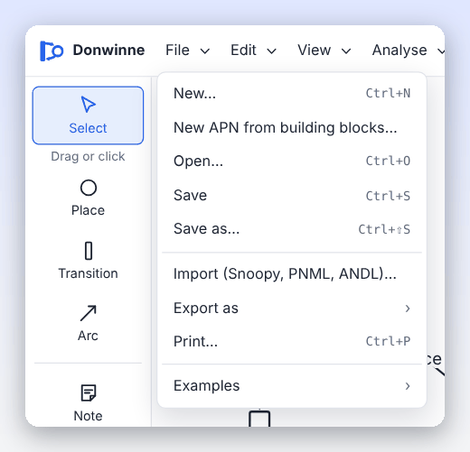

# File formats

Donwinne saves models in its own format and exchanges them with other Petri net tools: Snoopy, tools that read PNML, the ANDL family (Charlie, Marcie, Spike), LoLA, TINA, the APNN toolbox, PRISM and SBML tools. It can also export pictures (SVG, PNG, LaTeX/TikZ) and print. This page lists every format, what it can hold, and what is lost on the way.

## Contents

- [Overview](#overview)
- [Opening, importing and saving](#opening-importing-and-saving)
- [The native format (.pns.json)](#the-native-format-pnsjson)
- [Snoopy](#snoopy)
- [PNML](#pnml)
- [ANDL and CANDL](#andl-and-candl)
- [LoLA](#lola)
- [TINA](#tina)
- [APNN](#apnn)
- [PRISM](#prism)
- [SBML](#sbml)
- [Declarations as CSV](#declarations-as-csv)
- [Minimal cut sets (DNF)](#minimal-cut-sets-dnf)
- [Pictures: SVG, PNG and LaTeX (TikZ)](#pictures-svg-png-and-latex-tikz)
- [Printing](#printing)
- [How ambient nets are stored](#how-ambient-nets-are-stored)
- [Simulation results](#simulation-results)
- [Reachability graphs](#reachability-graphs)
- [The "Exported from Donwinne" mark](#the-exported-from-donwinne-mark)

## Overview

| Format | Extension | Read | Write | Classes |
| --- | --- | --- | --- | --- |
| Donwinne | `.pns.json` | yes | yes (Save) | all |
| Snoopy | per class, e.g. `.pn`, `.spped`, `.spn`, `.colpn` | yes | yes | all |
| PNML | `.pnml`, `.xml` | yes | yes | Petri nets except freestyle |
| ANDL | `.andl` | yes | yes | P/T, extended, timed, music, stochastic, continuous, hybrid |
| CANDL | `.candl` | yes | yes | coloured, coloured stochastic, coloured continuous, coloured hybrid |
| LoLA | `.lola` | no | yes | P/T, extended, timed, stochastic, music |
| TINA | `.net` | no | yes | P/T, extended, timed, stochastic, music |
| APNN | `.apnn` | no | yes | P/T, extended, timed, stochastic, music |
| PRISM | `.sm` | no | yes | stochastic |
| SBML | `.sbml` | no | yes | stochastic, continuous, hybrid |
| Declarations as CSV | `.csv` | no | yes | Petri nets |
| Minimal cut sets (DNF) | `.dnf.txt` | yes | yes | fault trees |
| LaTeX (TikZ picture) | `.tex` | no | yes | all |
| SVG image | `.svg` | no | yes | all |
| PNG image | `.png` | no | yes | all |

**File > Export as** lists only the formats that apply to the current class. If a format cannot hold this particular net (for example LoLA and an inhibitor arc), its menu item is greyed out and the reason is shown underneath, such as "LoLA has no inhibitor arcs (found one at "P" -> "T"). Inhibitor arcs can be exported as Snoopy, PNML, ANDL, APNN, PRISM or TINA." Donwinne finds the reason by trying the export in advance.



## Opening, importing and saving

- **File > Open…** (Ctrl+O) opens a Donwinne file or a PNML file (`.json`, `.pnml`, `.xml`).
- **File > Import (Snoopy, PNML, ANDL)…** opens anything Donwinne can read: Donwinne files, Snoopy files of every class, PNML, ANDL, CANDL and DNF fault trees.
- You can also **drop a file** onto the window, or (in the desktop app) open a file from your file manager.

Donwinne recognises the format by its content, not only by its extension: text starting with `{` is a Donwinne file, XML with a `<Snoopy>` root is a Snoopy file, other XML is PNML, a `.dnf` or `.dnf.txt` file (or text that looks like `a & b | c`) is a DNF fault tree, and anything else is read as ANDL or CANDL.

A Donwinne file opens with its file name ("Opened …"). An imported file opens as a new, unsaved model without a file name, so **Save** asks where to store it in Donwinne's format. If the import had to leave something out, the message says "Imported … with N warning(s)" followed by the first warning.

**Saving.** **File > Save** (Ctrl+S) and **Save as…** (Ctrl+Shift+S) write the native format, with the suggested name `<net name>.pns.json`:

- in Chrome, Edge and other browsers with the File System Access API, Save writes back to the same file after the first time;
- in other browsers, each Save downloads a file;
- the desktop app uses the system's file dialogs.

Exports are named after the file (or the net) with the format's extension.

## The native format (.pns.json)

The native format is the model itself as JSON, pretty-printed with two spaces, with `"format": "pns/1"`. It stores everything: places, transitions, arcs with their bend points, notes, subnets, colours, label positions, comments, declarations, fault tree nodes and edges, and class-specific fields such as intervals, sounds, kinds and the modulus. Every field added since the first version is optional, so older files still open.

When opening, Donwinne checks the file and refuses it with a clear message if it is not valid, for example:

- "This is not a Donwinne file (the "format" field is missing)."
- "Unknown net class …"
- "The modulus must be a whole number of at least 2."
- "The id "…" is used by both … and …; ids must be unique."
- "Arc "…" must connect a place and a transition." (not for [freestyle nets](net-classes.md#freestyle-nets), where any two nodes may be connected)
- "The subnets of … and … contain each other (a cycle in the hierarchy)."


The format is defined in [`../packages/core/src/model.ts`](../packages/core/src/model.ts) and checked in [`../packages/io/src/native.ts`](../packages/io/src/native.ts).

## Snoopy

[Snoopy](https://github.com/PetriNuts/snoopy) is the Petri net editor from BTU Cottbus that inspired Donwinne. Its files are XML (version 2). Donwinne reads and writes every Snoopy class it has a counterpart for:

| Donwinne class | Snoopy net class | Extension written | Also read |
| --- | --- | --- | --- |
| Place/transition net | Petri Net | `.pn` | `.spped` |
| Extended net | Extended Petri Net | `.xpn` | `.spept` |
| Coloured net | Colored Petri Net | `.colpn` (`.colxpn` with non-normal arcs) | `.colextpn` |
| Timed net | Time Petri Net | `.tpn` | `.sptpt` |
| Stochastic net | Stochastic Petri Net | `.spn` | `.spstochpn` |
| Continuous net | Continuous Petri Net | `.cpn` | `.spcontped` |
| Hybrid net | Hybrid Petri Net | `.hpn` | `.sphybrid` |
| Coloured stochastic net | Colored Stochastic Petri Net | `.colspn` | `.colstochpn` |
| Coloured continuous net | Colored Continuous Petri Net | `.colcpn` | `.colcontped` |
| Coloured hybrid net | Colored Hybrid Petri Net | `.colhpn` | `.colhybpn` |
| Fuzzy stochastic net | Fuzzy Stochastic Petri Net | `.fspn` | `.fuzzyspstochpn` |
| Fuzzy continuous net | Fuzzy Continuous Petri Net | `.fcpn` | `.fspcontped` |
| Fuzzy hybrid net | Fuzzy Hybrid Petri Net | `.fhpn` | `.fsphybrid` |
| Coloured fuzzy stochastic net | Colored Fuzzy Stochastic Petri Net | `.colfspn` | `.colfstochpn` |
| Coloured fuzzy continuous net | Colored Fuzzy Continuous Petri Net | `.colfcpn` | `.colcontfped` |
| Coloured fuzzy hybrid net | Colored Fuzzy Hybrid Petri Net | `.colfhpn` | |
| Modulo net | Modulo Petri Net | `.mpn` | `.spmnet` |
| Music net | Music Petri Net | `.spm` | |
| Freestyle net | Freestyle Net | `.spfreen` | |
| Fault tree | Fault Tree | `.spft` | `.ft` |
| Extended fault tree | Extended Fault Tree | `.speft` | `.xft` |
| APN, T-APN | Colored Petri Net (Colored Extended Petri Net with inhibitor arcs) | `.colpn` / `.colxpn` | |

Snoopy's *Colored Extended Petri Net* class is read as a coloured net. Coordinates are scaled by 2, because Snoopy draws places 20 units wide and Donwinne 40.

### What is carried over

Places with their markings, logical (fusion) places, transitions, all six arc types with their weights or inscriptions and bend points, subnets (Snoopy's coarse nodes and their pages), comments, notes, constants, colour sets and variables, functions, observers, fixed and continuous places, transition kinds and rate functions, firing intervals, the modulus, music notes, and fault tree events and gates with their failure data.

### How well each part is tested

Snoopy's file format is not documented, so Donwinne's reader and writer were built from real files and from Snoopy's source code:

- **Checked against real Snoopy files:** Petri Net (`.spped`, Snoopy 1.21), Continuous Petri Net (revisions 1.21 to 2.0) and Hybrid Petri Net (revision 2.0): the node, edge and constant layout, logical nodes, comments and modifier edges.
- **Checked against Snoopy's source code:** the class names and extensions, the attributes of every node and edge class, subnets, fixed places, modifier edges, functions and observers.
- **Not yet checked against real files:** how Snoopy writes coloured declarations and coloured markings, music sounds (written as `note;duration;instrument`), fuzzy numbers (in the ConstA to ConstD columns), freestyle nets, where border copies of nodes go in subnets, function parameters, and bool, string, union and subset colour sets. Please report files that do not round-trip.

### Importing from Snoopy

Import stops with an error when:

- the file is compressed ("This Snoopy file is compressed (a zip archive). Unzip it and open the model.xml inside, or save it uncompressed in Snoopy.");
- the root element is not `<Snoopy>`;
- the file version is older than 2 ("open and save it with Snoopy 2 first");
- the file has no `<netclass>`, or the class is not supported.

Otherwise anything Donwinne cannot represent is skipped with a warning. The most common warnings are:

| Warning | Meaning |
| --- | --- |
| Nodes, edges or metadata of an unsupported Snoopy class were skipped | Donwinne has no counterpart. |
| Reversible transitions are not supported | Add the reverse reaction as a separate transition. |
| Transitions with several function rows were imported with their first function only | Snoopy can keep alternative rate functions; Donwinne keeps one. |
| Constants with several value sets were imported with their active value set only | The same for constant value sets. |
| Coarse events were imported as intermediate events | Fault tree subtrees are flattened. |
| The int colour set … was widened to the range … | Snoopy int sets with gaps become ranges. |
| Observers over individual colour instances were imported as observers over the coloured nodes | Check their expressions. |
| Some edges do not connect a place and a transition and were dropped | |
| A … from a transition to a place was imported as a normal arc | Only normal arcs can leave a transition. |

### Exporting to Snoopy

**File > Export as > Snoopy file** writes a Snoopy 2 file for the current class. Snoopy has no place for some of Donwinne's features, so the following are left out or changed (the app writes the file without listing them):

| Feature | What happens |
| --- | --- |
| Read, inhibitor, reset or equal arcs in a place/transition net | The file is written as an Extended Petri Net. |
| Place capacities | Dropped: Snoopy has no place capacities. |
| Guards outside coloured nets | Dropped. |
| Rates, transition kinds, fixed places, observers outside stochastic, continuous and hybrid nets | Dropped. |
| Firing intervals outside timed nets, sounds outside music nets | Dropped. |
| Continuous places outside hybrid nets | Saved as ordinary places. |
| Colour sets and variables outside coloured nets | Dropped. |
| Logical places with different markings on their copies | The first marking is kept. |
| Fault tree subtrees | Flattened to the top level; notes inside them move up. |

## PNML

PNML (ISO/IEC 15909-2) is the standard exchange format for Petri nets.

**Export** (**File > Export as > PNML**) writes place/transition-based classes with the `ptnet` grammar and all coloured classes with the symmetric net grammar. Names, positions, label offsets, fill and line colours use standard PNML graphics. Everything that has no standard element (arc types, capacities, logical places, comments, notes, expressions where the standard expects numbers, the exact declarations, rates, intervals, sounds, the net class and the modulus) goes into `<toolspecific tool="Donwinne" version="1">` blocks. Other tools ignore these blocks; Donwinne reads them back, so a PNML file written by Donwinne opens again without loss. PNML export is offered for every Petri net class except freestyle nets; fault trees have no PNML grammar.

**Import** is lenient towards files from other tools (such as PIPE, TINA, Snoopy and CPN-style exporters):

- only the first net in the file is read ("The file contains N nets; only the first one was imported.");
- reference places and transitions are resolved; arcs to missing nodes are dropped with a warning;
- arc types are taken from Donwinne's tool data or from a `type` element (`normal`, `read`/`test`, `inhibitor`, `reset`, `equal`, `modifier`); unknown types become normal arcs;
- markings and inscriptions that are not numbers are kept as text, with a warning;
- nodes without positions are arranged in a grid;
- an unknown net type is read as a place/transition net;
- a high-level net that uses declarations Donwinne cannot read is imported as a place/transition net without colours, with a warning.

The importer refuses files whose root is not `<pnml>` or that contain no `<net>`. Files written by earlier versions of Donwinne under the tool name *PetriNetStudio* are still read.

## ANDL and CANDL

ANDL (abstract net description language) is Snoopy's text format, also read by Charlie, Marcie and Spike. CANDL is its coloured variant. A transition is written with its conditions (read, inhibitor and equal arcs, and in CANDL the guard), its updates (normal and reset arcs) and its rate function.

**Export** (**File > Export as > ANDL (Charlie, Marcie, Spike)** or **CANDL (coloured ANDL)**) chooses the ANDL net type from the class:

| Class | ANDL type |
| --- | --- |
| Place/transition net | `pn` (`xpn` if it has non-normal arcs) |
| Extended net | `xpn` |
| Timed net, music net | `xpn`, with a comment saying that intervals or sounds were dropped |
| Stochastic net | `spn`; `xspn` with non-normal arcs; `gspn` with immediate, deterministic or scheduled transitions |
| Continuous net | `cpn` (all transitions must be continuous) |
| Hybrid net | `hpn` |
| Coloured net | `colpn` (`colxpn` with non-normal arcs) |
| Coloured stochastic / continuous / hybrid net | `colspn` / `colcpn` / `colhpn` |

ANDL is not available for fuzzy, modulo, freestyle and ambient nets, or for fault trees. CANDL cannot write union colour sets (Snoopy cannot either). Constants keep their groups. Modifier arcs and fixed places are left out, as they do not change the behaviour of a stochastic net. The layout of ANDL was checked against Snoopy's export code; CANDL, and the syntax of the functions and observers sections, follow Snoopy's code as closely as could be determined but have not been checked against real files.

**Import** reads ANDL types `pn`, `xpn`, `spn`, `xspn`, `gspn`, `xgspn`, `cpn` and `hpn`, and CANDL types `colpn`, `colxpn`, `colspn`, `colxspn`, `colgspn`, `colxgspn`, `colcpn` and `colhpn`. Nodes are arranged in a grid. Reversible transitions (`{rev}`) are imported in their forward direction only, and functions on transitions of untimed nets are ignored, each with a warning. Syntax errors are reported with a line number ("ANDL, line N: …").

## LoLA

[LoLA](https://theo.informatik.uni-rostock.de/theo-forschung/tools/lola/) is a state space model checker. **File > Export as > LoLA** writes the LoLA 2 net format (`PLACE`, `MARKING`, `TRANSITION … CONSUME … PRODUCE …`) for place/transition, extended, timed, stochastic and music nets:

- read arcs are written as a consume/produce pair of the same weight, which has the same interleaving behaviour;
- inhibitor, reset and equal arcs cannot be written, and such nets are refused;
- modifier arcs are left out;
- capacities become `SAFE n:` place groups;
- times, rates and sounds are dropped;
- markings and weights must be whole numbers (constants are evaluated; marking-dependent weights are refused).

## TINA

[TINA](https://projects.laas.fr/tina/) analyses time Petri nets. **File > Export as > TINA (.net)** writes TINA's `.net` format for place/transition, extended, timed, stochastic and music nets:

- read arcs become test arcs `p?n`, and inhibitor arcs become `p?-n`;
- equal arcs become a test arc `p?n` plus an inhibitor arc `p?-(n+1)` (this combination has not been tried in TINA itself);
- reset arcs have no TINA counterpart and are refused; modifier arcs are left out;
- in timed nets, firing intervals become TINA's static intervals, with `w[` for an infinite upper bound;
- capacities are not written.

## APNN

APNN (abstract Petri net notation) is the format of the APNN toolbox, also exported by Snoopy. **File > Export as > APNN** writes place/transition, extended, timed, stochastic and music nets with all arc types except modifier arcs, place capacities, constants and, for stochastic nets, the rate functions (user functions are expanded in place). Stochastic nets may only contain stochastic transitions.

## PRISM

[PRISM](https://www.prismmodelchecker.org/) is a probabilistic model checker. **File > Export as > PRISM model** writes a stochastic net as a continuous-time Markov chain (`ctmc`) module with one variable per place:

- every place needs a finite range: its capacity, or otherwise 100 (the constant `Max`); transitions that would exceed a bound are disabled, and a marking above its bound is refused;
- `MassAction(k)` is expanded to $k$ times the binomial coefficients of the input places; user functions are expanded in place;
- read, inhibitor, equal and reset arcs become guards and updates; modifier arcs are left out; fixed places never change;
- only stochastic transitions are allowed ("PRISM CTMCs only have exponentially timed transitions").

## SBML

SBML (Systems Biology Markup Language) is the standard for biochemical models. **File > Export as > SBML** writes SBML Level 2 Version 4 for stochastic, continuous and hybrid nets (and place/transition and extended nets through the library):

- one compartment; places become species, constants parameters, transitions reactions (input places reactants, output places products, read and modifier arcs modifiers);
- rates become kinetic laws in MathML, with `MassAction(k)` expanded to $k \cdot P_1^{w_1} \cdot P_2^{w_2} \cdots$;
- fixed places become boundary species;
- user functions become function definitions when their bodies use only their parameters, otherwise they are expanded in place;
- observers become parameters with assignment rules;
- inhibitor, equal and reset arcs cannot be written; immediate, deterministic and scheduled transitions are refused; hybrid nets lose the difference between discrete and continuous parts.

## Declarations as CSV

**File > Export as > Declarations as CSV** writes Snoopy's CSV layout of a net's declarations, with semicolons between columns and a blank line after each section:

```
Place;Marking
P;3

Transition;Main
T;MassAction(k)

Constant Class;Main
k;0.5
```

The transition section appears only for stochastic, continuous and hybrid classes. Logical places appear once. Use it to edit initial markings, rates and constants in a spreadsheet. This export is not available for fault trees and freestyle nets, and Donwinne does not read CSV files.

## Minimal cut sets (DNF)

For fault trees, **File > Export as > Minimal cut sets (DNF)** writes the minimal cut sets as a formula in disjunctive normal form, using event names, for example `(Pump1 & Pump2) | Power`.

DNF text can also be **imported** with **File > Import**, to build a fault tree from a list of cut sets. The syntax is flexible:

- OR is written `|`, `||`, `+`, `or` or a line break;
- AND is written `&`, `&&`, `*`, `,`, `and` or spaces;
- an event may be negated with `!`, `~` or `not` (this adds a NOT gate);
- lines starting with `#` or `//` are comments.

The result is a fault tree with a top event fed by an OR gate over one AND gate per term, shared basic events (each with probability 0.01), laid out top-down.

## Pictures: SVG, PNG and LaTeX (TikZ)

- **SVG image** saves the current page as a standalone SVG drawing on a white background, with the [Donwinne mark](#the-exported-from-donwinne-mark) below it. While the token game runs, the current marking is drawn.
- **PNG image** saves the same drawing as a PNG at twice the screen size.
- **LaTeX (TikZ picture)** writes a `tikzpicture` of the current page for LaTeX documents. It needs `\usetikzlibrary{petri,arrows.meta}`. Positions are scaled so that 50 units are 1 cm; places, transitions, labels, bend points and arc types are drawn, uncoloured places show up to 6 tokens, and fault tree events and gates are drawn as labelled boxes and circles. Modifier arcs are not handled yet and need their line style edited by hand.

Simulation plots are saved separately with **Save image** in the plot tab (see [Exporting results](simulation.md#exporting-results)).

## Printing

**File > Print…** (Ctrl+P) prints the current page:

- In the browser, Donwinne opens a new window with the net's name and class as a heading and the drawing below it, and starts printing. Your browser must allow pop-ups for the app ("Allow pop-ups to print"). Choose *Save as PDF* in the print dialog to get a PDF.
- In the desktop app, the canvas itself is printed: the view is fitted to the net, the selection is cleared, and the menus and panels are hidden by the print stylesheet.

## How ambient nets are stored

APNs and T-APNs carry three things that ordinary coloured nets do not have: the class itself, the **gluing** places (where steps are composed) and the **complementary colour sets** of T-APNs. See [Ambient Petri nets](ambient-petri-nets.md).

| Format | How |
| --- | --- |
| Donwinne | The class (`apn` or `tapn`), a `gluing` field on each gluing place and a `complementOf` field on each complementary colour set. |
| Snoopy | Snoopy has no ambient classes (Konios drew APNs and T-APNs as coloured Petri nets), so the net is written as a *Colored Petri Net* (or *Colored Extended Petri Net* when it has inhibitor arcs), and a last line is added to the net's description: `[Donwinne ambient net: {"netClass":"apn","gluing":[…],"complements":{…}}]`. Donwinne reads this line back on import and removes it from the description; Snoopy shows it as part of the description. |
| PNML | The net class is stored in Donwinne's tool-specific data, each gluing place has a `gluing` entry, and complementary colour sets keep their `complementOf` attribute in the declarations. |
| ANDL, CANDL | Not available. The [unfolding](simulation.md#unfolding) of an ambient net is an ordinary net and can be exported like one. |

## Simulation results

Plots from **Simulate & plot** can be saved as CSV (comma-separated, with a `Time` column and one column per curve) or as an SVG image; see [Exporting results](simulation.md#exporting-results). The analysis report is saved as text from the **Net properties and invariants** dialog; see [The text report](analysis.md#the-text-report).

## Reachability graphs

The **Reachability graph** dialog (and the **Concurrent reachability graph** dialog of ambient nets) has an **Export** row:

| Button | File | Contents |
| --- | --- | --- |
| SVG | `<net>-reachability.svg` (`-crg.svg` for a CRG) | The graph drawn as in the dialog: one box per state with its marking, an arrow per firing or step, M0 in blue and dead states in red. Up to 1,000 states. |
| PNG | `.png` | The same drawing as a PNG. |
| DOT | `.dot` | The graph for GraphViz (`dot -Tpdf graph.dot -o graph.pdf`) and other graph tools, with the same colours. Any size. |
| CSV | `.csv` | One row per state: its name, the tokens on each place (the structured places for a CRG), whether it is dead, and its successors as `transition->state`. Any size. |

## The "Exported from Donwinne" mark

Every file Donwinne exports says where it came from:

- **Pictures show it.** SVG and PNG images of the net, of reachability graphs and of plots have a small grey *Exported from Donwinne* in a strip below the drawing, so it never covers part of the net. Prints carry it too (in the browser it is part of the printed drawing; in the desktop app it is printed in the bottom corner), and TikZ pictures end with it as a small grey label.
- **Other files carry it as metadata**, written so the file still opens in the tools it is meant for: an XML comment `<!-- Exported from Donwinne -->` after the XML declaration in Snoopy, PNML, SBML and SVG files; a first-line comment in ANDL, CANDL and PRISM (`//`), LoLA (`{ … }`), TINA, CSV and DNF (`#`), APNN and TikZ (`%`) and GraphViz (`//`); and `tEXt` chunks (*Software: Donwinne 0.3.0*, *Comment: Exported from Donwinne*) in PNG files. The text report of **Net properties** starts with the line *Exported from Donwinne*.

Donwinne's own importers skip these comments, so an exported file opens again unchanged. Saving a model (**Save**, `.pns.json`) is not an export and adds nothing.
