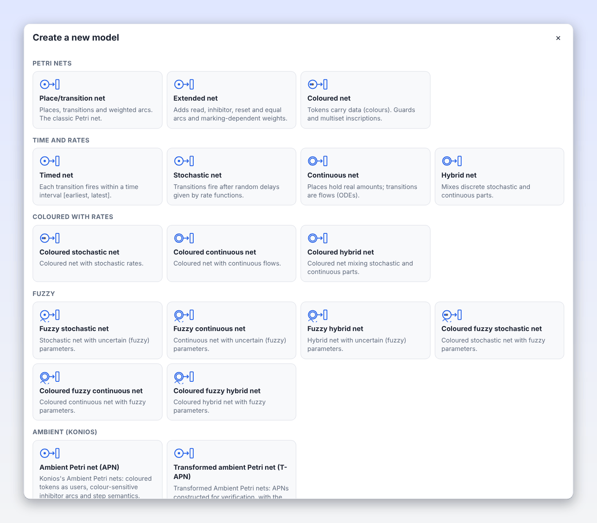
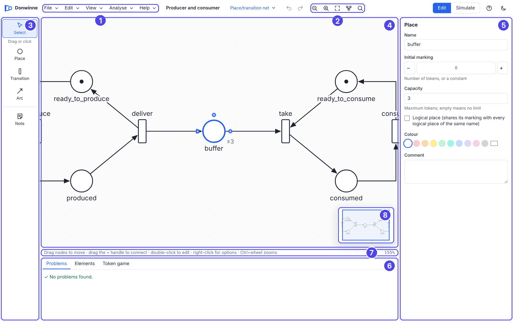
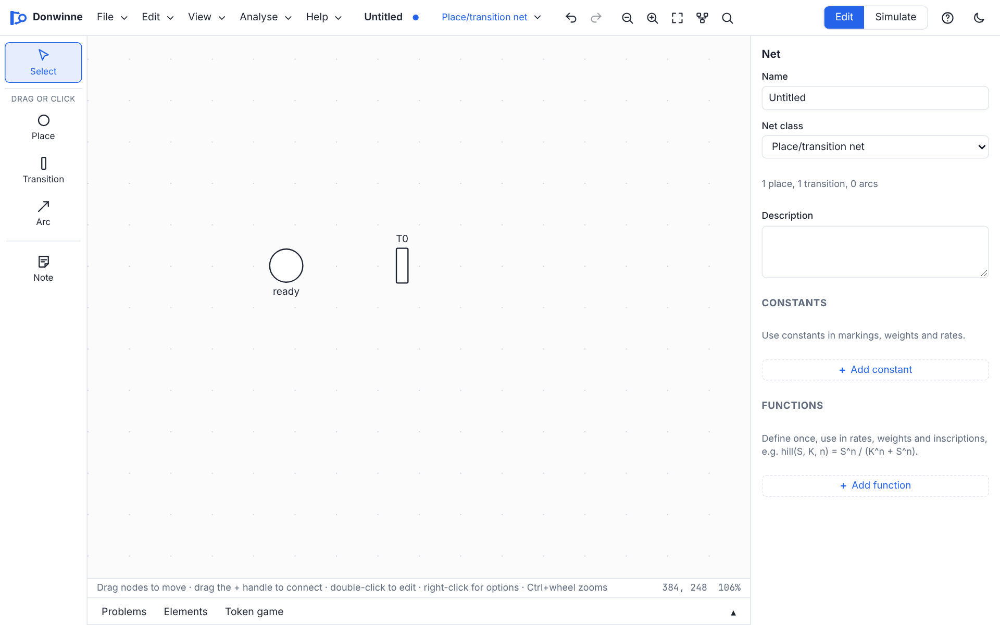
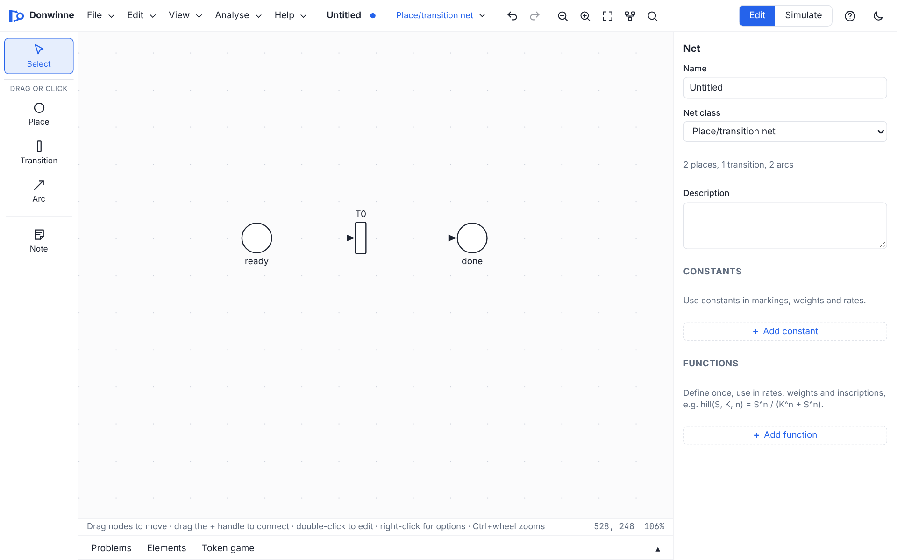
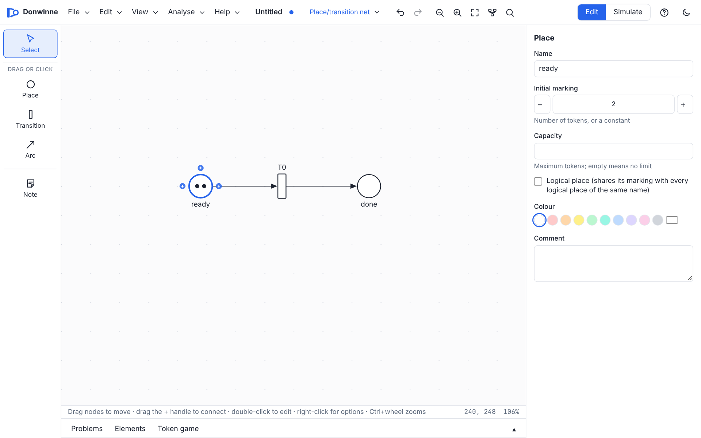
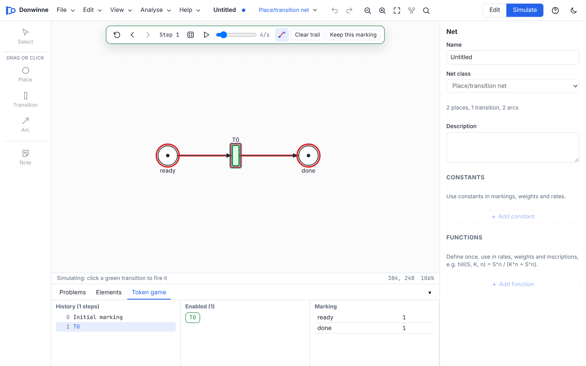
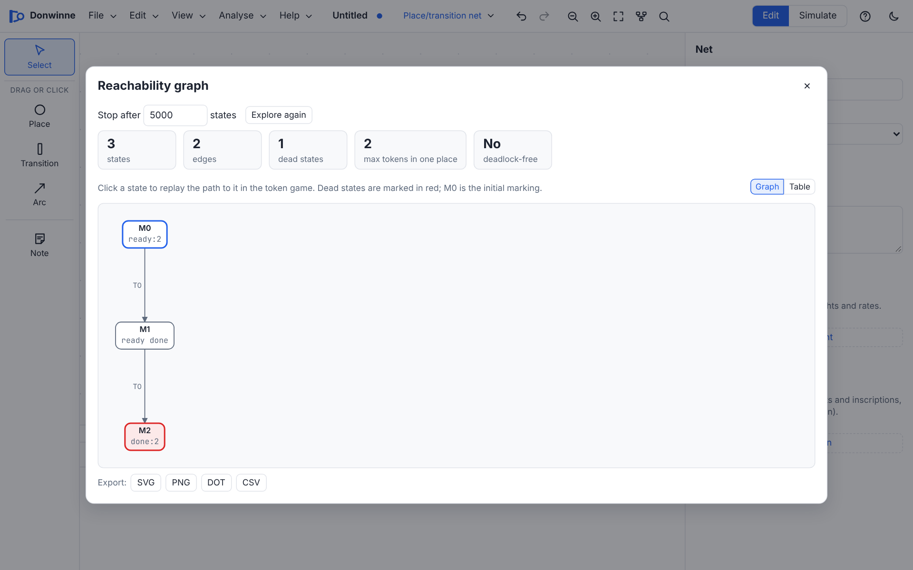
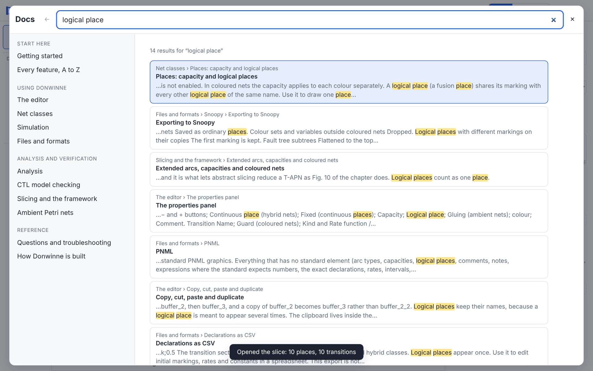

# Getting started

Donwinne is a Petri nets studio. You draw a net, play it with tokens, simulate it over time, analyse it
(reachability graph, invariants, CTL model checking, slicing) and exchange it with other tools such as
Snoopy. It also has the Ambient Petri nets of Konios's thesis, and fault trees. It runs in a browser, as
an installed app that also works offline, and as a desktop app. Your models stay on your own device.

This page gets you from an empty screen to a working net in a few minutes. Every feature has its own
line in [Every feature, A to Z](feature-index.md), and the search box at the top of **Docs** finds any
of them.

## Contents

- [Opening Donwinne](#opening-donwinne)
- [The screen at a glance](#the-screen-at-a-glance)
- [Your first net in five steps](#your-first-net-in-five-steps)
- [Saving and opening](#saving-and-opening)
- [Trying the examples](#trying-the-examples)
- [What next](#what-next)
- [Using these docs](#using-these-docs)

## Opening Donwinne

There are three ways to run Donwinne:

| Way | How | Notes |
| --- | --- | --- |
| In a browser | Open the web app's address, or run `pnpm dev` from the source and open `http://localhost:5173`. | Chrome, Edge, Firefox and Safari 14 or newer. |
| As an installed app | In the browser, use **Install** (or **Add to Home Screen** on a phone). | Works offline once loaded. See [Installing and working offline](editor.md#installing-and-working-offline). |
| As a desktop app | Run `pnpm desktop` from the source, or install a built package. | Native menus and file dialogs. See [The desktop app](editor.md#the-desktop-app). |

Building from the source needs Node.js 20.19 or newer and pnpm 10:

```sh
pnpm install
pnpm dev          # the web app at http://localhost:5173
pnpm build        # a production build in apps/web/dist
pnpm desktop      # the desktop app
pnpm test         # the test suite
```

When the app starts with nothing open, the **Create a new model** dialog appears. Press **Enter** for a
place/transition net, pick another class, open a file, or load an example.



## The screen at a glance



| No. | Area | What it is for |
| --- | --- | --- |
| 1 | Menu bar | **File**, **Edit**, **View**, **Analyse** and **Help**. On a phone or tablet they are in the **Menu** drawer. |
| 2 | Toolbar | The net's name (click to rename), its class badge (click to switch class), undo and redo, zoom, auto layout, find, and the **Edit** / **Simulate** switch. |
| 3 | Palette | Select (V), Place (P), Transition (T), Arc (A, with the arc type chooser) and Note (N). Fault trees show events and gates instead. |
| 4 | Canvas | The drawing. Scroll to move, Ctrl+wheel or pinch to zoom, double-click empty space to add a place. |
| 5 | Properties panel | Everything about the selection, or about the whole net (name, class, declarations) when nothing is selected. |
| 6 | Bottom panel | **Problems**, **Elements** (a spreadsheet of the net), the **Token game**, **Simulate & plot** and **Fault tree analysis**. Press B to show or hide it. |
| 7 | Status bar | Hints for the current tool, the pointer's coordinates and the zoom level. |
| 8 | Overview map | The whole page in miniature; click or drag in it to move the view. Press M to show or hide it. |

The [editor page](editor.md) describes every menu item, button and panel in detail.

## Your first net in five steps

This builds the classic producer and consumer: a producer makes items into a buffer, a consumer takes
them out.

**1. Add places and transitions.** Drag **Place** from the palette onto the canvas, or double-click
empty canvas: a place appears and you can type its name straight away (try `ready`). Add a transition
with **Transition** (or press T and click).



**2. Connect them.** Hover a node: small **+** handles appear. Drag one onto the other node to draw an
arc. Drop it on empty canvas instead and Donwinne creates the next node for you, already connected, so
a whole chain takes one drag per step. Arcs always join a place and a transition.



**3. Put tokens in a place.** Select a place and press **+** (or **−**), use the − and + buttons of
**Initial marking** in the properties panel, or double-click inside the place and type a number.



**4. Play the token game.** Press **S** or the **Simulate** switch. Enabled transitions turn green;
click one to fire it and watch the tokens move. ← and → step back and forward, R fires a random
transition, Space runs, Esc stops. Clicking a transition that cannot fire tells you why.



**5. Ask questions about it.** Under **Analyse**: **Reachability graph…** shows every marking the net
can reach, **Net properties and invariants…** says whether it is bounded, live, deadlock-free and
reversible, **Model checking (CTL)…** checks your own properties, and **Slice the net…** cuts it down to
the part that matters for a property.



## Saving and opening

- **File > Save** (Ctrl+S) writes a `.pns.json` file. In Chrome and Edge later saves go back to the
  same file; in other browsers each save downloads a copy. **Save as…** (Ctrl+Shift+S) picks a new name.
- **File > Open…** (Ctrl+O) opens Donwinne and PNML files. **File > Import (Snoopy, PNML, ANDL)…**
  also reads Snoopy files of every class, ANDL, CANDL and DNF fault trees. You can also drop a file onto
  the window.
- **File > Export as** writes Snoopy, PNML, ANDL, CANDL, LoLA, TINA, APNN, PRISM, SBML, CSV, DNF, LaTeX
  (TikZ), SVG and PNG, whichever fit the net.
- The model is also **auto-saved** in the browser a moment after every change and comes back the next
  time you open the app there. That is a safety net, not a replacement for saving a file.

Details are in [Files and formats](file-formats.md).

## Trying the examples

**File > Examples** (or **Examples ▾** in the new model dialog) opens ready-made models: producer and
consumer, priority access with read, inhibitor and reset arcs, Konios's Figs 3.1, 4.9, 4.10 and 4.11,
the ambient garage and conference room, predator and prey (continuous), radioactive decay
(stochastic), a traffic light (timed), a scale (music) and a water supply (fault tree). The project's
`docs/examples` folder holds many more models in Snoopy format that open with **File > Import…**.

## What next

| I want to… | Read |
| --- | --- |
| Learn every editing trick: subnets, alignment, find, shortcuts, touch | [The editor](editor.md) |
| Choose the right kind of net and write markings, guards and rates | [Net classes](net-classes.md) |
| Run a net with tokens, or simulate it over time and plot it | [Simulation](simulation.md) |
| Check boundedness, liveness, deadlocks, invariants, siphons and traps | [Analysis](analysis.md) |
| Write and check my own properties in CTL, find paths | [CTL model checking](ctl.md) |
| Make a big net small enough to verify | [Slicing and the framework](slicing.md) |
| Model ambient systems with APNs and T-APNs | [Ambient Petri nets](ambient-petri-nets.md) |
| Open Snoopy or PNML files, export pictures | [Files and formats](file-formats.md) |
| Fix a problem | [Questions and troubleshooting](faq.md) |

## Using these docs

**Help > Docs** (F1) opens these pages inside Donwinne. They work offline and in the desktop app.



- **Search.** Type in the box at the top (press **/** or **Ctrl+K** to jump there). Every section of
  every page is searched as you type, and each result shows where it is and the matching text. **↑**
  and **↓** move through the results and **Enter** opens one, with the words you searched for marked on
  the page. Searches match the start of words (`subn` finds *subnet*), ignore plurals and know a few
  other spellings (*color* finds *colour*). Put words in quotes to search for an exact phrase, such as
  `"inhibitor arc"`.
- **Browse.** The list on the left has every page, grouped; the open page shows its headings below its
  name. **← Back** (Alt+←) goes back to where you were, and the buttons at the end of a page go to the
  previous and next page.
- **Link.** Hover a heading and click **#** to go to it; the link to the section is copied too.
- **Close** with **Esc** (it first clears the search) or ✕.

The same pages are in the `docs` folder of the source, for reading on GitHub.
