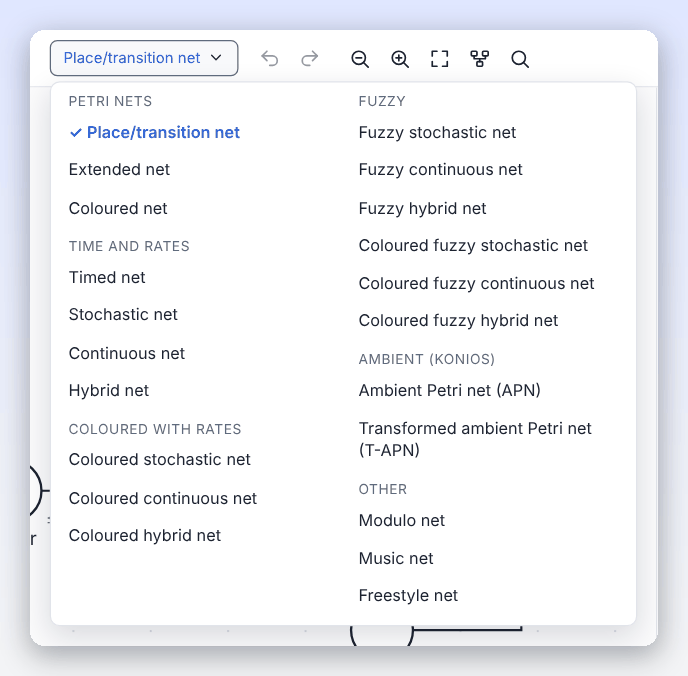
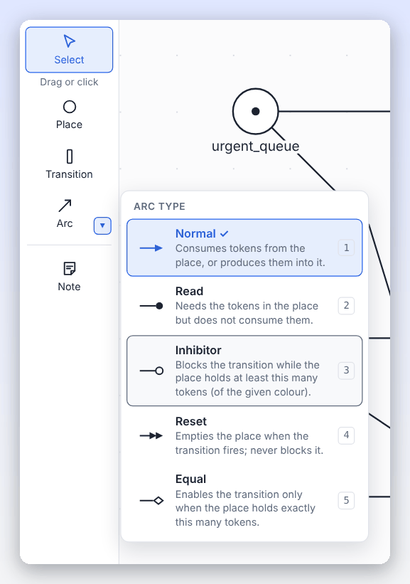
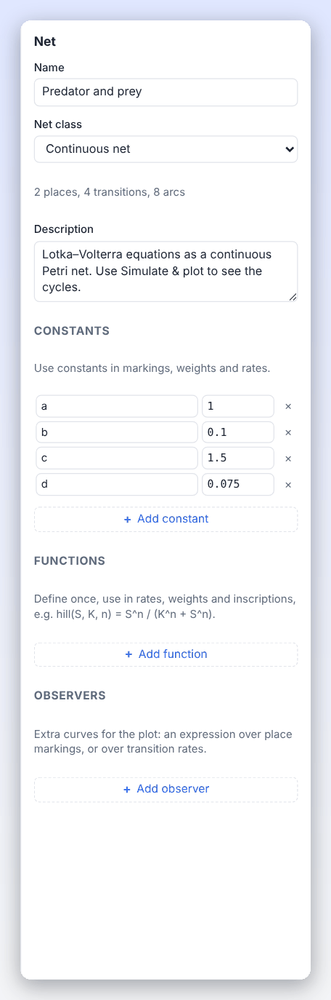
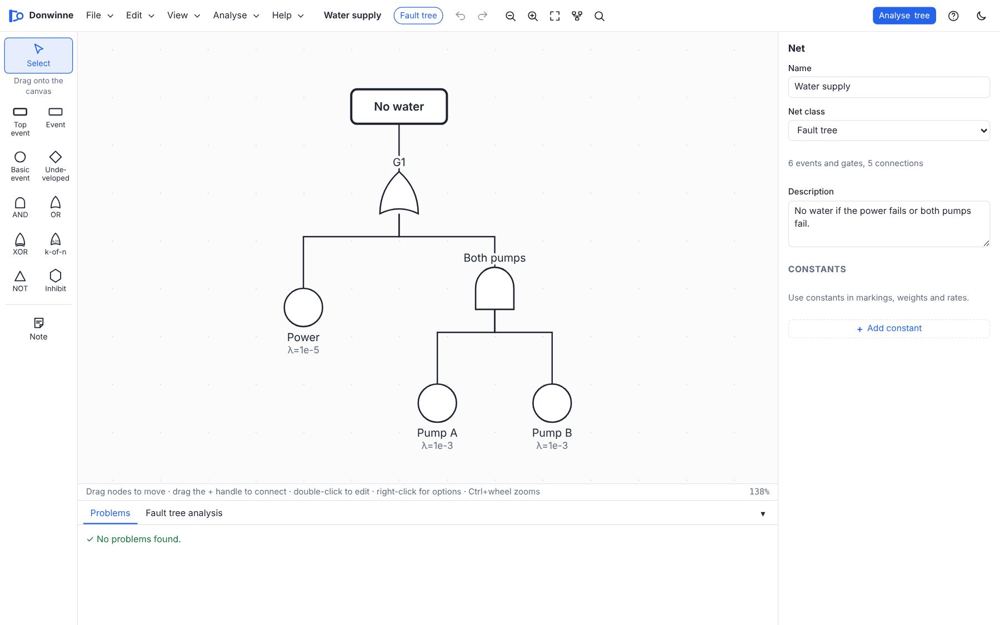

# Net classes

Every Donwinne model belongs to a **net class**. The class decides what the model may contain (which arcs, colours, rates or gates) and how it behaves (the firing rule, and which simulation and analysis tools apply). This page explains each class, the arc types, the declarations language and fault trees.

## Contents

- [Choosing a class](#choosing-a-class)
- [Summary of classes](#summary-of-classes)
- [The basic firing rule](#the-basic-firing-rule)
- [Arc types](#arc-types)
- [Weights, markings and expressions](#weights-markings-and-expressions)
- [Places: capacity and logical places](#places-capacity-and-logical-places)
- [Declarations](#declarations)
- [Place/transition nets](#placetransition-nets)
- [Extended nets](#extended-nets)
- [Coloured nets](#coloured-nets)
- [Timed nets](#timed-nets)
- [Stochastic nets](#stochastic-nets)
- [Continuous nets](#continuous-nets)
- [Hybrid nets](#hybrid-nets)
- [Coloured nets with rates](#coloured-nets-with-rates)
- [Fuzzy nets](#fuzzy-nets)
- [Modulo nets](#modulo-nets)
- [Music nets](#music-nets)
- [Freestyle nets](#freestyle-nets)
- [Ambient Petri nets](#ambient-petri-nets)
- [Fault trees](#fault-trees)
- [Switching class](#switching-class)

## Choosing a class

You choose the class when you create a model with **File > New…**. The **Create a new model** dialog groups the classes as *Petri nets*, *Time and rates*, *Coloured with rates*, *Fuzzy*, *Ambient (Konios)*, *Special* and *Reliability*. You can change the class of a Petri net later with the class badge in the toolbar (see [Switching class](#switching-class)).

## Summary of classes

| Class (as shown in the app) | Arc types | Tokens | Time | Main tools |
| --- | --- | --- | --- | --- |
| Place/transition net | normal | whole numbers | none | token game, reachability graph, properties and invariants, CTL |
| Extended net | normal, read, inhibitor, reset, equal | whole numbers | none | as above |
| Coloured net | normal, read, inhibitor, reset, equal | coloured multisets | none | as above, plus unfolding |
| Timed net | normal, read, inhibitor, reset, equal | whole numbers | firing intervals | timed token game, untimed analysis |
| Stochastic net | all six | whole numbers | random delays | token game, simulation and plots (Gillespie), analysis |
| Continuous net | all six | real amounts | ODEs | simulation and plots (ODE solvers), analysis of the discrete view |
| Hybrid net | all six | both | random delays and ODEs | simulation and plots, analysis of the discrete part |
| Coloured stochastic / continuous / hybrid net | all six | coloured | as above | simulation by unfolding, analysis |
| Fuzzy stochastic / continuous / hybrid net, and their coloured variants | all six | as above | as above | simulation with fuzzy bands |
| Modulo net | normal, read, inhibitor, reset, equal | whole numbers modulo $m$ | none | token game, analysis |
| Music net | normal, read, inhibitor, reset, equal | whole numbers | none | token game with sound |
| Freestyle net | anything | none | none | drawing only |
| Ambient Petri net (APN) | normal, inhibitor | coloured | none | step token game, concurrent reachability graph, CTL |
| Transformed ambient Petri net (T-APN) | normal | coloured | none | step token game, CTL, equivalence check |
| Fault tree | connections | events | optional mission time | fault tree analysis |
| Extended fault tree | connections | events | optional mission time | fault tree analysis with repair and dynamic gates |

"All six" arc types are normal, read, inhibitor, reset, equal and modifier. The classes and the six arc types follow [Snoopy](file-formats.md#snoopy)'s, so models can travel between the two tools.

## The basic firing rule

A Petri net has **places** (circles), **transitions** (rectangles) and **arcs** between them. Places hold **tokens**; the distribution of tokens over the places is the **marking**. A transition is **enabled** when its input places hold enough tokens; when it **fires**, it removes tokens from its input places and adds tokens to its output places, as given by the arc **weights**.

Donwinne's firing rule, for every class with a discrete token game, is:

1. In a coloured net, the transition's **guard** must hold for the chosen binding of its variables.
2. Every **normal** input arc needs its weight (or multiset) of tokens in the place, and these tokens are removed when the transition fires.
3. Every **read** arc needs its tokens in the place but does not remove them.
4. Every **inhibitor** arc blocks the transition if the place holds at least the arc's weight of tokens. In a coloured net this is checked colour by colour: the transition is blocked if, for some colour on the arc, the place holds at least that many tokens of that colour.
5. Every **equal** arc requires the place to hold exactly the arc's weight (in a coloured net, exactly the arc's multiset).
6. **Reset** arcs never block; firing empties the place.
7. **Modifier** arcs are ignored by the firing rule.
8. Output arcs add their tokens. If an output place has a **capacity**, the marking after firing must respect it, otherwise the transition is not enabled.

The rule is implemented in [`../packages/core/src/semantics.ts`](../packages/core/src/semantics.ts).

## Arc types

| Type | Drawn as | Key | Meaning | Classes |
| --- | --- | --- | --- | --- |
| Normal | filled arrowhead | 1 | Consumes tokens from the place, or produces them into it. | all Petri nets |
| Read (test) | filled dot | 2 | Needs the tokens in the place but does not consume them. | all except P/T, APN and T-APN |
| Inhibitor | open circle | 3 | Blocks the transition while the place holds at least this many tokens (of the given colour). | all except P/T and T-APN |
| Reset | double arrowhead | 4 | Empties the place when the transition fires; never blocks it. | all except P/T, APN and T-APN |
| Equal | open diamond | 5 | Enables the transition only when the place holds exactly this many tokens. | all except P/T, APN and T-APN |
| Modifier | dashed line | 6 | Lets the place's marking appear in the transition's rate without testing or changing it. | stochastic, continuous and hybrid classes (and their coloured and fuzzy variants) |

Only normal arcs can go from a transition to a place; all the other types go from a place to a transition. Drawing a read, inhibitor, reset or equal arc in a place/transition net turns it into an [extended net](#extended-nets). A place and a transition can be joined by several arcs of different types (for example a read arc and an inhibitor arc), but not by two arcs of the same type.

How to choose an arc type in the editor is described in [The arc type chooser](editor.md#the-arc-type-chooser).

## Weights, markings and expressions

Markings, arc weights, guards, rates and constant values are written in a small expression language:

| Syntax | Meaning |
| --- | --- |
| `3`, `2.5`, `1e-4` | Numbers |
| `k`, `P1` | A constant, a variable, a colour value or a place name |
| `+ - * / % ^` | Arithmetic (`%` is the remainder, `^` the power) |
| `= == <> != < <= > >=` | Comparisons |
| `and && &`, `or \|\| \|`, `not !` | Logic |
| `true`, `false` | Booleans |
| `(a, b)` | A tuple (a value of a product colour set) |
| ``n`v`` | `n` tokens of colour `v` |
| `++` | Multiset union, for example ``2`red ++ blue`` |
| `f(x, y)` | A call to a built-in or declared function |

Built-in functions are `min`, `max`, `abs`, `pow`, `sqrt`, `exp`, `log`, `ln`, `log10`, `log2`, `floor`, `ceil`, `round`, `div` (whole-number division), `sqr`, `sin`, `cos`, `tan`, `asin`, `acos`, `atan`, `sinh`, `cosh`, `tanh`, `sign` and `empty` (the empty multiset). Coloured nets add `all(CS)` (one token of every colour in colour set `CS`), `succ(v)` and `pred(v)` (the next and previous value; enumerations wrap around). Quantitative nets add the [rate functions](#rate-functions), and fuzzy nets `TFN` and `TZN`.

In an uncoloured net a place's marking is a whole number of tokens or a constant. An arc weight must evaluate to a whole number of at least 1 (a weight of 0 is accepted with a warning, because the arc then has no effect). An arc weight may also mention place names: such a **marking-dependent weight** is evaluated in the current marking when the transition fires. The grammar is in [`../packages/core/src/expr.ts`](../packages/core/src/expr.ts).

## Places: capacity and logical places

- **Capacity** limits how many tokens a place may hold; empty means no limit. A transition whose firing would exceed a capacity is not enabled. In coloured nets the capacity applies to each colour separately.
- A **logical place** (a fusion place) shares its marking with every other logical place of the same name. Use it to draw one place in several spots, for example on several subnet pages. Turn it on with **Logical place** in the properties panel or **Make logical (fusion) place** in the right-click menu.

## Declarations

Declarations are edited in the properties panel when nothing is selected, below the net's name and class. Which sections appear depends on the class:

| Section | Classes | Contents |
| --- | --- | --- |
| Colour sets | coloured classes | Name, Type and Values of each set. |
| Variables | coloured classes | Name and colour set of each variable. |
| Constants | all except freestyle | Name and value. "Use constants in markings, weights and rates." |
| Functions | Petri nets except freestyle | One function per line, written `name(a, b) = body`. |
| Observers | stochastic, continuous and hybrid classes | Name, kind and expression of each observer. |

Each section has an **Add** button (**Add colour set**, **Add variable**, **Add constant**, **Add function**, **Add observer**).

### Constants

A constant has a name and a value, which may be a number, a boolean, or an expression over other constants. Constants can be used in markings, weights, guards, rates and other constants. In fuzzy classes the value may be a fuzzy number such as `TFN(1, 2, 3)` (see [Fuzzy nets](#fuzzy-nets)). New constants are named N1, N2, … with the value 1.

### Colour sets

| Type | Values field | Example | Values |
| --- | --- | --- | --- |
| dot | (none) | | the single black token `dot` |
| enum | names separated by commas | `red, green, blue` | `red`, `green`, `blue` |
| int range | `low..high` | `1..5` | 1, 2, 3, 4, 5 |
| bool | (none) | | `false`, `true` |
| string | names separated by commas | `in, out` | `in`, `out` |
| product | sets joined by `*` | `Colour * Size` | tuples such as `(red, 2)` |
| union | sets joined by `\|` | `Cars \| Bikes` | every value of every component |
| alias | another set's name | `Colour` | the same values under another name |
| subset | base set, `with`, a condition on `x` | `Num with x > 2` | the values `x` of the base set for which the condition holds |

Notes:

- Enumeration and string values are used in expressions as plain names, so write string values without quotes. A value used in two enumerations belongs to the first one.
- The values of a union must all be different.
- A colour set may have at most 100,000 values.
- T-APNs also use **complementary colour sets** (a set declared as the complement of another, with the same number of values). These are created by the T-APN construction and are kept in files, but there is no field to declare one by hand, and editing such a set's values in the panel turns it into an ordinary set. See [Ambient Petri nets](ambient-petri-nets.md).

### Variables

A variable has a name and a colour set, for example `x` of type `Colour`. Variables are used in arc inscriptions and guards of coloured nets; each firing chooses a **binding**, a value for each variable. New variables are named x, y, z, u, v and w in turn.

### Functions

A function is written on one line as `name(a, b) = body`, for example `hill(S, K, n) = S^n / (K^n + S^n)`. Functions can be used in rates, weights, guards and inscriptions. A function may call other functions but not itself (directly or indirectly), and every call must pass the right number of arguments. Functions are not available in fault trees and freestyle nets.

### Observers

Observers add extra curves to simulation plots:

- an observer of kind **places** is an expression over place markings and constants, for example `A + B`;
- an observer of kind **rates** is an expression over transition names, standing for their current rates (or flows), for example `t1 + t2`.

See [Observers](simulation.md#observers).

## Place/transition nets

The classic Petri net: places, transitions and weighted normal arcs. Use it to learn Petri nets and for models where only the order of events matters. Place/transition nets support the token game, the reachability graph, the properties and invariants report and CTL model checking.

## Extended nets

An extended net adds **read**, **inhibitor**, **reset** and **equal** arcs and **marking-dependent weights**. These arcs make it easy to model priorities, tests for zero and resets, at the price of some analysis power (structural results such as invariants ignore inhibitor, equal and reset arcs, see [Analysis](analysis.md#how-the-analysis-sees-a-net)). The *Priority access with read, inhibitor and reset arcs* example shows all of them.

## Coloured nets

In a coloured net, tokens carry data, called **colours**. Each place has a **colour set**, its marking is a **multiset** of colours, and arcs carry **inscriptions** instead of plain weights.

### Markings and inscriptions

A marking such as ``2`red ++ blue`` means two red tokens and one blue token. `all(Colour)` puts one token of every colour of `Colour`. In a place of a product colour set, tokens are tuples: ``(red, 1) ++ 2`(blue, 3)``. A place of the `Dot` set holds plain black tokens, and its marking can be written as a number.

An arc inscription is a multiset expression that may use variables, for example `x`, ``2`x``, `(x, succ(n))` or `x ++ y`. When a new arc is drawn, its inscription is set to the dot token or to a variable of the place's colour set.

### Guards and bindings

A transition's **guard** is a boolean expression over its variables, such as `x <> y` or `n < 5`; empty means always true. A **binding** gives each variable of the transition a value. The transition is enabled in a binding when the guard holds and the input arcs, evaluated under that binding, are satisfied by the marking. Variables that appear only on output arcs range over their whole colour set. Donwinne tries at most 10,000 bindings per transition.

In the token game, clicking a transition with several enabled bindings opens **Choose a binding**; see [Coloured simulation](simulation.md#coloured-nets-in-the-token-game).

### Capacities

The capacity of a coloured place applies to each colour separately: with capacity 1, the place may hold one red and one blue token, but not two red ones.

### Unfolding

Any coloured net can be **unfolded** into an equivalent uncoloured net, with one place per place and colour and one transition per transition and binding. Use **Analyse > Unfold to an uncoloured net**; see [Unfolding](simulation.md#unfolding). Analysis and quantitative simulation of coloured nets work on the unfolding automatically.

## Timed nets

A timed net (a time Petri net in the sense of Merlin and Farber) gives every transition a **firing interval** `[earliest, latest]`, set in the properties panel under **Firing interval**. Use `inf` (also `infinity`, `oo` or `∞`) for an open upper bound. New transitions get `[0, inf]`.

The rules:

- Each transition has a clock that starts when it becomes enabled.
- An enabled transition may fire once its clock has reached `earliest`.
- It must fire (or be disabled by another firing) before its clock passes `latest`: time cannot pass beyond the latest firing time of any enabled transition (strong semantics).
- When a transition fires, the clocks of transitions that stay enabled keep running. A transition is **newly enabled**, and its clock restarts, if it is the one that fired or if it was disabled by the removal of the fired transition's input tokens (the intermediate marking).

The *Traffic light* example uses intervals such as `[30, 30]`, `[25, 40]` and `[3, 5]`. See [The timed token game](simulation.md#the-timed-token-game). The reachability graph, properties and CTL ignore time and work on the underlying untimed net.

## Stochastic nets

In a stochastic net, each transition fires after a **random delay**. The delay of an enabled transition is exponentially distributed with a **rate** given by its rate function, which may depend on the marking. Stochastic nets are simulated with the Gillespie algorithm; see [Stochastic simulation](simulation.md#stochastic-simulation).

### Transition kinds

Besides ordinary stochastic transitions, stochastic and hybrid nets have special kinds (Snoopy's names), chosen with **Kind** in the properties panel:

| Kind | Field | Meaning |
| --- | --- | --- |
| stochastic | Rate function | Fires after an exponentially distributed delay. The rate may depend on the marking. |
| immediate | Weight | Fires as soon as it is enabled, before any timed transition. The value is its weight when several compete. |
| deterministic | Delay | Fires after a fixed delay once enabled. |
| scheduled | Schedule | Fires at fixed times: start, repetition interval, end (for example `0, 10, 100`). |
| continuous | Rate function | A continuous flow; the rate is the speed of the flow (an ODE term). Hybrid nets only. |

Rate functions written in Snoopy's style also set the kind when a model is imported: `ImmediateFiring(w)` is immediate, `TimedFiring(d)` is deterministic, and `FixedTimedFiring_Single(t)` and `FixedTimedFiring_Periodic(begin, repetition, end)` are scheduled.

### Rate functions

| Function | Value |
| --- | --- |
| `MassAction(k)` | For a stochastic transition, $k \cdot \prod_p \binom{m_p}{w_p}$; for a continuous one, $k \cdot \prod_p m_p^{w_p}$. The product is over the places joined to the transition by normal and read input arcs, with marking $m_p$ and arc weight $w_p$. |
| `BioMassAction(k)` | The same as `MassAction(k)`. |
| `BioLevelInterpretation(k, N)` | $k N \prod_p (m_p / N)^{w_p}$, for models with $N$ concentration levels. |
| `MichaelisMenten(vmax, km)` | $v_{max} S / (k_m + S)$, where $S$ is the marking of the first normal input place. A third argument gives $S$ explicitly. |
| `binomial(m, w)` | The binomial coefficient. |
| any expression | Constants, place names (their current marking) and functions, for example `k * P1 * P2`. |

Modifier arcs exist so that a place can appear in a rate without being an input: draw a modifier arc from the place to the transition. The constants `_SimStart` and `_SimEnd` hold the start and end of the simulation. New transitions get the rate `MassAction(1)`.

The *Radioactive decay* example is a stochastic net with one transition of rate `MassAction(k)`.

## Continuous nets

In a continuous net, places hold **real amounts** and transitions are continuous **flows**. Each transition's rate function gives the speed of its flow, and the net describes a system of ordinary differential equations (ODEs): the amount in each place changes at the rate of its inflows minus its outflows, weighted by the arc weights. This is the usual way to model biochemical reaction networks and population dynamics, such as the *Predator and prey* example.

- All places are continuous; the field is called **Initial amount** and accepts real numbers.
- A place can be marked **Fixed**: its amount stays constant during simulation, like a boundary condition.
- A transition flows only while each of its continuous input places is above zero; read, inhibitor and equal arcs act as thresholds on the amounts.

See [Continuous simulation](simulation.md#continuous-simulation).

## Hybrid nets

A hybrid net mixes discrete stochastic parts and continuous parts:

- places are discrete unless you tick **Continuous place (holds a real amount)**;
- transitions can have any of the five kinds, including **continuous**.

A continuous transition may only change continuous places; it can test discrete places with read or inhibitor arcs, but an attempt to change a discrete place is reported as an error ("use a read or inhibitor arc"). See [Hybrid simulation](simulation.md#hybrid-simulation).

## Coloured nets with rates

**Coloured stochastic**, **coloured continuous** and **coloured hybrid** nets combine colours with rates. Rates may use the transition's variables. They are simulated by unfolding them into the uncoloured class of the same kind, and the plots show the total per place or one curve per colour.

## Fuzzy nets

Fuzzy nets (fuzzy stochastic, fuzzy continuous, fuzzy hybrid and their coloured variants) model **uncertain parameters** with fuzzy numbers:

- `TFN(low, peak, high)` is a triangular fuzzy number: fully possible at `peak`, impossible below `low` and above `high`.
- `TZN(a, b, c, d)` is a trapezoidal fuzzy number: fully possible between `b` and `c`.

The arguments must not decrease. Fuzzy numbers can be used in constants, initial markings, rates, schedules and observers, but not in arc weights. A simulation then shows **bands**: for each membership level (the alpha-cuts 0, 0.25, 0.5, 0.75 and 1), the range of trajectories the uncertain parameters can produce. See [Fuzzy bands](simulation.md#fuzzy-bands).

## Modulo nets

In a modulo net, token counts are counted **modulo** a number $m$ (the **Modulus**, at least 2, set in the properties panel when nothing is selected). Firing subtracts and adds tokens as usual, then wraps the result into $0, \dots, m-1$. Because subtraction wraps around too, normal input arcs never block a transition, and capacities are not checked. Read, inhibitor and equal arcs still test the marking, and reset arcs set a place to 0. Modulo nets are used for qualitative models in which only counts modulo $m$ matter.

## Music nets

A music net is an extended net whose transitions play **notes** when they fire. In the properties panel each transition has a **Note** (C2 to B6, with a ▶ button to hear it) and a **Sound**: the instrument (piano, sine, square, sawtooth, triangle or drum) and the duration (0.05 to 4 seconds). New transitions get the notes C4, D4, E4, … in turn, 0.3 seconds, piano. Sound plays in the token game when the sound button is on; see [Music nets](simulation.md#music-nets). The *Scale* example plays a scale.

## Freestyle nets

A freestyle net is a sketch: draw places, transitions, arcs and notes with no rules at all, for example arcs from a place to a place. It has no firing rule, no token game, no analysis and no declarations. A freestyle net with a place-to-place or transition-to-transition arc can be saved, but Donwinne currently refuses to open such a file again ("must connect a place and a transition"), so keep sketches with such arcs exported as images, or avoid those arcs.

## Ambient Petri nets

Ambient Petri nets (APNs) and transformed ambient Petri nets (T-APNs) follow Alexandros Konios's thesis ([Konios 2015](thesis/Konios-2015-Modelling-and-Verification-of-Ambient-Systems-using-Petri-Nets.pdf)). They are coloured nets in which tokens stand for users, arcs carry the mode variable, inhibitor arcs are colour-sensitive, and transitions fire in **steps**. APNs allow normal and inhibitor arcs; T-APNs allow normal arcs only and use complementary colour sets. A new APN starts with the colour set `BW = {b, w}` and the variable `x`. **Analyse > Treat as an APN (ambient net)** turns an ordinary coloured net into an APN.

All of this, including the step token game, the concurrent reachability graph, the T-APN construction and the equivalence check, is described in [Ambient Petri nets](ambient-petri-nets.md); model checking is in [CTL](ctl.md).

## Fault trees

A fault tree explains how a system failure (the **top event**) can arise from component failures (**basic events**) through logic **gates**. Fault trees are a different kind of model from Petri nets: they are drawn with the fault tree palette and analysed with **Analyse tree** (see [Fault tree analysis](analysis.md#fault-tree-analysis)).

### Events

| Node | Meaning |
| --- | --- |
| Top event | The failure being analysed. One per tree. |
| Event (intermediate) | An intermediate event, caused by the gate below it. Several inputs are combined with OR. |
| Basic event | A component failure with a rate or probability. |
| Undeveloped | An event not analysed further. Without failure data it never occurs. |

Each basic or undeveloped event has, in the properties panel:

- **Failure rate λ** (failures per hour): the probability that the event has occurred by time $t$ is $1 - e^{-\lambda t}$;
- **Or a fixed probability** between 0 and 1;
- **Repair rate μ** (extended fault trees): with repair, the probability of being failed at time $t$ is $\frac{\lambda}{\lambda+\mu}\left(1 - e^{-(\lambda+\mu)t}\right)$, or $\frac{\lambda}{\lambda+\mu}$ in the long run when no mission time is given.

A basic event needs a failure rate or a probability. When it has a rate, the analysis needs a mission time, unless a fixed probability is also given. New basic events get the probability 0.01. Values can be constants or expressions over constants.

### Gates

| Gate | Fails when | Inputs |
| --- | --- | --- |
| AND | all inputs fail | one or more |
| OR | any input fails | one or more |
| XOR | exactly one input fails | one or more |
| k-of-n (voting) | at least k inputs fail | at least k |
| NOT | its input works | exactly one |
| Inhibit | the input fails and the condition holds | exactly two |
| Priority AND | the inputs fail from left to right | one or more (extended trees) |
| Spare | the primary unit and all its spares have failed; spares replace the primary when it fails | at least two basic events (extended trees) |
| Func. dep. (FDEP) | (no output) the first input, the trigger, forces the others, its dependent basic events, to fail | a trigger and at least one dependent (extended trees) |
| Condition | a condition for an inhibit gate; behaves like Inhibit | exactly two (extended trees) |

The order of inputs matters for Priority AND, Spare and FDEP: inputs are read **from left to right** by their position on the canvas. A k-of-n gate's `k` is set in the properties panel (new gates have k = 2).

Connections go upwards: from an event or gate to the gate or event it feeds. A valid tree has exactly one top event and no cycles. Priority AND, Spare and FDEP gates and repair rates belong to **extended fault trees**; using them in a plain fault tree is reported in the Problems tab.

The *Water supply* example is a fault tree. The meaning of the dynamic gates in the analysis is explained in [Fault tree analysis](analysis.md#fault-tree-analysis).

## Switching class

You can change a Petri net's class at any time:

- click the **class badge** in the toolbar and pick a class (grouped as *Petri nets*, *Time and rates*, *Coloured with rates*, *Fuzzy*, *Ambient (Konios)* and *Other*); or
- select nothing and use **Net class** in the properties panel.

Switching is one undoable step, and Donwinne adapts the model:

| Change | What happens |
| --- | --- |
| To a coloured class | A `Dot` colour set is added if there is none, and every place gets it. |
| From a coloured class to an uncoloured one | Colour sets are kept in the declarations but places lose them; markings and inscriptions that are not plain numbers are cleared (inscriptions become 1). |
| To a stochastic, continuous or hybrid class | Transitions get the class's default kind (stochastic, or continuous in continuous nets) and the rate `MassAction(1)` if they have none. |
| To a continuous class | Every place becomes continuous. |
| To a timed net | Transitions without an interval get `[0, inf]`. |
| To a music net | Transitions without a note get C4, 0.3 seconds, piano. |
| To a modulo net | The modulus is set to 2 if it was not set. |

Some switches are refused, with a message:

- to a place/transition net while the net has read, inhibitor, reset, equal or modifier arcs ("Remove read, inhibitor, reset, equal and modifier arcs before switching to a P/T net");
- to a class without modifier arcs while the net has some;
- between a fault tree and a Petri net ("Fault trees and Petri nets are different kinds of models; start a new file instead (File > New)"). The class badge of a fault tree is not a menu, but the **Net class** field in the properties panel switches between a fault tree and an extended fault tree.

Switching to a T-APN or APN does not check Konios's rules; the Problems tab and the ambient tools report anything that does not fit.
