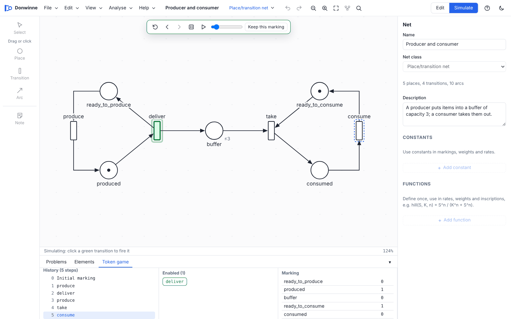
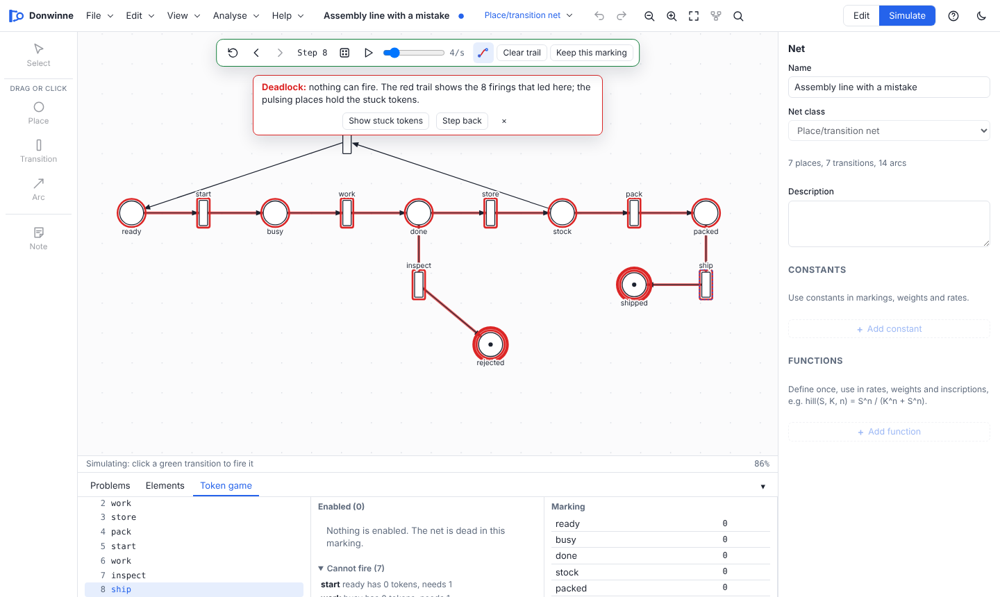
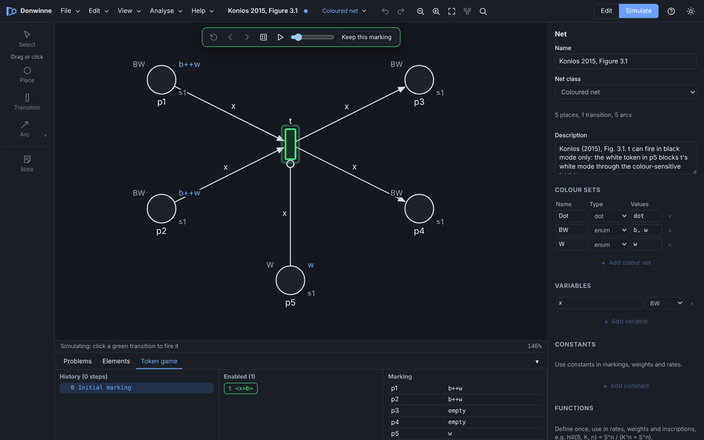

# Simulation

Donwinne runs nets in two ways. The **token game** fires transitions one at a time, by hand or at random, so you can watch the marking change. **Simulating over time** computes how the marking of a stochastic, continuous or hybrid net evolves and plots it. This page covers both, for every class.

## Contents

- [The token game](#the-token-game)
  - [Starting and stopping](#starting-and-stopping)
  - [Firing transitions](#firing-transitions)
  - [History: back and forward](#history-back-and-forward)
  - [Random firing and running](#random-firing-and-running)
  - [Keep this marking](#keep-this-marking)
  - [The red token trail and deadlocks](#the-red-token-trail-and-deadlocks)
  - [Coloured nets in the token game](#coloured-nets-in-the-token-game)
  - [The timed token game](#the-timed-token-game)
  - [Music nets](#music-nets)
  - [Ambient nets: the step token game](#ambient-nets-the-step-token-game)
- [Simulating over time](#simulating-over-time)
  - [Settings](#settings)
  - [Reading the plot](#reading-the-plot)
  - [Stochastic simulation](#stochastic-simulation)
  - [Continuous simulation](#continuous-simulation)
  - [Hybrid simulation](#hybrid-simulation)
  - [Fuzzy bands](#fuzzy-bands)
  - [Coloured nets with rates](#coloured-nets-with-rates)
  - [Observers](#observers)
  - [Exporting results](#exporting-results)
- [Unfolding](#unfolding)

## The token game

The token game is available for every Petri net class except freestyle nets. Fault trees are analysed instead ("Fault trees are analysed, not simulated with tokens; see the Fault tree tab").

In stochastic, continuous and hybrid nets the token game uses the plain firing rule described in [Net classes](net-classes.md#the-basic-firing-rule): it ignores rates and transition kinds and shows which transitions *can* fire. To see how the net behaves over time, use [Simulate over time and plot](#simulating-over-time).

### Starting and stopping

Start the token game with the **Simulate** side of the Edit / Simulate switch, **Analyse > Play the token game**, or the S key. The model must have no errors first; if it has, the **Problems** tab opens with the message "Fix N problems before simulating". While the game runs:

- the palette is greyed out and the simulation controls float at the top of the canvas, with a step counter;
- editing is disabled (undo, delete, drawing and the properties panel are read-only);
- enabled transitions are drawn in green and places show the current marking;
- the bottom panel shows the **Token game** tab (on phones it stays folded so the net remains visible; open it with B or the panel's tab).

Stop with the **Edit** side of the switch, **Analyse > Stop the token game**, or Esc. The net goes back to its initial marking.

### Firing transitions

Click a green (enabled) transition on the canvas to fire it. Clicking a transition that cannot fire says why, for example "reuse cannot fire: stock has 0 tokens, needs 1". Hovering over it shows the same reason, and hovering over a place shows how many tokens it holds now. The reasons name a place that is short of tokens, a read or equal arc that is not satisfied, an inhibitor arc that blocks, a false guard, or an output place that would go over its capacity. You can also fire from the **Enabled (N)** list in the token game tab, which shows each enabled transition (and binding, in coloured nets). When nothing can fire, the tab says "Nothing is enabled. The net is dead in this marking."

The tab has three columns:

| Column | Contents |
| --- | --- |
| History (N steps) | Every marking so far, starting with *Initial marking*, labelled with the transition that led to it. Click an entry to go back to it. |
| Enabled (N) | A button for each enabled transition and binding (up to 200). Below it, **Cannot fire (N)** lists every other transition with the reason it is blocked (open by default when nothing can fire); click one to find it on the canvas. Timed nets show their clocks instead. |
| Marking | The current marking of every place. Click a row to select the place on the canvas. |

### History: back and forward

| Control | Key | Action |
| --- | --- | --- |
| Back to the initial marking | | Go to step 0. |
| Step back | ← | Go one step back in the history. |
| Step forward | → | Go one step forward again. |

Going back does not delete the later steps: they stay greyed out in the history and **Step forward** replays them. Firing a transition from an earlier step replaces the later steps with the new one.

### Random firing and running

- **Fire a random enabled transition** (R) chooses uniformly at random among all enabled transitions and bindings, and fires it.
- **Run random firings** (Space) keeps firing at random until you press **Pause** (Space) or the net is dead ("No transition is enabled: the net is dead in this marking").
- The **speed** slider sets how many firings per second the run makes, from 1 to 30 (4 by default).

### Keep this marking

**Keep this marking** makes the current marking the net's initial marking, as an undoable edit, and restarts the game from it with the message "Current marking saved as the initial marking". It is useful to set up a starting situation by playing.

### The red token trail and deadlocks

To help find mistakes in large nets, the token game draws a **red trail** of where the tokens went: every transition that fired, the arcs the tokens moved along and the places they passed through get a red outline. The latest firings are drawn strongest and older ones fade a little, so you can follow the route the tokens took. Read, inhibitor, equal and modifier arcs only look at a place, so they are not part of the trail. When the trail goes into a subnet, the subnet's node on the parent page is outlined too.

When the token game reaches a **deadlock** (nothing can fire, and in a timed net waiting would not help):

- the whole trail turns solid red and stays that way, showing the complete route that led to the deadlock;
- the places that still hold tokens pulse with a red ring: these are the tokens that are stuck;
- a banner says how many firings led there, with **Show stuck tokens** (zooms to them) and **Step back**.

| Control | Key | Action |
| --- | --- | --- |
| Token trail (the red curve button in the token game bar) | T | Show or hide the trail. The choice is remembered. |
| Clear trail | | Start the trail again from the current marking. |

The trail is rebuilt from the history, so stepping back and forward moves it too. It is drawn only on the canvas, not in exported images.

### Coloured nets in the token game

In a coloured net, places show their tokens as multisets (for example ``2`red++blue``), and the **Enabled** list has one button per transition and binding, written like `T1 <x=red, y=2>`. Clicking a transition on the canvas fires it directly when it has one enabled binding; with several, a **Choose a binding** popup lists them. Random firing picks a binding at random among all enabled ones.

A transition may only put colours into a place that belong to the place's colour set. Otherwise firing stops with an error such as "T would put 4 into P, which is not in Num".

### The timed token game

In a [timed net](net-classes.md#timed-nets) the tab is called **Timed token game** and shows a clock:

- **Time** is the global time.
- **Wait until something can fire (+d)** lets time pass until the earliest transition may fire.
- The box next to **Wait** lets time pass by any amount you type. Time cannot pass beyond the latest firing time of an enabled transition; the line "Something must fire within X" tells you how long you may wait.
- In the **Enabled** list, transitions that are enabled but whose clock has not reached their earliest firing time are greyed out with "in d" (the remaining wait). Hover a button to see its interval and clock. Clicking such a transition on the canvas explains how long it must still wait ("… may fire only after d more time units"), and typing a wait that is too long gives "Time can advance by at most … before a transition must fire".

The history labels firings with the time, for example `go at t=30`, and waits as `wait 5 → t=35`. Random firing fires a transition that may fire now, or, when none may, waits until one can. Stepping back restores the time and clocks as they were.

### Music nets

In a [music net](net-classes.md#music-nets), each firing plays the transition's note on its instrument, using the browser's audio. The sound button in the simulation controls turns sound on and off (**Sound on** / **Sound off**). Running the game at different speeds plays the net as a melody.

### Ambient nets: the step token game

APNs and T-APNs have a **step token game**, in which transitions fire in steps of colour modes, with extra controls to fire a maximal step (X) and to collect a step. It is described in [Ambient Petri nets](ambient-petri-nets.md#step-semantics-and-the-step-token-game).

## Simulating over time

For stochastic, continuous and hybrid nets, and their coloured and fuzzy variants, **Analyse > Simulate over time and plot…** opens the **Simulate & plot** tab of the bottom panel. Press **▶ Run simulation** to compute how the marking evolves from time 0 to the end time. A progress bar and a **Stop** button appear while it runs. The model must have no errors ("Fix N problems first: …").

Rates use the transitions' rate functions and the constants in the declarations (see [Stochastic nets](net-classes.md#stochastic-nets)).

### Settings

| Setting | Default | Range | Shown for | Meaning |
| --- | --- | --- | --- | --- |
| End time | 100 | more than 0 | all | The simulation runs from 0 to this time. |
| Points | 201 | 2 to 5000 | all | Number of evenly spaced output times. |
| Runs | 20 | 1 to 10000 | stochastic and hybrid | Number of stochastic runs; the plot shows their average. |
| ODE solver | Adaptive (Dormand–Prince) | | continuous and hybrid | See [Continuous simulation](#continuous-simulation). |
| Seed | random | whole number | stochastic and hybrid | The same seed gives the same result. Leave it empty for a different result each time. |

Settings and the last result are kept while you switch tabs or play the token game. They are reset when another model is opened.

The simulator checks its settings before it starts, so a mistyped value fails at once with a clear message instead of
running for a long time or running out of memory. Times, tolerances and step sizes must be finite numbers (and step
sizes and tolerances positive). A single request may use at most 10,000 runs in all (runs × fuzzy parameter samples)
and keep at most 5,000,000 numbers in its result (output points × series, times the runs kept); the limits are
`SIMULATION_LIMITS` in [simulate.ts](../packages/sim/src/simulate.ts).

### Reading the plot

The legend on the right controls what is drawn:

- **Places** shows the marking of each place over time (tokens, or amount in continuous nets).
- **Transitions** shows, for discrete transitions, the number of firings in each output interval, and for continuous transitions the flow (flux) at each output time.
- **Observers** shows the [observers](#observers), when there are any.
- **Log scale** uses a logarithmic y axis.
- **Totals** / **Per colour** (coloured classes) shows each place summed over its colours, or one curve per colour.
- **All** / **None** and the checkboxes show or hide curves.

Below the plot a line gives the number of runs, the number of events and the time taken, with "stopped early (step limit)" if a run hit the step limit. If you change the model after a run, it warns "The model changed since this run. Run again to update." A warning from the simulator (for example a transition kind that does not fit the class) is shown as a message.

### Stochastic simulation

Stochastic nets are simulated with **Gillespie's direct method**, which produces exact sample paths of the underlying continuous-time Markov chain:

1. **Immediate transitions** fire first, as long as any is enabled; when several compete, one is chosen with probability proportional to its weight.
2. **Deterministic transitions** fire once they have been enabled continuously for their delay. Their clock starts when they become enabled and resets when they are disabled.
3. **Scheduled transitions** fire at the times `start`, `start + repetition`, … up to `end`, when they are enabled at that moment.
4. Otherwise, the total rate $a_0$ of all enabled stochastic transitions is computed, the time advances by an exponentially distributed delay with mean $1/a_0$, and one stochastic transition is chosen with probability proportional to its rate.

Each run is random; with **Runs** greater than 1 the plot shows the average over all runs. Random numbers come from a Mersenne Twister generator, so a fixed **Seed** reproduces results exactly. A net with no stochastic transitions and at most one immediate transition is deterministic, so it is run only once.

If immediate transitions keep firing without time passing (more than 100,000 times at one instant), the simulation stops with "Transitions keep firing at time … without time passing".

### Continuous simulation

A continuous net is a system of ordinary differential equations: each place's amount changes at the rate of its inflows minus its outflows. Donwinne solves it with one of four solvers:

| Solver | Name in the app | Notes |
| --- | --- | --- |
| Dormand–Prince 5(4) | Adaptive (Dormand–Prince) | The default. An adaptive Runge–Kutta method with error control (absolute tolerance $10^{-8}$, relative $10^{-6}$). Good for most models. |
| Rosenbrock (ROS2) | Stiff (Rosenbrock) | An adaptive implicit method for **stiff** systems, where some processes are much faster than others. Uses a numerical Jacobian. |
| Classic Runge–Kutta | Runge–Kutta 4 | Fixed step, a tenth of the output spacing. |
| Euler | Euler | Fixed step, a tenth of the output spacing. Simple but inaccurate; mainly for teaching. |

Details:

- A continuous transition flows only while all its continuous input places hold a positive amount; read, inhibitor and equal arcs act as thresholds.
- **Fixed** places keep their amount.
- Amounts that would become slightly negative through numerical error are set to 0.
- If an adaptive solver needs ever smaller steps, the run stops with "Step size too small at time …; the system may be stiff (try the rosenbrock solver)". Choose **Stiff (Rosenbrock)** in that case.

A continuous simulation is deterministic, so there is only one run and no seed.

### Hybrid simulation

A hybrid net combines both methods. Continuous transitions are integrated with the chosen ODE solver. Stochastic transitions fire at random times, computed by integrating their total rate along with the ODEs: a stochastic transition fires when the integral reaches a random exponential threshold, so the rates may change continuously in between. Immediate, deterministic and scheduled transitions behave as in stochastic nets. **Runs** and **Seed** apply, because the stochastic part is random.

### Fuzzy bands

In a [fuzzy net](net-classes.md#fuzzy-nets), parameters such as `TFN(1, 2, 3)` are uncertain. A simulation then computes:

- the **peak trajectory**, with every fuzzy number at its most possible value (the middle value of a TFN, the middle of the core of a TZN), drawn as the line;
- **bands** for the membership levels (alpha-cuts) 0, 0.25, 0.5, 0.75 and 1: for each level, 10 parameter combinations are taken from the range of the fuzzy numbers at that level (the centre first, then the corners, then random points), each one is simulated, and the band covers the smallest and largest value reached at each time. The bands are nested: a lower level's band contains the bands of the higher levels.

Stochastic fuzzy nets average the given number of runs for each combination, so a fuzzy simulation can take around 50 times as long as a plain one.

### Coloured nets with rates

Coloured stochastic, continuous and hybrid nets (and their fuzzy variants) are simulated by [unfolding](#unfolding) them first. The plot then offers **Totals** (each coloured place summed over its colours, each transition summed over its bindings) and **Per colour** (one curve per colour or binding, named like `P_red` or `T_red_2`).

### Observers

Observers add computed curves to the plot. Declare them in the declarations (see [Observers](net-classes.md#observers)):

- an observer of kind **places** is evaluated on the marking at each output time, for example `Prey + Predator`;
- an observer of kind **rates** uses transition names, which stand for the transition's current rate (stochastic) or flow (continuous). For immediate, deterministic and scheduled transitions it uses their number of firings in the output interval.

In coloured nets an observer's place or transition names stand for the sum over all their colours or bindings.

### Exporting results

- **Export CSV** saves all curves as comma-separated values: a `Time` column, then one column per place, transition and observer (observers last). For coloured nets both the totals and the per-colour curves are included. For fuzzy nets the peak trajectory is written; the bands are not.
- **Save image** saves the plot as it is shown, as an SVG image.

## Unfolding

**Analyse > Unfold to an uncoloured net** turns a coloured net into an equivalent uncoloured net and opens it as a new, unsaved model named "… (unfolded)":

- every place of colour set $C$ becomes one place per colour, named `P_colour` (for example `Buffer_red`; tuples become `Buffer_1_a`); places of the `Dot` set keep their names;
- every transition becomes one transition per binding of its variables that satisfies its guard, named `T_value1_value2`;
- inscriptions become plain weights, rates have their variables replaced by values, and observers become sums over the instances.

| Coloured class | Unfolds to |
| --- | --- |
| Coloured net | Extended net |
| Coloured stochastic / continuous / hybrid | Stochastic / continuous / hybrid |
| Coloured fuzzy stochastic / continuous / hybrid | Fuzzy stochastic / continuous / hybrid |
| APN | Extended net |
| T-APN | Place/transition net |

At most 100,000 bindings are examined per transition. If the unfolded net has 400 nodes or fewer, it is laid out automatically. A message reports the size: "Unfolded into N places and M transitions". If the current model has unsaved changes, Donwinne asks before replacing it.

The same unfolding is used behind the scenes to simulate coloured nets with rates and to analyse coloured nets (see [Analysis](analysis.md#how-the-analysis-sees-a-net)).
