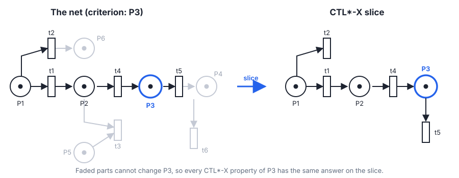
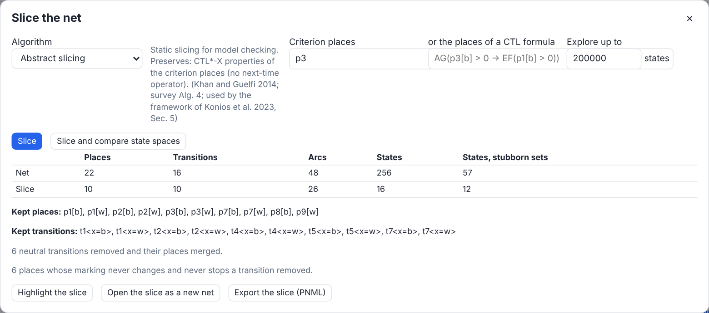
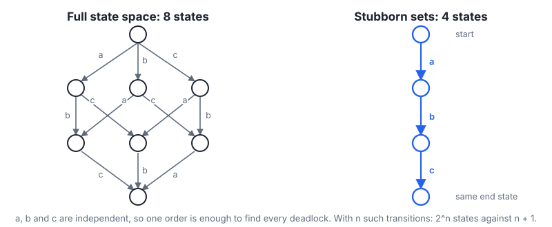
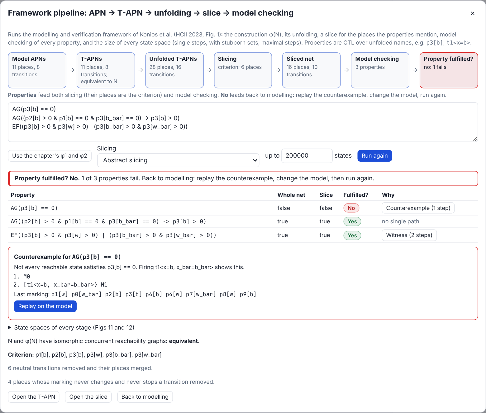
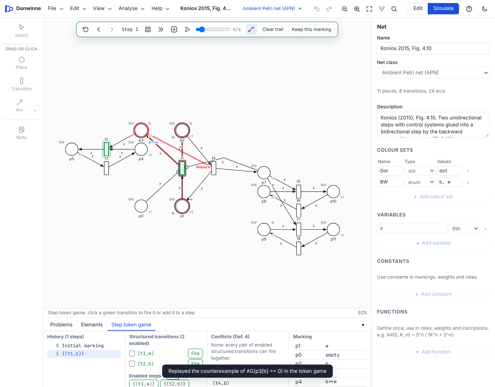
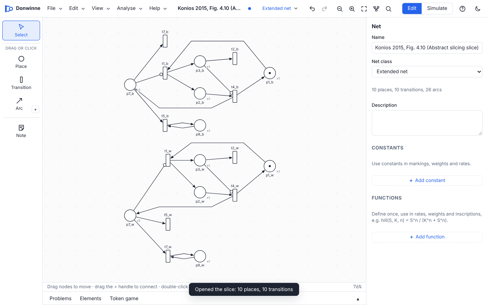

# Slicing, stubborn sets and the verification framework

Donwinne implements the Petri net slicing algorithms of the survey by Khan, Konios and Guelfi,
*A Survey of Petri Nets Slicing* (ACM Computing Surveys 51(5), 2018), stubborn-set state space
reduction, and the modelling and verification framework of Konios, Khan, Garcia-Constantino and
Lopez-Nava, *A Modular Framework for Modelling and Verification of Activities in Ambient
Intelligent Systems* (HCII 2023, LNCS 14029, pp. 503-530).

## Contents

- [Why slice](#why-slice)
- [Slicing a net in the editor](#slicing-a-net-in-the-editor)
- [The algorithms](#the-algorithms)
- [The slicing criterion](#the-slicing-criterion)
- [Extended arcs, capacities and coloured nets](#extended-arcs-capacities-and-coloured-nets)
- [Abstract slicing in detail](#abstract-slicing-in-detail)
- [Evolution: when does a change need a new check?](#evolution-when-does-a-change-need-a-new-check)
- [Lee and Chang: slices that cover the whole net](#lee-and-chang-slices-that-cover-the-whole-net)
- [Stubborn sets](#stubborn-sets)
- [The framework pipeline](#the-framework-pipeline)
- [Results on the papers' examples](#results-on-the-papers-examples)
- [Using the engine directly](#using-the-engine-directly)
- [How it is tested](#how-it-is-tested)

## Why slice

Model checking explores every reachable marking, and their number grows exponentially with the
size of the net. A property usually mentions only a few places (the *criterion*). Slicing removes
the places and transitions that cannot influence those places, and the property keeps its verdict
on the much smaller slice. Stubborn sets attack the same problem from the other side: they keep
the net, but fire only one representative order of independent transitions.



## Slicing a net in the editor

**Analyse > Slice the net…** opens the slicing dialog:

1. Pick the algorithm. The dialog says whether it is static or dynamic, what it is for, which
   properties it preserves and where it comes from.
2. Give the criterion: place names (`p3`, or one colour `p3[b]`; a coloured place stands for all
   its colours), or type a CTL formula and its places become the criterion.
3. For trace slicing, give the firing sequence (`t1 t4 t5`).
4. Press **Slice**, or **Slice and compare state spaces** to also count the reachable states of
   the net and the slice, with and without stubborn sets.



The result lists the kept places and transitions. **Highlight the slice** marks them on the
canvas, **Open the slice as a new net** opens it as an editable (uncoloured) net, laid out again
when it came from an unfolding, and **Export the slice (PNML)** saves it for other tools, as the
SLiM tool of the survey does.

The dialog remembers its last slice, criterion and algorithm while you edit the same model (opening
another model forgets them). Reopen it after a change and it says that the model changed and offers
**Does this change need a new check?** (see [Evolution](#evolution-when-does-a-change-need-a-new-check)). The answer is **No**
when the change lies outside the slice, so every property the slice preserves keeps its verdict, or
**Yes** with the changes that touch it. Every change is listed, and the ones in the slice are marked.

**Divide the net into parts (survey Algs 5 and 6)**, at the bottom of the dialog, needs no criterion:
**Invariant slices** splits the whole net along its P-invariants ([Lee et al.](#lee-and-chang-slices-that-cover-the-whole-net)),
and **Concurrency sets** groups each communication transition with the paths that lead to it (Chang et
al.). A table lists every part with its places, transitions and how it was formed; **Highlight** marks
a part on the canvas.

## The algorithms

| Algorithm (id) | Kind | For | Preserves | Source |
| --- | --- | --- | --- | --- |
| Abstract slicing (`abstract`) | static | model checking | CTL\*-X properties of the criterion places | Khan and Guelfi 2014; survey Alg. 4; the framework's Sec. 5 |
| Abstract slicing with parallel transitions (`abstractParallel`) | static | model checking | CTL\*-X | Survey Sec. 8.4, Fig. 28 |
| CTL\*-X slicing (`ctlStarX`) | static | model checking | CTL\*-X (weak fairness for liveness) | Rakow 2008; survey Alg. 1 |
| APNSlicing (`apnSlicing`) | static | model checking | LTL-X | Khan et al. 2012; survey Alg. 3 |
| Safety slicing (`safety`) | static | model checking | Stutter-invariant safety: AG of state formulas, and EF as their negation (reachability); not liveness | Rakow 2012; survey Alg. 2 |
| Basic slicing (`basic`) | static | model checking | CTL\*-X (keeps reading transitions too) | Survey Sec. 5.1.2, Fig. 7, Table 1 |
| Backward slicing (`backward`) | static | model checking and testing | Whether tokens can reach the criterion | Llorens et al. 2008; survey Alg. 7 |
| Forward slicing (`forward`) | dynamic | testing | The part of the net the initial tokens can reach | Llorens et al. 2008; survey Alg. 8 |
| Backward and forward (`llorens`) | dynamic | model checking and testing | Paths from M0 that can feed the criterion | Survey Sec. 6.2.1 |
| Concerned slicing (`concerned`) | dynamic | testing | Paths from M0 that can change the criterion | Survey Alg. 11 |
| Wangyang slicing (`wangyang`) | dynamic | model checking and testing | Token flows found on the local reachability graph (a node is the set of marked places; an inhibitor arc of weight above 1 does not block there, since a marked place may hold fewer tokens) | Survey Alg. 10 |
| Trace slicing (`trace`) | dynamic | testing | The firings of one sequence that feed the criterion | Llorens et al. 2008; survey Alg. 9 |

The static algorithms ignore the initial marking; the dynamic ones use it. Rakow's algorithms
build the slice backwards from the criterion: CTL\*-X slicing keeps every transition that changes
the marking of a kept place, with all its input places, but not transitions that only read a
place (a loop that puts the tokens back). Safety slicing keeps fewer: of the transitions that only
take tokens away from a kept place, it keeps those that also feed the criterion. Basic slicing
keeps every transition around a kept place, reading ones included.

## The slicing criterion

The criterion is a set of places, and optionally transitions (the transitions a formula mentions
with `fireable(t)`; their input places join the criterion). `criterionFromCtl(formula)` reads it
from a CTL formula and also reports whether the formula uses `EX`/`AX` (slices preserve CTL\*
*without* next-time) or `deadlock` (which depends on every transition), and whether it is a safety
formula (AG or EF of a state formula), for which safety slicing and stubborn sets are enough.

## Extended arcs, capacities and coloured nets

The survey's algorithms are defined for P/T nets. Donwinne applies them to every discrete class:

- **Coloured nets, APNs and T-APNs** are unfolded first (as the framework does, Sec. 4.2), so a
  slice keeps single colours: `p3[b]` but not `p3[w]`.
- **Read, inhibitor and equal arcs** are conditions on a place: the place joins the slice, with
  every transition that can change it. An inhibitor arc makes a place *non-monotone* (more tokens
  can disable a transition), so the monotone shortcuts of safety slicing are not used for it.
- **Reset arcs and marking-dependent weights** make a transition depend on every place it reads.
- **Capacities** block a transition when a place is full, so they are conditions too, unless the
  P-invariants prove the capacity is never reached (`invariantBounds`). That is the case for the
  capacity of 1 per colour of every T-APN place, and it is what lets abstract slicing reduce a
  T-APN as Fig. 10 of the chapter does.
- **Logical places** count as one place.

## Abstract slicing in detail

Abstract slicing (survey Alg. 4) starts from the CTL\*-X slice and then removes *neutral*
transitions: a transition with one input and one output place, weight 1 on both, no other arcs,
no condition, and an input place that only it consumes from. Firing it just moves a token, so the
two places merge into one. The algorithm then drops places whose marking can never change and
that never block a transition (a database place whose refill was merged away), and, in the
parallel variant, transitions with exactly the same arcs as another (Sec. 8.4). These three
steps repeat until nothing changes. The kept transitions are moved onto the merged places, and the
slice opens as a net with those arcs.

## Evolution: when does a change need a new check?

Sec. 8.3 of the survey proposes slicing to avoid re-verifying an evolving model.
In the editor this is **Does this change need a new check?** in the slice dialog (above). In code,
`evolutionImpact(before, after, criterion)` lists the differences between two versions of a net
(places, transitions, arcs, markings, capacities) and slices both. If the slices are the same,
the verdict of every property over the criterion is **preserved**; otherwise it returns
**recheck** with the changes that touch the slice.

## Lee and Chang: slices that cover the whole net

`leeSlices(pt)` (survey Alg. 5) splits a net into slices for compositional analysis: the
smallest minimal P-invariants are taken while they cover new places (one per process), and every
place still uncovered joins the smallest slice it shares a transition with. These slices do not
shrink the state space (survey Sec. 7.1); they split the work. `changConcurrencySets(pt)` (Alg. 6)
builds, for each communication transition (one that touches more than one process), the shortest
paths inside every process involved from its initially marked places to that transition, for
test generation. Both are under **Divide the net into parts** in the slice dialog.

## Stubborn sets



`stubbornSystem(pt, { visible })` explores a reduced state space. At every marking it fires only
the enabled transitions of a *stubborn set*: a set closed under

- **D1**: for an enabled transition in the set, every transition that conflicts with it or
  changes its conditions (a shared input place, a read, inhibitor or equal arc, a capacity) is in
  the set;
- **D2**: for a disabled transition in the set, the transitions that can lift one blocking
  condition (the producers of an input place without enough tokens, the consumers of an
  inhibitor place or a full place) are in the set.

Up to eight seeds are tried per state and the set with the fewest enabled transitions wins.
Without visible places the reduced graph keeps every deadlock. With visible places (the places the
property reads) two more conditions make it keep their reachable markings, so AG and EF of state
formulas over them keep their verdicts:

- **visibility**: a set with an enabled transition that changes a visible place contains every
  such transition;
- **the ignoring proviso** (Valmari's condition S\_V): every terminal strongly connected
  component of the reduced graph has a state whose set contains every visible transition. The
  exploration checks this after it finishes, re-expands one state of each component that lacks
  one, and repeats.

Modulo nets and marking-dependent weights are explored in full.

## The framework pipeline

**Analyse > Ambient > Framework pipeline (APN → T-APN → slice)…** runs Fig. 1 of the chapter end
to end on the open net. The top of the dialog draws the figure's boxes and fills each one in as the
run gets there:

1. **Model APNs**: the APN N, as built by forward and backward composition of basic, root and one
   step nets.
2. **T-APNs**: the construction φ(N) of Def. 10, with the check that N and φ(N) have isomorphic
   concurrent reachability graphs. An APN that is not a composite step net (Def. 13) goes on as
   itself, and the box says so.
3. **Unfolded T-APNs**: the unfolding of the T-APN (Sec. 4.2).
4. **Slicing** and the **sliced net**: the slice for the places the properties mention (abstract
   slicing by default, Sec. 5).
5. **Model checking** of every property, on the whole net and on the slice.
6. **Property fulfilled?** Yes ends the flow. No leads back to modelling, as the figure's arrow
   does.

**Properties** feed both slicing and model checking, as in the figure: write one CTL formula per
line, over unfolded names (`p3[b]`, `t1<x=b>`). Their places are the slicing criterion. **Use the
chapter's φ1 and φ2** fills in the two properties of Sec. 5.

### Property fulfilled?

A banner gives the answer for all properties together, and the table gives it for each one:

| Column | Meaning |
| --- | --- |
| Whole net | The verdict on the unfolded net: `true`, `false`, or `unknown` when its graph was cut off at the limit before the answer was certain. A violated AG or a reachable EF is found on the explored part already; an AG or EF that needs every state is checked on the stubborn-set graph when the full one is too big. |
| Slice | The verdict on the sliced net. It is shown in red when it disagrees with the whole net (only possible for properties the algorithm does not preserve). |
| Fulfilled? | **Yes**, **No** or **Unknown**. It is the whole net's verdict. When the whole net could not be checked, it is the slice's verdict, but only if the slicing algorithm preserves that kind of property; hover the pill to see which graph decided. |
| Why | A **Counterexample** (when the property fails) or a **Witness** (when it holds), where CTL gives a single path. AG that holds and EF that fails have none. |

Which slices may stand in for the whole net (survey Table 3): abstract slicing, abstract slicing
with parallel transitions and basic slicing keep every CTL\*-X property of the criterion places;
CTL\*-X slicing (which needs weak fairness for liveness), APNSlicing (LTL-X) and safety slicing keep
AG and EF of state formulas. Formulas with EX, AX, `deadlock` or `fireable(…)` depend on transitions
a slice drops or merges, so their slice verdict never stands in.

Why EF counts for safety slicing: EF s is not a liveness property but reachability, the negation
of the safety property AG ¬s. Rakow's safety slice reaches exactly the criterion markings the net
reaches (a slice firing sequence runs unchanged in the net, and a net firing sequence without the
dropped transitions, which only take tokens away, runs in the slice), so AG ¬s, and with it EF s,
has the same verdict on both. The tests check this on 200 random nets with every arc kind. Liveness
(AF, EG, AG EF) is not kept: a test shows AF changing on a safety slice, and the pipeline never lets
a safety slice decide it.

**Check with single steps or maximal steps.** The chapter verifies φ1 and φ2 under both (Sec. 6,
Figs 11 and 12). With **maximal steps** the whole net is checked on its graph of maximal steps (for
an APN or T-APN, the maximal-step concurrent reachability graph of φ(N)). Slicing results are for
single steps: a slice drops and merges transitions, which changes which steps are maximal, so under
maximal steps the slice never decides. A maximal-step counterexample of an ambient net replays as
steps; for other nets it is shown but not replayed, since their token game fires one transition at
a time.

**Transitions that cannot be evaluated.** When a marking-dependent arc weight is negative or not a
whole number at some reachable marking, it is unknown there whether the transition can fire. That
marking is never counted as dead, the state space counts as incomplete, and every verdict that
depends on it is Unknown, in the pipeline, in model checking and in the properties report.

### Back to modelling

The first counterexample opens under the table when the run ends. It lists the firings from M0,
says when the path loops back or ends in a dead state, and gives the last marking.

- **Replay on the model** closes the dialog and plays the path in the token game, with the trail
  drawn on the net. For an APN the path comes from φ(N), whose transitions carry the APN's names and
  modes, so it replays as single steps on the APN itself.
- **Open the slice and replay** appears when only the slice could decide. It opens the slice as a
  new model and plays the path there.
- **Back to modelling** closes the dialog.

Change the model, then open the dialog again. It remembers the properties, the settings and the last
run for as long as the model is the same one (or an edited version of it), says "The model changed
since run n", and offers **Run again on the changed model**. **Runs on this model** lists the answer
of every run, so the loop of Fig. 1 is visible: no, change, run, until the answer is yes.

### State spaces of every stage

**State spaces of every stage (Figs 11 and 12)** opens a table with the number of places and
transitions of each stage and the size of three state spaces (Sec. 6): single steps, single steps
with stubborn sets, and maximal steps. A "+" means the exploration stopped at the limit. **Open the
T-APN** and **Open the slice** open those stages as new models.







## Results on the papers' examples

**Chapter, Figs 7-10** (thesis Fig. 4.10, criterion Q = {p3b, p3w, p3g, p3l}):

| Stage | Places | Transitions | Single steps | Stubborn sets | Maximal steps |
| --- | --- | --- | --- | --- | --- |
| APN N | 11 | 8 | 256 | | 5 |
| T-APN φ(N) | 11 | 8 | 256 | 73 | 5 |
| Unfolded net | 28 | 16 | 256 | 73 | 5 |
| Abstract slice | 16 | 10 | 16 | 15 | 4 |

The construction gives the chapter's Post\_NEW and M'0 exactly; the slice keeps t1, t2, t4, t5
and t7 for both colours, as in Fig. 10, merging the six response places into their database
places; φ1 and φ2 are true on the net and on the slice.

**Survey Fig. 7** (Rakow's example, criterion P3): basic slicing keeps P1, P2, P3, P5 and t1-t5;
CTL\*-X slicing drops the reading transition t3 (P1, P2, P3; t1, t2, t4, t5); safety slicing also
drops t2 (t1, t4, t5). These are the slices of the figure. The state counts follow the order of
Table 1 (full > basic > CTL\*-X ≥ safety); the absolute numbers depend on the initial marking,
which the survey's figure does not fully give.

**The ambient garage** (thesis chapter 7): the full single-step graph of its T-APN has more than
two million states; stubborn sets find all its deadlocks in 355.

## Using the engine directly

```ts
import { toPTNet, sliceNet, sliceToNet, stubbornSystem, interleavingSystem, checkCtl } from "@pns/analysis";
import { constructTapn, fig410 } from "@pns/apn";

const pt = toPTNet(constructTapn(fig410()).net);
const slice = sliceNet(pt, { places: ["p3[b]", "p3[w]", "p3[b_bar]", "p3[w_bar]"] }, { algorithm: "abstract" });
slice.stats;                         // { places: 16, transitions: 10, ... }
checkCtl(interleavingSystem(slice.pt), "EF(p3[b] > 0 & p3[w] > 0)");
const net = sliceToNet(slice);       // an editable net, ready for exportPnml
stubbornSystem(pt, { visible: ["p3[b]"] });
```

`runFramework(net, { formulas })` in `packages/editor/src/framework.ts` runs the whole pipeline. Its
result carries `fulfilled` (`"yes"`, `"no"` or `"unknown"`) and, for each property, the verdicts,
which graph decided and the witness or counterexample. `slicePreserves(algorithm, criterion)` says
whether a slice's verdict may stand in for the whole net's.

## How it is tested

[`packages/analysis/test/slicing.test.ts`](../packages/analysis/test/slicing.test.ts) checks the
survey's Fig. 7 slices, the chapter's construction, unfolding, Fig. 10 slice, state counts and
verdicts, and every algorithm on the T-APN. On 300 random nets (with read, inhibitor arcs and
capacities) it checks that the model-checking slices reach exactly the criterion markings the net
reaches, that backward slicing keeps every transition that feeds the criterion and forward
slicing every transition that can fire, that stubborn sets keep every deadlock and, with visible
places, every visible marking, and that a slice opened as a net behaves like the slice.
[`packages/editor/test/framework.test.ts`](../packages/editor/test/framework.test.ts) runs the
pipeline on the chapter's example and on the garage: the yes and no answers, that a counterexample
uses the APN's transition names, that the slice decides only when its algorithm preserves the
property, and that its counterexample names the transitions of the opened slice.
